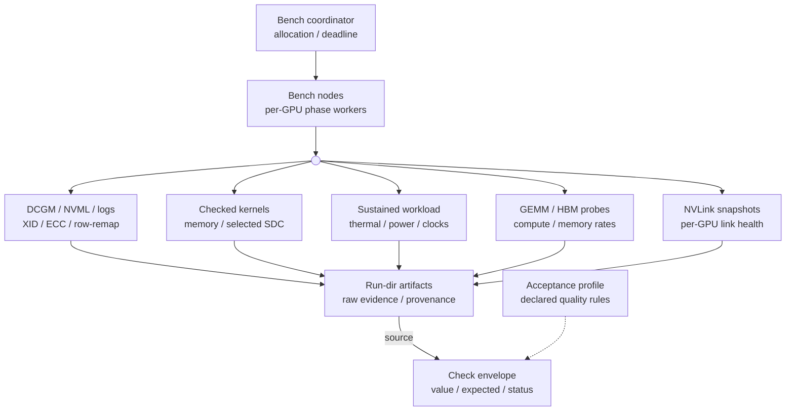

# GPU quality briefing and suite design

Research date: 2026-10-11.

## Purpose

This plan shows a proposed device-level GPU screen and its evidence requirements.
Use measured GPU evidence, not lifetime or vendor certification.
The implementation tickets show future work, not an existing GPU bench category.

Seven sourced briefs inform this document:
[neoclouds](../neoclouds.md), [hyperscalers](../hyperscalers.md),
[AI labs](../ai-labs.md), [large companies](../large-companies.md),
[ClusterMAX](../clustermax.md), [academia](../academia.md), and [books](../books.md).
[The research report](../research.md) contains the node map and short lessons.

`[observed]` identifies source statements. It does not identify live rack measurements.
`[calculated]` identifies arithmetic. `[inference]` identifies proposed checks and policy.
No researcher runs a test on the Chennai rack.

## Part A — What we test

### Why we test this

Use per-GPU evidence to answer customer questions about correctness, performance, and health.

[observed] NVIDIA lists 72 GPUs across 18 GB300 NVL72 compute trays.
Each tray contains four GPUs.
[Source: NVIDIA components](https://docs.nvidia.com/enterprise-reference-architectures/nvl72-ai-factory/latest/components.html).

[inference] One failed GPU can invalidate a job across many healthy GPUs.
A rack average can hide one slow GPU.
A fast GEMM can still produce an incorrect result.
Therefore, collect identity, performance, correctness, and health evidence for each GPU.

[observed] CoreWeave lists idle-node SDC, numerical-regression, and thermal tests.
Its automatic tests last 20–30 minutes.
Its public description does not give a GB300 acceptance threshold table.
[Source: HPC Verification](https://docs.coreweave.com/platform/fleet-management/hpc-verification).

[observed] ClusterMAX 3.0 lists eight-hour concurrent GPU and network burn-in.
Its performance and reliability scripts remain internal.
[Source: methodology](https://newsletter.semianalysis.com/p/clustermax-30-the-industry-standard).

[inference] The opportunity is a tenant-readable measurement record, not a stronger vendor promise.
Keep failures as data. Give every skipped check an exact reason.

### Contract and scope

[inference] Use `bench gpu` for an approximately two-hour device-level screen.
Use `smoke gpu` for longer burn-in and periodic screening.
Exclude east-west fabric performance, NCCL collectives, and fault injection.
Include per-GPU NVLink state and health counters.

[inference] Keep collection status separate from quality assessment.
A failed GPU can produce valid measurements.
A missing threshold prevents a quality PASS, not collection of a throughput value.
A vendor-reported healthy state is an observation, not an active workload result.

[inference] PASS needs a completed measurement and an applicable, declared acceptance rule.
Without a profile, show observations and withhold absolute quality grades.
Use FAIL for an executed check that violates its rule.
Use WARN for ambiguous evidence that needs investigation.
Use SKIP for missing capability, permission, safe allocation, reference, threshold, or remaining time.
Never convert null, `N/A`, absent output, or an unsupported plugin to zero or PASS.

[inference] Do not change device configuration during the screen.
Do not reset GPUs, clear counters, change ECC or MIG, or change clocks or power limits.
Do not write synthetic XIDs or reset PCIe bridges.
Active tests consume resources. Require an exclusive, operator-approved allocation.

[observed] NVIDIA documents these configuration operations separately from queries.
DCGM diagnostics do not repair devices or decide RMA eligibility.
[Sources: nvidia-smi](https://docs.nvidia.com/deploy/nvidia-smi/index.html),
[DCGM](https://docs.nvidia.com/datacenter/dcgm/latest/user-guide/dcgm-diagnostics.html).

### What the tests assume

The proposed tests use these prerequisites:

- Use the declared physical-GPU map before completeness grading.
- Run active workloads only with exclusive allocation and approved power/cooling.
- Check the deployed stack's support for each plugin and telemetry field.
- Use independent references and declared rules for quality grades.
- Keep device configurations unchanged.
- Keep measurements when acceptance thresholds are missing.
- Use the shared category deadline and tested cancellation.

### Part 1 — Failure-mode catalog

`2h` shows proposed detection opportunity. It does not guarantee detection.

| Failure mode | Evidence and mechanism | Proposed rack-bench answer | 2h |
| --- | --- | --- | --- |
| DOA, missing, or inaccessible GPU | [observed] XID 79 shows lost bus access. Enumeration alone does not prove execution. [NVIDIA](https://docs.nvidia.com/deploy/xid-errors/analyzing-xid-catalog.html) | [inference] Check expected identities, then allocate memory and run a checked kernel. Preserve absent-device slots. | Strong for present failure |
| Gross compute degradation | [observed] DCGM diagnostic compares GPU performance. Power and clock tolerances can identify outliers. [DCGM](https://docs.nvidia.com/datacenter/dcgm/latest/user-guide/dcgm-diagnostics.html) | [inference] Measure warmed GEMM by GPU, precision, and shape. Check profile limits and homogeneous peers. | Conditional |
| Correctable ECC growth | [observed] Corrected errors do not imply corrupted application data. Volatile and aggregate counters have different lifetimes. [nvidia-smi](https://docs.nvidia.com/deploy/nvidia-smi/index.html) | [inference] Store both snapshots and deltas. Apply a declared policy; do not fail every historical count. | Present events only |
| Uncorrectable HBM or SRAM errors | [observed] ECC and recovery signals distinguish uncorrectable errors. Containment can restrict affected applications. [NVIDIA](https://docs.nvidia.com/deploy/nvidia-smi/index.html) | [inference] Monitor detailed ECC domains, XIDs, recovery action, and workload errors. Stop unsafe load. | Present events only |
| Pending or failed row remapping | [observed] Pending remaps need reset. Failure and spare-row availability show different states. [NVIDIA](https://docs.nvidia.com/deploy/a100-gpu-mem-error-mgmt/latest/row-remapping.html) | [inference] Record counts, pending state, failure state, and availability. Leave repair to maintenance. | State visible if supported |
| Blackwell memory repair limits | [observed] Blackwell can use HBM channel repair. Field diagnostics validate RMA eligibility. [RMA policy](https://docs.nvidia.com/deploy/a100-gpu-mem-error-mgmt/latest/rma-policy-thresholds-for-row-remapping.html) | [inference] Record channel-repair, unrepairable-memory, and recovery fields where supported. Do not issue an RMA verdict. | Partial |
| XID, driver, or firmware failure | [observed] XIDs include application, driver, and hardware conditions. XID 154 summarizes recovery action. [NVIDIA catalog](https://docs.nvidia.com/deploy/xid-errors/analyzing-xid-catalog.html) | [inference] Save the raw event timeline and adjacent counters. Do not label every XID as defective hardware. | Partial |
| Silent data corruption | [observed] Incorrect computation can occur without a hardware alarm. Inputs and operating conditions affect detection. [OCP](https://www.opencompute.org/documents/sdc-in-ai-ocp-whitepaper-final-pdf) | [inference] Check deterministic outputs against independent references. Show tested coverage, not “SDC-free.” | Reproducible subset only |
| HBM data-path defect | [observed] DCGM memory writes and reads patterns over a substantial allocation. Its documented default allocation is 75%. [DCGM](https://docs.nvidia.com/datacenter/dcgm/latest/user-guide/dcgm-diagnostics.html) | [inference] Record allocated bytes, patterns, mismatch counts, duration, and ECC events. Untested HBM remains a gap. | Partial |
| HBM bandwidth degradation | [observed] DCGM memory-bandwidth uses STREAM-style work. Working-set size affects interpretation. [DCGM](https://docs.nvidia.com/datacenter/dcgm/latest/user-guide/dcgm-diagnostics.html) | [inference] Measure validated local-memory throughput with a recorded working set. Separate bandwidth from memory integrity. | Conditional |
| Thermal throttling | [observed] NVIDIA reports thermal event reasons and temperature limits. T.Limit is a margin, not an absolute temperature. [nvidia-smi](https://docs.nvidia.com/deploy/nvidia-smi/index.html) | [inference] Sample GPU/HBM temperature, clocks, throughput, and thermal time counters under sustained load. | Load-dependent |
| Power cap or external power brake | [observed] Software power caps and external power brakes have distinct event reasons. Module power can include CPU consumption. [nvidia-smi](https://docs.nvidia.com/deploy/nvidia-smi/index.html) | [inference] Record requested/enforced limits, GPU/module power, clocks, and event durations. Respect rack power policy. | Load-dependent |
| Wrong clocks or software stack | [observed] DCGM checks software access and conflicts. Generic mode omits calibrated thresholds for affected tests. [DCGM releases](https://docs.nvidia.com/datacenter/dcgm/latest/release-notes/changelog.html) | [inference] Check actual versions/settings against the approved manifest. Run kernels with the deployed runtime. | Strong for tested path |
| Per-GPU NVLink fault | [observed] NVLink generations show different counters. Blackwell links can sleep. [nvidia-smi](https://docs.nvidia.com/deploy/nvidia-smi/index.html) | [inference] Save state, expected topology, counters, and deltas per GPU/link. No fabric-performance grade. | Passive health only |
| MIG allocation mismatch | [observed] MIG current/pending mode and GI/CI geometry affect visibility and available resources. [MIG guide](https://docs.nvidia.com/datacenter/tesla/mig-user-guide/latest/) | [inference] Check geometry and ownership against the profile. Never destroy instances to make a test run. | Configuration only |
| Aging or rare intermittent defect | [observed] Titan shows batch-specific board failures. Meta reports SDC that appears after months. [Titan](https://christian-engelmann.de/publications/ostrouchov20gpu.pdf), [Meta](https://engineering.fb.com/2025/07/22/data-infrastructure/how-meta-keeps-its-ai-hardware-reliable) | [inference] Keep dated baselines and repeated screening. Use longer smoke tests and lifecycle monitoring. | No lifetime conclusion |

#### Failure attribution rules

[inference] A repeatable mismatch fails the test's correctness rule.
It does not alone identify the faulty hardware component.
Repeat with fixed data, software, and settings on the suspect GPU and a reference GPU.
Check whether the failure follows the physical GPU, software, or input.
Keep the first mismatch and all later results.

[observed] Meta reports known-model tests and reductive triage.
OCP lists software, data, and nondeterminism as competing explanations.
[Sources: Meta](https://engineering.fb.com/2025/07/22/data-infrastructure/how-meta-keeps-its-ai-hardware-reliable),
[OCP](https://www.opencompute.org/documents/sdc-in-ai-ocp-whitepaper-final-pdf).

[inference] A corrected ECC event is not an SDC event.
An XID-free interval is not proof of correct computation.
An injected ECC value tests monitoring response, not physical defect detection.
[Source: injection semantics](https://docs.nvidia.com/datacenter/dcgm/latest/user-guide/dcgm-error-injection.html).

### Part 2 — Evidence from the seven categories

| Category | Verdict | Important limit |
| --- | --- | --- |
| Neoclouds | [observed] CoreWeave reports active idle-node tests. Runpod shows selected DCGM counters. | Provider descriptions do not give serial-bound GB300 results. [Brief](../neoclouds.md) |
| Hyperscalers | [observed] Google gives detailed XID/DCGM triage. AWS documents job-start checks and infrastructure recovery. | Managed-platform recovery is not device certification. AWS XID support text remains partly unverified. [Brief](../hyperscalers.md) |
| AI labs | [observed] CP-Bench gives model and operator comparisons. Meta describes deterministic triage. | Peer agreement cannot detect all common-mode errors. GB300 validation remains open. [Brief](../ai-labs.md) |
| Large companies | [observed] Meta combines directed tests, online signals, and exception analysis. | CPU scanner rates do not prove GPU detector sensitivity. Sources give limited Microsoft-specific screening detail. [Brief](../large-companies.md) |
| ClusterMAX | [observed] 3.0 combines compute, memory, burn-in, and provider-response tests. | Eight-hour mixed burn-in exceeds this scope. ECC criteria do not prove active counter collection. [Brief](../clustermax.md) |
| Academia | [observed] Field studies show heterogeneous errors, populations, and batch effects. | Historical rates do not estimate GB300 failure rates. [Brief](../academia.md) |
| Books | [inference] Gregg gives the method. Current NVIDIA guides give command and counter semantics. | Books do not give current GB300 thresholds or support matrices. [Brief](../books.md) |

The proposed bench architecture keeps measurement evidence with or without an acceptance profile.



Run only one active workload per GPU.

#### ClusterMAX comparison

[observed] Reliability criteria name ECC, XIDs/SXIDs, NVLink, thermal, power, PCIe, and version consistency.
These requirements differ from proof that an executable collector measures each property.
[Source: criteria](https://www.clustermax.ai/criteria/reliability).

[observed] The public audit lists GPU drivers, idle thermals, XID capture, and DCGM health-check wiring.
Its criteria file marks some monitoring coverage as partial.
[Source: pinned CLI criteria](https://github.com/SemiAnalysisAI/ClusterMAX/blob/1492ac5e4ac992ae436f062cc51a340d61672ca3/cmax/scripts/1-audit/criteria-checks.json).

[observed] The 1.0 article names TinyMeg2 in top-provider screening practices.
The 3.0 article does not show current TinyMeg2 use on GB300.
[Sources: 1.0](https://newsletter.semianalysis.com/p/the-gpu-cloud-clustermax-rating-system-how-to-rent-gpus),
[3.0](https://newsletter.semianalysis.com/p/clustermax-30-the-industry-standard).

[inference] Do not call a two-hour GPU screen equivalent to ClusterMAX's eight-hour mixed burn-in.
Do not call publicly unverified internal checks absent.

### Part 3 — Proposed two-hour suite

#### Preconditions

[inference] Require an expected device map before a rack-wide completeness grade.
The map must bind tray, host, module, GPU UUID, and expected SKU.
Do not assume one operating-system host per tray.

Count each physical GPU once. Exclude MIG UUIDs from physical-GPU totals.
The rack total is 72. Each host uses its own expected count.

[inference] Require an exclusive allocation, operator-approved power/cooling limits, and matched software support.
Record cooling conditions that the facility exposes, including coolant temperatures where available.
Chennai's location alone does not set a device temperature threshold.

[observed] DCGM 4.4.0 adds GB300 NVL Bianca support.
DCGM 4.4.2 adds Galaxy and MaxQ variants.
Later releases change diagnostics, telemetry, and false-positive behavior.
[Source: release notes](https://docs.nvidia.com/datacenter/dcgm/latest/release-notes/changelog.html).

[inference] Check exact device/subsystem IDs, driver, CUDA lane, DCGM client, hostengine, and plugin support.
Do not treat “Blackwell supported” as approval for every rack configuration.

#### Wall-clock budget

[inference] This schedule is a proposed envelope, not a measured GB300 runtime.
Run supported GPU-local tests concurrently only within approved power and cooling limits.
Use one monotonic category deadline across all hosts and phases.

| Elapsed minutes | Phase | Required evidence |
| --- | --- | --- |
| 0–10 | Allocation, identity, versions, baseline | Expected/observed UUID map; process/MIG state; raw RAS/NVLink snapshots; log cursor |
| 10–20 | Readiness and runtime | DCGM level 1; CUDA allocation/kernel execution; per-device errors |
| 20–45 | Memory integrity | Supported memory/memtest patterns; bytes tested; mismatches; counter changes |
| 45–65 | Independent correctness and GEMM | Exact integer/memory checks; justified floating-point comparisons; warmed per-GPU throughput |
| 65–95 | Sustained compute/power | Telemetry throughout load; temperature, power, clocks, throttle time, throughput |
| 95–105 | HBM bandwidth | Local streaming bandwidth; working set; output verification; repeated samples |
| 105–115 | Final health evidence | RAS/NVLink snapshots; XID log interval; resets/disappearance; collection coverage |
| 115–120 | Output and cleanup | Complete/partial records; skip reasons; remaining child-process check |

[calculated] These phases total 120 minutes.
[inference] Continuous telemetry runs across active phases; it does not consume a separate workload window.
Choose one sustained workload per GPU. Do not run competing diagnostics on the same GPU.
Stop before the deadline to preserve output and clean up test processes.
A shortened or interrupted test cannot earn its full-duration PASS.

#### Candidate checks

This document proposes all names below. Existing GPU bench code does not use them.

| Check | Method | Value and coverage | Quality rule or skip reason |
| --- | --- | --- | --- |
| `gpu.presence` | Inventory plus expected-map comparison | Expected/observed physical UUIDs, missing slots, duplicate IDs | FAIL declared mismatch. SKIP completeness grade without expected map. |
| `gpu.runtime` | Per-device allocation and synchronized checked kernel | Allocation size, return codes, output comparison | PASS only tested execution rule. FAIL execution or comparison error. |
| `gpu.software` | Actual version capture plus manifest comparison | Driver/runtime/DCGM/firmware/container/binary identity | Compare approved compatibility manifest. Keep unavailable fields separate. |
| `gpu.mig_hygiene` | Current/pending MIG mode, GI/CI geometry, process ownership | Parent/instance map and allocation policy | Check the profile. SKIP whole-device load for occupied or unsupported geometry. |
| `gpu.ras` | Before/after detailed ECC, retire/remap, repair and recovery fields | Raw values, units, counter lifetime, valid deltas | FAIL declared severe condition. WARN corrected growth per policy. SKIP unavailable subfields. |
| `gpu.xids` | Kernel/event-log interval with GPU attribution | Timestamp, BDF/UUID, raw text, co-occurring events | Use the versioned catalog to label events. Keep unknown events; show inaccessible logs. |
| `gpu.dcgm` | Named diagnostics with recorded parameters | Raw JSON, status, error IDs, GPU entities, wall time | Keep vendor result separate from rack profile grade. SKIP unsupported plugins. |
| `gpu.memory_integrity` | Pattern write/read and byte comparison | Allocated/touched bytes, patterns, iterations, mismatch positions | FAIL any valid exact mismatch. Show untested memory and reserved capacity. |
| `gpu.compute_correctness` | Independent known-answer and operator checks | Seed, precision, algorithm, reference hash, error distribution | Exact equality only for exact contracts. Missing reference means SKIP that grade. |
| `gpu.gemm` | Warmed, synchronized GPU-local GEMM | Shape, precision, math mode, TFLOP/s distribution, repetitions | Check the workload/SKU profile. Peer-relative screen does not give absolute acceptance. |
| `gpu.hbm_bandwidth` | Verified streaming workload | GB/s, bytes/operation convention, working set, cache controls | Check the validated workload profile. Insufficient working set limits HBM interpretation. |
| `gpu.load_telemetry` | Periodic samples and cumulative event-time deltas | GPU/HBM temperature, GPU/module power, limits, clocks, load | Check platform safety limits and workload rules. Missing sensors remain gaps. |
| `gpu.nvlink_health` | Per-GPU/link status and supported counters | Before/after state, errors, recoveries, FEC/BER, expected links | Read generation, sleep state, and profile. No throughput certification. |
| `gpu.coverage` | Check all expected devices and planned checks | Completed/skipped/failed tests, duration, telemetry gaps | Never show rack PASS when required evidence is absent. |

#### Safe command examples

[observed] NVIDIA documents the following query and diagnostic interfaces.
Check the installed tools' help before use.
[Sources: nvidia-smi](https://docs.nvidia.com/deploy/nvidia-smi/index.html),
[dcgmi diag](https://docs.nvidia.com/datacenter/dcgm/latest/reference/command-line-reference/dcgmi/dcgmi-diag.html).

```sh
nvidia-smi --version
nvidia-smi -L
nvidia-smi -q -x
nvidia-smi --help-query-gpu
nvidia-smi nvlink --status
nvidia-smi nvlink --errorcounters
dcgmi -v
dcgmi discovery --list --all
# Per host: use that host's expected count, not the rack's 72.
dcgmi diag -r 1 -n gpu:EXPECTED_HOST_COUNT --timeout 120 --json
# Examples: substitute tested GPU entities and qualified parameters.
dcgmi diag -r diagnostic -i gpu:0,gpu:1 \
  -p diagnostic.test_duration=300 --timeout 600 --enable-heartbeat --json
dcgmi diag -r targeted_power -i gpu:0,gpu:1 \
  -p targeted_power.test_duration=300 --timeout 600 --enable-heartbeat --json
```

[inference] These examples do not give a validated rack execution script.
Map numeric DCGM entities back to captured physical UUIDs on each host.
Capture all-GPU discovery because default discovery can exclude non-active GPUs.

[observed] `--expectedNumEntities` checks active counts with default/all-GPU selection.
It does not apply to custom entity lists.
Named GPU diagnostics also run built-in software checks.
The CLI does not accept `software` as a standalone test name.

`--timeout` defaults to unlimited.
`--enable-heartbeat` needs DCGM 4.4.2 or later.
[Source: CLI reference](https://docs.nvidia.com/datacenter/dcgm/latest/reference/command-line-reference/dcgmi/dcgmi-diag.html).

[inference] A plugin's `test_duration` does not bound the complete suite.
Use overall timeouts and tested cancellation behavior.
Do not assume that killing `dcgmi` stops hostengine work without the required cancellation mechanism.
Never ignore error codes or throttle reasons to manufacture a PASS.

#### Correctness contract

[inference] Start with byte-exact memory checks and deterministic integer operations.
Define overflow behavior. Check every output element against an independent host reference.

For floating-point work, declare precision, accumulation mode, dimensions, algorithm, and error limits.
Record absolute/relative errors and NaN/Inf counts.
Do not use bitwise equality for all floating-point GEMMs.
Do not loosen error limits after a mismatch.

[observed] CP-Bench compares operators across GPUs and supports model reference logs.
Its README warns that checksums can change across environments.
Its quick, standard, and thorough operator durations are project estimates.
[Source: pinned CP-Bench](https://github.com/facebookincubator/CP-Bench/blob/bc4343097f9dd77b6136d4608b76617b4cf78214/README.md).

[inference] Keep CP-Bench optional until its exact build passes GB300 validation.
Use operator-local checks here, not distributed model collectives.
Peer agreement is not an independent reference.
Shared library or compiler errors can make all GPUs agree incorrectly.
A scalar checksum can miss cancelling element errors.

#### Performance and telemetry contract

[inference] Show measured rates without a profile; skip only the unavailable quality comparison.
Check homogeneous GPUs under the same workload and allocation conditions.
Use peer comparisons to find outliers, not to certify a uniformly slow rack.
Record repetition count and spread, not only the fastest sample.
Do not compare sparse FP4 vendor peaks with dense FP32 measured results.

[inference] Use a working set that avoids cache-only bandwidth results.
Record the memory-bandwidth plugin's actual allocation and configuration.
Its documented default working set does not show full-HBM coverage on GB300.

[inference] Sample telemetry at a declared interval, such as one second.
Also store cumulative throttle-time deltas where available.
A one-second sample cannot capture every transient.
Distinguish temperature margins from absolute temperatures.
Distinguish GPU power from module power.
Normal software power capping does not alone prove a defect.

[inference] Counter decreases require reset/wrap/reload analysis, not negative error counts.
Do not calculate deltas across an unexplained counter-lifetime change.
NVLink5 counter reset limitations do not prevent valid snapshot differences.
Corrected FEC counts and sleeping links need generation-specific interpretation.
A quiet passive link does not prove data-transfer correctness.

### Part 4 — What two hours cannot establish

| Miss | Why the screen misses it | Next action |
| --- | --- | --- |
| Rare SDC absence | Finite inputs and time cannot exercise every failure condition. | Periodic correctness checks and workload monitoring. |
| Full HBM coverage | Reserved memory and bounded allocations leave untested regions. | Record tested bytes; use authorized deeper diagnostics. |
| Eight-hour burn-in equivalence | The requested window is one quarter of ClusterMAX's stated burn-in. | Longer `smoke gpu` run with a separate scope. |
| Lifetime, aging, and prior use | Short observations do not reconstruct operating history. | Serial-bound history, repeated baselines, maintenance records. |
| RMA eligibility | Online counters do not replace field diagnostics. | OEM/NVIDIA maintenance process. |
| Fabric performance | This category excludes collective and east-west tests. | Separate fabric category. |
| Complete GB300 support | Plugin and counter support depends on the actual deployed stack. | Representative-tray pilot, then controlled rack pilot. |
| Universal performance limits | Workload, precision, cooling, and power policy change rates. | Versioned SKU/workload acceptance profile. |
| Physical root cause | Software and host conditions can cause the same symptom. | Controlled reproduction and maintenance diagnosis. |

#### Statistical example

[calculated] Seventy-two GPUs observed for two hours give at most 144 GPU-hours.
That total assumes complete observation for the full window.
Actual active-test exposure can be smaller.

[calculated] With zero events, a Poisson model gives a one-sided 95% upper rate bound:
`rate_upper = -ln(0.05) / exposure`.
For 144 GPU-hours, the bound is approximately `0.0208 events/GPU-hour`.
This calculation assumes constant rate, independent events, homogeneous exposure, and complete detection.
[NIST gives the Poisson probability formula](https://www.itl.nist.gov/div898/handbook/eda/section3/eda366j.htm).

[inference] Shared rack faults and incomplete SDC detection violate those assumptions.
The result is an illustration, not a GB300 reliability estimate.
Do not apply historical Titan, Summit, or Delta rates to this rack.
[Source context: academia brief](../academia.md).

### Part 5 — Implementation tickets

#### Existing code boundary

[observed] `rack_bench/audit/gpu.py` uses passive `nvidia-smi -q -x` collection.
It collects inventory, ECC/MIG state, firmware, clocks, power, and instantaneous thermals.
[Source](file:///home/avirus/.herdr/worktrees/rack-bench/research-gpu/rack_bench/audit/gpu.py#L17-L90).

[observed] `rack_bench/bench/runner.py` registers only the internet category.
Its category interface supports options, named checks, and before/after hooks.
[Source](file:///home/avirus/.herdr/worktrees/rack-bench/research-gpu/rack_bench/bench/runner.py#L12-L61).

[observed] `Check` supports pass, warn, fail, skip, value, expected, detail, and source.
`Result` also has a manifest.
[Source](file:///home/avirus/.herdr/worktrees/rack-bench/research-gpu/rack_bench/common/models.py#L8-L29).

[inference] Keep passive audit separate. Add active checks as a new bench category.
These tickets propose future work; this research adds no executable GPU bench.

| Ticket | Scope | Acceptance test |
| --- | --- | --- |
| GPU-01: category and safety gate | Add GPU Options and runner registration. Require exclusive allocation and approved load policy. | No active probe starts when allocation or safety policy fails. Show the exact reason. |
| GPU-02: identity and capability map | Bind host/tray/module/UUID to expected SKU; discover excluded/non-active devices and MIG entities. | Fixtures detect missing/duplicate GPUs. Physical rack count excludes MIG instances. |
| GPU-03: immutable evidence | Save raw outputs, timestamps, exit codes, commands, hashes, tool versions, and per-GPU attribution. | A failing GPU still has usable raw measurements. One missing field does not erase other fields. |
| GPU-04: RAS and event intervals | Collect before/after ECC, remap, retirement, recovery, XIDs, and per-GPU NVLink. | Tests cover N/A, reset, counter decrease, wrap, permission denial, and unknown XID. |
| GPU-05: DCGM adapter | Select named plugins; pin parameters; parse installed-version JSON; bound runtime and cancellation. | Fixtures cover unsupported plugin, partial JSON, vendor failure, timeout, and hostengine cancellation. |
| GPU-06: exact correctness workload | Add a small checked memory/integer workload with independent host reference and binary identity. | Development injection causes mismatch FAIL. Valid modular arithmetic does not cause false failure. |
| GPU-07: GEMM and HBM measurements | Use supported existing libraries/tools before custom kernels. Record shape, precision, working set, and repetitions. | Every tested GPU has attributable rate samples. Missing threshold leaves measurements intact. |
| GPU-08: sustained telemetry | Collect clocks, GPU/HBM temperatures, power scopes, event bits, and throttle-time deltas. | Synthetic samples distinguish power cap, thermal event, missing sensor, and insufficient coverage. |
| GPU-09: profile assessment | Add versioned workload/SKU rules without changing collection semantics. | No profile produces observations, not absolute certification. Peer outliers remain distinct. |
| GPU-10: rack deadline and coverage | Add coordinated host execution, category deadline, partial output, and cleanup. | Controlled multi-host tests preserve completed results and reasoned skips after deadline. |
| GPU-11: GB300 pilot | Check a representative tray, then rack concurrency under approved cooling/power conditions. | Show measured durations, plugin support, tested bytes, counter semantics, and safe stopping behavior. |
| GPU-12: optional operator detector | Evaluate pinned CP-Bench operator mode after baseline checks. | Check dtype/kernel support, reference behavior, runtime, and common-mode limits on GB300. |
| GPU-13: smoke handoff | Save unresolved findings and proposed longer tests without automatic repairs. | Show the differences between short bench, longer smoke, periodic monitoring, and RMA maintenance. |

#### Required result record

[inference] Keep one physical-GPU record for every expected GPU, including missing devices.
Each test record needs:

- Identity: rack, tray, host, module, UUID, BDF, serial, SKU, and MIG context.
- Provenance: UTC interval, monotonic duration, command, binary/container hash, tool versions, and configuration.
- Measurement: raw value, unit, repetitions, spread, workload coverage, and source artifact.
- Collection: completed, failed collection, unsupported, blocked, or interrupted; include the exact reason.
- Assessment: observed-only, PASS, WARN, FAIL, or SKIP; include rule and profile version.
- Events: before/after counters, valid deltas, XIDs, recovery action, and telemetry gaps.
- Limits: untested memory, operations, precisions, links, duration, and missing thresholds.

[inference] Preserve the current result envelope where practical.
Store collection and assessment details without inventing an unsupported status enum.
Do not change the schema silently.

### Part 6 — Reading list

1. [NVIDIA DCGM Diagnostics](https://docs.nvidia.com/datacenter/dcgm/latest/user-guide/dcgm-diagnostics.html): plugin behavior and diagnosis limits.
2. [DCGM CLI](https://docs.nvidia.com/datacenter/dcgm/latest/reference/command-line-reference/dcgmi/dcgmi-diag.html): selectors, timeouts, JSON, and cancellation.
3. [DCGM release notes](https://docs.nvidia.com/datacenter/dcgm/latest/release-notes/changelog.html): GB300 variants and version-specific corrections.
4. [nvidia-smi](https://docs.nvidia.com/deploy/nvidia-smi/index.html) and [NVML](https://docs.nvidia.com/deploy/nvml-api/index.html): stable identity and telemetry semantics.
5. [NVIDIA operational events](https://docs.nvidia.com/deploy/gpu-operational-events/latest/): detailed event and recovery scope.
6. [Blackwell memory RMA policy](https://docs.nvidia.com/deploy/a100-gpu-mem-error-mgmt/latest/rma-policy-thresholds-for-row-remapping.html): repair mechanisms and escalation limits.
7. [OCP SDC in AI](https://www.opencompute.org/documents/sdc-in-ai-ocp-whitepaper-final-pdf): correctness methods and nondeterminism limits.
8. [Pinned CP-Bench](https://github.com/facebookincubator/CP-Bench/tree/bc4343097f9dd77b6136d4608b76617b4cf78214): operator/model comparisons and reference limitations.
9. [Meta hardware reliability](https://engineering.fb.com/2025/07/22/data-infrastructure/how-meta-keeps-its-ai-hardware-reliable): fleet methods and GPU triage.
10. [ClusterMAX 3.0](https://newsletter.semianalysis.com/p/clustermax-30-the-industry-standard): mixed burn-in and monitoring-response scope.
11. [Titan lifetime study](https://christian-engelmann.de/publications/ostrouchov20gpu.pdf) and [Delta study](https://arxiv.org/html/2503.11901v3): population-specific failure evidence.
12. [Gregg, Systems Performance, 2e](https://www.brendangregg.com/systems-performance-2nd-edition-book.html): methodology, observability, and controlled benchmarking.
13. [CUDA guide](https://docs.nvidia.com/cuda/cuda-c-programming-guide/), [cuBLAS](https://docs.nvidia.com/cuda/cublas/index.html), and [Compute Sanitizer](https://docs.nvidia.com/compute-sanitizer/ComputeSanitizer/index.html): correctness implementation and software diagnosis.
14. [Bekman GPU debugging](https://github.com/stas00/ml-engineering/blob/8d028c29ad1c858300a59dba2c42835f9bbc48f9/compute/accelerator/nvidia/debug.md): practitioner triage, with checks against current vendor guidance.
15. [Fregly, AI Systems Performance Engineering companion](https://github.com/cfregly/ai-performance-engineering): optional GPU measurement methods for test authors.
    Use its [public checklist](https://raw.githubusercontent.com/cfregly/ai-performance-engineering/main/docs/appendix.md) for matched workloads, warmup, event timing, output references, and raw artifacts.
    Do not import configuration tuning, distributed tests, or generic performance/temperature examples as acceptance rules.
16. [PMPP 4e](https://www.elsevier.com/books/programming-massively-parallel-processors/hwu/978-0-323-91231-0): optional kernel architecture, chapters 4–6, 10, and numerical considerations.

[The O'Reilly supplement](../oreilly.md) checks ten catalog records and records edition, ISBN, TOC, and access gaps.
Gregg 2e remains the general method reference. Current NVIDIA guides remain the operational references.
Fregly adds practical GPU measurement reading; it does not give GB300 RAS limits or measured rack feasibility.

Living companion documents can differ from published book text. Keep revisions with any adapted test.
No book changes the safety or measured-PASS contract.

## Part B — Discovery questions: your rack today

### Identity and software

- Can you provide the expected tray, host, module, GPU UUID, and SKU map?
- Which hosts own the physical GPUs?
- Which driver, runtime, firmware, and DCGM versions do the hosts use?
- Which diagnostic plugins and telemetry fields does the deployed stack support?
- Can you provide the approved compatibility manifest?

### Allocation and access

- Who approves the exclusive GPU allocation?
- Which GPUs or MIG instances contain customer workloads?
- Who permits read-only queries and event-log access?

### Power and cooling

- Which power and cooling limits does the operator approve?
- Which coolant and temperature measurements can you share?
- Which conditions require us to stop active workloads?

### Acceptance and references

- Which SKU/workload profile supplies each acceptance rule?
- Which references define exact and floating-point correctness?
- Which counters and sensor fields remain unsupported or inaccessible?

### Pilots and evidence

- Can you approve a representative-tray pilot before the rack pilot?
- Which conditions permit GPU-local workloads to run concurrently?
- Who checks safe cancellation and process cleanup?
- Who receives raw artifacts, per-GPU records, and the assessment report?
- Who reviews every skip reason and coverage gap?

## Part C — The default configuration we look for

The default configuration uses the requirements in this plan.
Keep available measurements when an item differs.
Show each difference and the applicable skip reason.

| Item | What we look for | If you have less |
| --- | --- | --- |
| Scope | GB300-class NVL72; physical GPUs only | Keep per-GPU evidence. Exclude fabric performance. |
| Identity | Expected tray/host/module/UUID/SKU map | Keep inventory. Skip completeness grading without the map. |
| Allocation | Exclusive, operator-approved allocation | Keep passive evidence. Skip blocked active checks. |
| Power and cooling | Approved limits and recorded facility conditions | Keep queries. Skip workloads without approval. |
| Software | Matched tool, driver, runtime, firmware, and plugin support | Show mismatches. Skip unsupported checks. |
| Acceptance | Declared SKU/workload rules | Keep measurements. Skip only the unavailable quality comparison. |
| References | Independent references and declared numerical contracts | Keep raw outputs. Skip grades without references. |
| Time | Monotonic category deadline and tested cancellation | Keep partial records and exact interruption reasons. |
| Evidence | Raw outputs, identities, versions, commands, times, and hashes | Show missing fields. Keep other measurements. |
| NVLink | Per-GPU state and supported health counters | Show unsupported fields. Exclude fabric performance. |

### What we bring

- Use the proposed GPU suite, matched NVIDIA tools, and approved workloads.
- Keep versioned commands, binary identities, independent references, and the acceptance profile with the test package.
- Keep raw artifacts and per-GPU Check records, including failed-device measurements and exact skip reasons.
- Show collection outcomes, quality assessment, and coverage gaps separately in the report.

Use the required pilots before any claim about rack-wide feasibility.

## Gaps

- No live measurements show the Chennai rack's two-hour feasibility, counter support, or safe concurrency.
- No public source gives universal GB300 performance, temperature, or ECC acceptance limits.
- Provider descriptions do not show device-specific screening results for the target rack.
- Public evidence does not show complete Microsoft GPU screening or a GPU tool named “Florence.”
- AWS XID support-page recovery details remain unverified; use checked official infrastructure-recovery documentation instead.
- A complete hardware bill of materials, compatibility manifest, and acceptance profile remain necessary.
- The parent must copy this internal document to project `docs/gpu-bench-research.md` if required.
