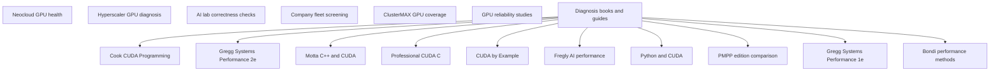

# GPU quality research

Research date: 2026-10-11.

Question: Which device-level checks can measure GPU quality within two hours on a GB300-class rack?

Audience: rack-bench developers and rack tenants in Chennai, India.
Expected answer: seven category briefs, ten book-source notes, a failure catalog, proposed checks, and implementation tickets.
The target has 18 compute trays and 72 physical GPUs.

Exclude east-west fabric tests. Include per-GPU NVLink health.
PASS requires measured evidence. Failures remain data. Every skip needs a reason.
No researcher makes live measurements on the target rack.

`[observed]` identifies source statements, not live rack results.
`[calculated]` identifies arithmetic. `[inference]` identifies recommendations.

The seven category nodes give independent evidence.
The O'Reilly supplement adds ten source nodes. Each source node uses the accepted N07 scope.
Catalog access does not show full-text access or verified chapter contents.

[Distilled document](docs/gpu-bench-research.md) · [Evidence review](evidence-review.md) ·
[Deliverables and limits](ORCHESTRATOR-REPORT.md) · [O'Reilly supplement](oreilly.md)

| Node | Question | Dependencies | Acceptance condition | Child | State |
| --- | --- | --- | --- | --- | --- |
| N01 | What GPU health evidence do neoclouds show tenants? | None | Source provider checks, tenant visibility, and limits. | neoclouds | done |
| N02 | Which GPU diagnosis steps do hyperscalers publish? | None | Source commands, recovery rules, platform restrictions, and limits. | hyperscalers | done |
| N03 | How do AI labs detect incorrect GPU results? | None | Source screening mechanisms, reference checks, examples, and limits. | ai-labs | done |
| N04 | How do large companies screen GPU fleets? | None | Separate GPU evidence from CPU evidence. Source methods and limits. | large-companies | done |
| N05 | What GPU quality does ClusterMAX actually test? | None | Verify methodology, injections, criteria, public code, and limits. | clustermax | done |
| N06 | What do studies show about GPU failures? | None | Source populations, mechanisms, rates, applicability, and short-test limits. | academia | done |
| N07 | Which books and guides help with GPU diagnosis? | None | Rank sources by task. Source current commands and book limits. | books | done |
| N08 | What does Cook add? | N07 | Record verified identity, TOC, techniques, and gaps. | oreilly-cook | done |
| N09 | What does Gregg 2e show? | N07 | Record verified identity, TOC, techniques, and gaps. | oreilly-gregg2 | done |
| N10 | What does Motta add? | N07 | Record metadata/TOC access gaps. Do not invent chapters. | oreilly-motta | done |
| N11 | What does Professional CUDA C add? | N07 | Record publisher topics, sample directories, and gaps. | oreilly-cheng | done |
| N12 | What does CUDA by Example add? | N07 | Record verified print identity, TOC, and format gaps. | oreilly-example | done |
| N13 | What does Fregly add? | N07 | Separate public companion methods from book text and RAS. | oreilly-fregly | done |
| N14 | What does Python and CUDA add? | N07 | Record public samples, historical dependencies, and TOC gaps. | oreilly-python | done |
| N15 | Which PMPP edition applies? | N07 | Correct identifiers. Preserve incomplete edition comparisons. | oreilly-pmpp | done |
| N16 | Does Gregg 1e remain useful? | N07 | Record durable methods and the preferred 2e reference. | oreilly-gregg1 | done |
| N17 | What does Bondi add? | N07 | Record public TOC methods and edition/format gaps. | oreilly-bondi | done |

## N01: Neocloud GPU health

Which provider evidence can a tenant use?
This question separates a provider's procedure from a particular GPU's measured condition.
SDC means incorrect computation without a hardware error signal.

[observed] CoreWeave describes idle-node SDC, performance-regression, and thermal tests.
Its automatic test lasts 20–30 minutes. It uses all node GPUs.
Its public procedure does not give per-GPU GB300 thresholds.
[Source](https://docs.coreweave.com/platform/fleet-management/hpc-verification).

[observed] Runpod exposes selected ECC and row-remap counters through Instant Clusters telemetry.
Its dashboard uses five-second samples.
[Source](https://docs.runpod.io/instant-clusters/cluster-observability.md).

[inference] For the Chennai rack, capture each GPU's own values before and after active tests.
Provider promises cannot replace those records.
A dashboard can show errors without testing arithmetic correctness.

[inference] Keep provider visibility and active screening as separate evidence types.
Compare this distinction with N02's recovery rules and N03's correctness checks.
No prerequisite applies to this node.
[Accepted evidence](nodes/N01.md) · [Complete brief](neoclouds.md).

## N02: Hyperscaler GPU diagnosis

Which provider commands and recovery rules apply?
An XID is a driver event code. It is not a physical-defect verdict.

[observed] Google publishes DCGM memory tests and XID-based diagnosis.
Its detailed table distinguishes contained XID 94 from uncontained XID 95.
Related events can change the cause. They can also change the recovery interpretation.
[Source](https://docs.cloud.google.com/compute/docs/troubleshooting/troubleshooting-gpus).

[observed] AWS automatic recovery responds to system-status failures on eligible instances.
It does not prove that a GPU passes a memory or arithmetic test.
[Source](https://docs.aws.amazon.com/AWSEC2/latest/UserGuide/ec2-instance-recover.html).

[inference] Run a named diagnostic with an overall timeout and save per-GPU output.
A plugin duration override does not set a time limit for every test in a numbered suite.
[Command semantics](https://docs.nvidia.com/datacenter/dcgm/latest/reference/command-line-reference/dcgmi/dcgmi-diag.html).

[inference] Example: XID 79 requires captured bus-access evidence and maintenance diagnosis.
Do not erase the evidence with an automatic reset.
Google's A3 temperature guidance does not show a GB300 threshold.
AWS's XID-specific support-page recovery text remains partly unverified.

This node has no prerequisite. Use N07 to select the operational guide.
[Accepted evidence](nodes/N02.md) · [Complete brief](hyperscalers.md).

## N03: AI lab correctness checks

How can a bench find incorrect GPU results?
Check performance and correctness separately. Fast execution can produce incorrect output.

[observed] Meta uses known-model tests and reductive triage to investigate AI hardware faults.
Finite gradient errors can escape a NaN-only check.
[Source](https://engineering.fb.com/2025/07/22/data-infrastructure/how-meta-keeps-its-ai-hardware-reliable).

[observed] CP-Bench provides model reference logs and operator comparisons across GPUs.
Its reference checksums can change across environments.
Its operator presets give project-estimated runtimes, not measured GB300 durations.
[Source](https://github.com/facebookincubator/CP-Bench/blob/bc4343097f9dd77b6136d4608b76617b4cf78214/README.md).

[inference] Use an independent host reference for deterministic memory and integer checks.
Define overflow behavior and compare every output element.
For floating-point work, define precision, algorithm, and justified error limits.
Do not require bitwise equality from every floating-point GEMM.

[inference] Example: repeat a mismatch with fixed inputs on the suspect GPU and a reference GPU.
Check whether the mismatch follows the physical GPU.
Peer agreement can miss shared compiler or library errors.
A clean short check does not show that the GPU is SDC-free.
[Limits](https://www.opencompute.org/documents/sdc-in-ai-ocp-whitepaper-final-pdf).

No prerequisite applies. N06 explains short-test statistical limits.
[Accepted evidence](nodes/N03.md) · [Complete brief](ai-labs.md).

## N04: Company fleet screening

What can a short bench take from fleet screening?
Fleet methods combine repeated tests, telemetry, and application evidence. They collect this evidence over long periods.

[observed] Meta describes static, transient, and silent faults.
Transient faults require the relevant load or operating conditions to occur.
Meta combines directed tests, short online tests, and exception analysis.
Its full-fleet directed-test cadence is 45–60 days.
[Source](https://engineering.fb.com/2025/07/22/data-infrastructure/how-meta-keeps-its-ai-hardware-reliable).

[inference] A two-hour bench can use the directed-test and telemetry part.
It cannot reproduce years of fleet history. It cannot reproduce detector sensitivity.
CPU scanner evidence does not show GPU SDC prevalence.
Public Microsoft evidence does not show an equivalent GPU screening recipe.
The GPU-screening identity of “Florence” remains unverified.

[inference] Example: collect ECC, XIDs, clocks, and temperature while a checked workload runs.
Keep the measurements when the workload fails.
Do not change power, clocks, MIG, or counters to obtain a clean result.
Active testing differs from read-only configuration collection.
[Operation boundaries](https://docs.nvidia.com/deploy/nvidia-smi/index.html).

No prerequisite applies. Compare repeated screening with N05's longer burn-in.
[Accepted evidence](nodes/N04.md) · [Complete brief](large-companies.md).

## N05: ClusterMAX GPU coverage

Which ClusterMAX checks measure devices, and which checks measure provider response?
Burn-in means sustained load. Fault injection deliberately creates a test condition.

[observed] ClusterMAX 3.0 describes GEMM, memory-path, and numerical-correctness workloads.
It also describes eight-hour concurrent GPU/network burn-in.
ClusterMAX keeps its performance and reliability scripts internal.
[Source](https://newsletter.semianalysis.com/p/clustermax-30-the-industry-standard).

[observed] Its criteria name ECC, XIDs/SXIDs, NVLink, thermal, power, PCIe, and version consistency.
The public audit marks some monitoring coverage as partial.
A criterion does not show that an active collector measures it.
[Criteria](https://www.clustermax.ai/criteria/reliability) ·
[Pinned public code](https://github.com/SemiAnalysisAI/ClusterMAX/blob/1492ac5e4ac992ae436f062cc51a340d61672ca3/cmax/scripts/1-audit/criteria-checks.json).

[inference] DCGM injection and synthetic logs test monitoring response. They do not test for physical defects.
A PCIe bridge reset causes a real disruption. It remains outside this bench's safety scope.
Example: report an injected ECC value as synthetic evidence, never as GPU-health PASS.

[inference] A two-hour screen cannot show that it matches eight-hour burn-in.
TinyMeg2 appears in historical provider-practice text. Current 3.0/GB300 use remains unverified.
No prerequisite applies. N03 gives a public correctness-tool alternative.
[Accepted evidence](nodes/N05.md) · [Complete brief](clustermax.md).

## N06: GPU reliability studies

What does a clean short test say about reliability?
Exposure measures observation time across devices. Coverage measures the operations and data that tests exercise.

[observed] Titan's study covers 18,688 GPUs and over 100,000 collective GPU-years.
Its late failure surge concerns a particular board-resistor corrosion problem.
That failure mode does not show a general GB300 chip defect.
[Source](https://christian-engelmann.de/publications/ostrouchov20gpu.pdf).

[calculated] Seventy-two GPUs observed for two hours provide at most 144 GPU-hours.
With zero events, a Poisson model gives a 95% upper rate bound of `-ln(0.05)/exposure`.
For that exposure, the bound equals approximately `0.0208 events/GPU-hour`.
[NIST formula](https://www.itl.nist.gov/div898/handbook/eda/section3/eda366j.htm).

[inference] The calculation assumes constant rates and independent events. It assumes homogeneous exposure and complete detection.
Shared rack faults and incomplete SDC detection violate those assumptions.
The example does not estimate actual GB300 reliability.
Do not pool historical rates across different populations or failure definitions.

[inference] Report tested bytes, patterns, precision, operations, duration, and telemetry coverage.
Keep collected measurements separate from quality grades.
No prerequisite applies. This result limits the claims from every other node.
[Accepted evidence](nodes/N06.md) · [Complete brief](academia.md).

## N07: Diagnosis books and guides

Which references help with a repeatable GPU bench?
Use books for diagnostic methods. Use matched product guides for current command semantics.

[observed] Gregg's Systems Performance covers methodology, observability, and benchmarking.
It does not give current GB300 diagnostic calibration.
[Source](https://www.brendangregg.com/systems-performance-2nd-edition-book.html).

[observed] NVIDIA's guides define ECC lifetimes, row-remap state, power scopes, and NVLink counters.
They distinguish unsupported fields from zero values.
CLI output can change across releases.
[Source](https://docs.nvidia.com/deploy/nvidia-smi/index.html).

[observed] DCGM release notes add GB300 variants and later diagnostic corrections.
The diagnostic CLI defaults to an unlimited timeout.
[Releases](https://docs.nvidia.com/datacenter/dcgm/latest/release-notes/changelog.html) ·
[CLI](https://docs.nvidia.com/datacenter/dcgm/latest/reference/command-line-reference/dcgmi/dcgmi-diag.html).

[inference] Example: save installed versions, run a bounded named test, and keep raw JSON.
Then compare each GPU's measured values with a declared workload/SKU profile.
A peer-relative comparison can miss a uniformly slow rack.
For unsupported fields, record the exact skip reason.
No guide shows a universal two-hour GB300 reliability guarantee.

No prerequisite applies. Use these guides to run the checks that the other nodes propose.
[Accepted evidence](nodes/N07.md) · [Complete brief](books.md).

## N08: Cook CUDA Programming

Which Cook topics help a test author?
Prerequisite: use N07's separation between programming methods and operational diagnosis.

[observed] Elsevier's twelve-chapter TOC includes error handling, memory, profiling, power, and cooling.
[Publisher](https://shop.elsevier.com/books/cuda-programming/cook/978-0-12-415933-4).

[inference] Example: check each CUDA error and compare completed output with an independent reference.
Measure compute and memory workloads separately.
Record working-set size, duration, and thermal/power context.
These proposals use TOC topics, not verified chapter procedures.

[inference] Keep this 2012 book as optional implementation reading.
Use current NVIDIA guides for GB300 APIs and RAS fields.
Do not infer a digital format from the catalog identifier.
[Accepted evidence](nodes/N08.md) · [Complete note](oreilly/cook.md).

## N09: Gregg Systems Performance 2e

Does the catalog pass change the method reference?
Prerequisite: use N07's measurement and acceptance contract.

[observed] InformIT lists second edition, 928 pages, and eBook ISBN 9780136821649.
Its copyright field gives 2021. Gregg identifies the edition as 2020.
[Publisher](https://www.informit.com/store/systems-performance-9780136821649) ·
[Author](https://www.brendangregg.com/systems-performance-2nd-edition-book.html).

[inference] Example: declare a fixed workload and compare timestamped before/after counters.
Keep per-GPU distributions instead of only a rack average.
Peer agreement can miss a rack-wide problem.
The public TOC shows methodology, observability, and benchmarking topics.
It does not show current GB300 RAS commands or acceptance limits.

[inference] Confirm the existing 2e reference. Keep publication and copyright dates separate.
[Accepted evidence](nodes/N09.md) · [Complete note](oreilly/gregg2.md).

## N10: Motta C++ and CUDA

Can the available record help with chapter recommendations?
Prerequisite: use N07's source and platform limits.

[observed] O'Reilly denies access. Packt presents security verification.
The source note cannot verify a complete TOC or ISBN format.
[Requested record](https://learning.oreilly.com/library/view/-/9781805124542/?orm_source=mcp).

[inference] Do not assign chapter numbers from a title.
Example: keep a proposed memory-pattern test as a generic CUDA method, not a Motta teaching claim.
Record tested bytes and mismatches with current CUDA/DCGM references.
[CUDA guide](https://docs.nvidia.com/cuda/cuda-c-programming-guide/).

[inference] Keep this title pending for optional CUDA learning.
A metadata gap is not proof that a chapter does not exist.
Do not change required reading from unverified catalog contents.
[Accepted evidence](nodes/N10.md) · [Complete note](oreilly/motta.md).

## N11: Professional CUDA C

What do public examples show?
Prerequisite: use N07's independent-reference and numerical-contract rules.

[observed] Wiley names Cheng, Grossman, and McKercher.
Wiley also describes CUDA execution, memory, concurrency, and profiling.
The companion has ten chapter example directories.
It includes floating-point accuracy/performance filenames, but not a verified complete TOC.
[Publisher](https://www.wiley.com/en-us/Professional+CUDA+C+Programming-p-9781118739327) ·
[Companion](https://github.com/deeperlearning/professional-cuda-c-programming).

[inference] Example: report a numerical mismatch count separately from arithmetic throughput.
Make synchronization and measured stream ordering explicit.
A sample filename does not prove a validated GB300 diagnostic.

[inference] Add optional examples. Keep current CUDA and NVIDIA RAS guides as operational references.
Edition, date, page count, and ISBN format remain incompletely verified.
[Accepted evidence](nodes/N11.md) · [Complete note](oreilly/cheng.md).

## N12: CUDA by Example

Which introductory methods transfer to a measured check?
Prerequisite: use N07's current CUDA and correctness contracts.

[observed] InformIT lists first edition, 320 print pages, and ISBN 9780131387683.
The supplied catalog gives 312 pages and a different identifier.
The public TOC includes events, thread cooperation, atomics, and streams.
[Publisher](https://www.informit.com/store/cuda-by-example-an-introduction-to-general-purpose-9780131387683).

[inference] Example: time a warmed workload with CUDA events on its execution stream.
Check a bounded integer atomic-update workload against known output.
Declare overflow behavior and synchronize before output comparison.
Timing does not show correctness or a GB300 quality limit.

[inference] Keep this book as optional introductory reading.
Check old APIs against the current toolkit before reuse.
Keep its 2011 copyright field separate from 2010 publication.
[Accepted evidence](nodes/N12.md) · [Complete note](oreilly/example.md).

## N13: Fregly AI performance

What new GPU measurement reference can test authors use?
Prerequisite: keep N07's current NVIDIA operational authority and safety contract.

[observed] Fregly's public companion lists twenty chapters and November 2025 publication.
Its checklist gives matched workloads, warmup, CUDA events, output references, and raw artifacts.
[Public TOC](https://github.com/cfregly/ai-performance-engineering#book-chapters) ·
[Checklist](https://raw.githubusercontent.com/cfregly/ai-performance-engineering/main/docs/appendix.md).

[inference] Example: use identical shapes, precision, seeds, and staging across GPU measurements.
Save commands, versions, raw results, and the numerical comparison contract.
Use bounded Nsight traces to examine measured outliers.
Keep unprofiled workload results separate from profiler evidence.

[inference] Add a practical GPU measurement reference beside Gregg and PMPP.
Do not copy clock, power, MIG, persistence, or OS tuning changes into the bench.
The living companion can differ from the published book.
It gives no universal GB300 RAS rule or two-hour feasibility result.
[Accepted evidence](nodes/N13.md) · [Complete note](oreilly/fregly.md).

## N14: Python and CUDA

Can historical Python examples serve as current bench dependencies?
Prerequisite: use N07's supported-software and correctness rules.

[observed] Packt's companion lists Python 2.7, Anaconda 5, CUDA 9.2/10.x, PyCUDA, and Scikit-CUDA.
It has twelve chapter directories.
The note lacks a complete authoritative chapter-title list.
[Companion](https://github.com/PacktPublishing/Hands-On-GPU-Programming-with-Python-and-CUDA).

[inference] Example: time host/device transfers separately from kernel execution.
Do not call the transfer rate HBM bandwidth.
Check fixed-input outputs against an independent reference.
An `allclose` comparison uses tolerance, not bit-exact equality.

[inference] Keep optional implementation ideas. Do not add the historical dependencies.
Current supported APIs and measured rack pilots remain necessary.
[Accepted evidence](nodes/N14.md) · [Complete note](oreilly/python.md).

## N15: PMPP edition comparison

Does the supplied identifier require an edition change?
Prerequisite: use N07's architecture-reference role.

[observed] Elsevier's 4e TOC has 23 chapters and numerical considerations.
The accepted publisher identifier is 9780323912310.
The supplied O'Reilly identifier has an unverified format and edition relationship.
[Publisher](https://www.elsevier.com/books/programming-massively-parallel-processors/hwu/978-0-323-91231-0).

[observed] The source note corrects the 2e identifier to 9780124159921.
Older metadata and later-edition status remain incompletely verified.
[Edition evidence](oreilly/pmpp.md).

[inference] Example: measure compute and memory paths with separate workloads.
Test several access patterns.
Check a reduction against its numerical contract.
Report tested bytes, operations, precision, and duration.

[inference] Confirm 4e for architecture. Do not infer edition changes from ISBN differences.
This pass does not prove that no later edition exists.
[Accepted evidence](nodes/N15.md) · [Complete note](oreilly/pmpp.md).

## N16: Gregg Systems Performance 1e

Must readers use both Gregg editions?
Prerequisite: use N07's accepted 2e method reference.

[observed] Gregg's 1e author page gives 2013 and thirteen chapters.
Its publisher label differs from the supplied catalog label.
Gregg's 2e description adds updated Linux/cloud and perf, Ftrace, and BPF material.
[First edition](https://www.brendangregg.com/sysperfbook.html) ·
[Second edition](https://www.brendangregg.com/systems-performance-2nd-edition-book.html).

[inference] Example: keep the utilization, saturation, and errors method for each GPU resource.
Declare comparable workloads and keep per-device distributions.
Use current NVIDIA guides for RAS counters and support.

[inference] Prefer 2e rather than require both editions.
The first edition shows durable methods, not present GB300 commands.
This choice keeps the existing reading list.
[Accepted evidence](nodes/N16.md) · [Complete note](oreilly/gregg1.md).

## N17: Bondi performance methods

Which test-planning methods help before the rack pilot?
Prerequisite: use N07's separation between measurement and quality assessment.

[observed] Pearson's public TOC has fifteen chapters.
It includes performance metrics, workload characterization, measurement validation, pilot testing, and measurement pitfalls.
Its identifier differs from the supplied O'Reilly record.
Edition and format metadata remain incompletely verified.
[Publisher TOC](https://www.pearson.de/media/muster/toc/toc_9780133038163.pdf).

[inference] Example: test the timing, counter collection, reference check, and cancellation before the rack run.
Declare measurable requirements and raw evidence for each check.
Keep averaging windows and comparison limits with the result.
Missing acceptance rules must not stop valid measurement collection.

[inference] Add optional requirements and test-planning reading.
The general TOC does not show GPU RAS procedures or GB300 thresholds.
[Accepted evidence](nodes/N17.md) · [Complete note](oreilly/bondi.md).
