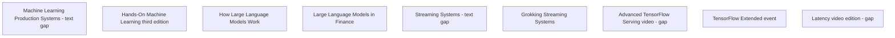

# O'Reilly inference reference supplement

Question: Which supplied sources show verified serving-performance methods for the inference reading list?

Research date: 2026-10-11.

Audience: rack-bench engineers.
Scope: make a supplement to the accepted inference research; keep its serving metric contract.
Context: GB300-class, NVL72-class, 18 trays, Chennai; audit → bench → smoke; two-hour bench window.
Checks: token throughput, p50/p99 latency, TTFT, TPOT, ITL, scheduling, startup, KV pressure, and quantization quality.

PASS makes valid measurement necessary, not vendor claims.
Check the supplied catalog metadata independently.
An accessible table of contents does not show access to full chapter text.
All nine source nodes are independent. The synthesis shows the original N07 reference findings, plus this material.

| Node | Question | Dependencies | Acceptance condition | Child | State |
| --- | --- | --- | --- | --- | --- |
| N08 | Does this 2024 production book show LLM serving methods? | None | Check edition, chapters, text access, portable checks, and canon relation | oreilly-ml-production-systems | gap |
| N09 | Which third-edition deployment chapters make inference validation easier? | None | Check edition, chapters, text access, portable checks, and canon relation | oreilly-hands-on-ml | done |
| N10 | Does this LLM introduction show serving performance checks? | None | Check edition, chapters, text access, portable checks, and canon relation | oreilly-how-llms-work | done |
| N11 | Does this finance title show transferable serving validation? | None | Check edition, chapters, text access, portable checks, and canon relation | oreilly-llms-finance | done |
| N12 | Which stream-processing methods make the transfer without metric confusion? | None | Check edition, chapters, text access, portable checks, and canon relation | oreilly-streaming-systems | gap |
| N13 | Which streaming-system checks make the transfer to the inference driver? | None | Check edition, chapters, text access, portable checks, and canon relation | oreilly-grokking-streaming | done |
| N14 | What does the TensorFlow Serving video show? | None | Check video identity, sections, access, portable checks, and canon relation | oreilly-tf-serving-video | gap |
| N15 | What does the TFX event show about validation and serving? | None | Check event identity, agenda, access, portable checks, and canon relation | oreilly-tfx-event | done |
| N16 | Which latency-video methods show use in a two-hour serving bench? | None | Check video identity, sections, access, portable checks, and canon relation | oreilly-latency-video | gap |

The original report shows nine accepted child notes and no running research child.
`done` shows sufficient public evidence for the bounded source recommendation.
It does not show complete-book access or verified rack performance.

`gap` shows TOC-only methods or inaccessible video content.
N15 shows agenda topics only. It does not show course demonstrations.
Use the [synthesis](../oreilly.md) and [combined report](../research.md).

## N08: Check the production book's LLM boundary

The book description shows GenAI and LLM serving topics in Machine Learning Production Systems.
Chapters 11–14 show serving patterns, infrastructure, and examples.
Chapter 22 shows Generative AI.
The checked description makes a wholly TF-era classification impossible.
However, visible examples show TF Serving and TorchServe.
The TOC does not show token-metric formulas or KV-pressure tests.

Use this book for production-lifecycle context.
N07 keeps AI Engineering as the primary inference book.

Sources: [public description](https://books.google.com/books/about/Machine_Learning_Production_Systems.html?id=iTEmEQAAQBAJ),
[child catalog/TOC](https://learning.oreilly.com/library/view/-/9781098156008/?orm_source=mcp).
Evidence: observed description and child TOC; inference for reading priority.
Gap: chapter prose is unavailable. Repeat catalog access shows a difference.
Full note: [N08](ml-production-systems.md).

## N09: Use general validation before TF deployment examples

Hands-On Machine Learning's third edition shows general ML validation context.
Chapter 2 shows performance measures, assumptions, and test sets.
Chapter 19 shows TensorFlow deployment at scale.
The public repository shows the author's third-edition examples.
These examples do not show full chapter access.

Use the validation context for test assumptions.
For example, show the tested model and workload before the rate sweep.
N03 shows current client timers. This book does not remove those definitions.

Sources: [catalog/TOC](https://learning.oreilly.com/library/view/-/9781098125967/?orm_source=mcp),
[author examples](https://github.com/ageron/handson-ml3).
Evidence: observed TOC and repository; inference for bench use.
Limit: chapter 19 text access shows 403. This book does not show a verified GB300 protocol.
Full note: [N09](hands-on-ml.md).

## N10: Keep tokenization context separate from measurement rules

How Large Language Models Work shows three authors, not only Drew Farris.
The authors are Edward Raff, Drew Farris, and Stella Biderman.
Public previews show tokenizers and general deployment limits.
The previews show overview prose, summaries, figures, and FAQs.
They do not show complete chapter access.

Keep the tokenizer fixed because different token representations make different counts.
Use engine documentation for token-count and timing rules.
N03 keeps event-gap ITL separate from request TPOT.

Sources: [publisher](https://www.manning.com/books/how-large-language-models-work),
[tokenizers preview](https://www.manning.com/preview/how-large-language-models-work/chapter-2),
[limits preview](https://www.manning.com/preview/how-large-language-models-work/chapter-7).
Evidence: observed child metadata and public previews; inference for bench use.
Limit: conceptual latency discussion does not show timed startup or KV diagnostics.
Full note: [N10](how-llms-work.md).

## N11: Keep fictional capacity values outside acceptance evidence

The finance companion lab keeps quality, latency, cost, memory, and capacity separate.
It uses fictional teaching fixtures, not rack measurements.
An M/M/1 screen shows arrivals at or above service rate as unstable.
The notebook makes a sum of queue-wait p95 and a service p95 field.
That calculation does not show the total-latency distribution.
The notebook instructions show workload replay as a requirement for that distribution.

The current suite is an additive educational layer, not the original canonical release.
Use its constraint separation, not its numbers or hidden chapter claims.
N06 makes measured operating points and bounded quality conclusions necessary.

Sources: [checked notebook](https://raw.githubusercontent.com/PacktPublishing/LLMs-in-Finance/main/notebooks/10_inference_and_capacity.ipynb),
[repository and edition boundary](https://github.com/PacktPublishing/LLMs-in-Finance).
Evidence: observed code, metadata, and caveat; inference for bench use.
Limit: this source shows no GB300, TTFT, TPOT, ITL, startup, or KV-pressure measurements.
Full note: [N11](llms-finance.md).

## N12: Do not use watermarks as decoder completion rules

Streaming Systems shows event time, processing time, windows, and watermarks.
Chapter 5 shows accuracy versus completeness.
These topics can make the request ledger clearer.
A reporting window can show its cutoff before completion of all requests.
Keep pending requests and the drain cutoff visible.
This transfer is an inference, not a verified book-prescribed benchmark.

A watermark does not show completed LLM decoding.
N03 shows the serving timer and output-event rules.

Source: [child catalog/TOC](https://learning.oreilly.com/library/view/-/9781491983867/?orm_source=mcp).
Evidence: observed child TOC; inference for the domain transfer.
Gap: complete chapter methods are unavailable. Repeat catalog access shows a failure.
Full note: [N12](streaming-systems.md).

## N13: Check generator parallelism and reporting windows

Grokking Streaming Systems shows readable public sample prose.
Chapter 6 shows grouping under parallelization.
Chapter 7 shows windowed computations.
Some later sections show headings only.

Use this context to make a record of generator parallelism and reporting windows.
For example, a fixed-count window is different from a fixed-duration window.
Backpressure can make actual sends different even when the configured rate is fixed.
This serving application is an inference.
N03 makes scheduled and actual send timestamps necessary.

Sources: [publisher](https://www.manning.com/books/grokking-streaming-systems),
[chapter 6 sample](https://livebook.manning.com/book/grokking-streaming-systems/chapter-6),
[chapter 7 sample](https://livebook.manning.com/book/grokking-streaming-systems/chapter-7).
Evidence: observed description, sample prose, and headings; inference for bench use.
Limit: stream-processing delivery topics do not show token percentiles or KV tests.
Full note: [N13](grokking-streaming.md).

## N14: Keep the video agenda separate from verified demonstrations

The TensorFlow Serving session date is October 30, 2019.
The child catalog shows February 2020 as the video publication date.
The public agenda shows payload tuning, TensorRT, batching, A/B testing, and monitoring.
Those agenda topics do not show the demonstrated procedures.

Use the source for historical server-configuration context.
Do not put LLM token metrics or mixed-prefill diagnostics in unseen video content.
N03 and N06 show current measurement and scheduling references.

Source: [checked conference agenda](https://conferences.oreilly.com/tensorflow/tf-ca-2019/public/schedule/detail/78365.html).
Evidence: observed agenda and child catalog; inference for reading priority.
Gap: playback, transcript, timestamps, and demonstrations are unavailable.
Full note: [N14](tf-serving-video.md).

## N15: Keep model evaluation separate from service readiness

The TFX event agenda shows evaluation slices and multiple-model analysis.
Its serving section shows export, versioning, batching, and test requests.
The agenda shows 180 minutes, including breaks.
It does not show the two-hour rack bench definition.

Keep candidate-quality evaluation separate from successful service generation.
For example, a ready endpoint can still show a task-quality check failure.
Current TFX documentation shows this distinction.
That documentation does not show that the event makes every related mechanism clear.
N07 keeps this event as lifecycle context.

Sources: [checked event agenda](https://www.oreilly.com/live-events/tensorflow-extended-model-build-analysis-and-serving/0636920251880),
[TFX Evaluator](https://www.tensorflow.org/tfx/guide/evaluator).
Evidence: observed agenda and separate docs; calculated duration; inference for bench use.
Limit: the exact session date and recording are unverified.
Full note: [N15](tfx-event.md).

## N16: Do not put book chapter claims in an inaccessible video

The Latency video record does not show its sections or transcript.
The related Manning book shows modeling, measurement, caching, and concurrency.
Its description shows Little's Law and Amdahl's Law.
These book claims do not show video coverage.
Use the related book for general latency context.

Little's Law makes consistent system boundaries and a stable system necessary for this check.
Do not use it as certification for a growing overload queue.
N03 shows LLM timing definitions. N06 shows arrival and sample limits.

Sources: [video record](https://learning.oreilly.com/videos/-/9781633438088VE/?orm_source=mcp),
[checked book description](https://www.manning.com/books/latency),
[book chapter record](https://books.google.com/books/about/Latency.html?id=u9SSEQAAQBAJ).
Evidence: observed related-book records; inference for bench use.
Gap: playback, video sections, and complete book text are unavailable.
Full note: [N16](latency-video.md).
