# Inference serving quality research

Question: Which measurements show serving quality within a two-hour GB300 rack test?

Research date: 2026-10-11.

Audience: rack-bench engineers and rack tenants in Chennai.
Expected answer: seven category briefs, nine supplemental source notes, failure modes, suite checks, and implementation tickets.
Scope: audit → bench → smoke, on a GB300-class, NVL72-class rack with 18 trays.
Exclusions: code changes, live GPU tests, production availability claims, and vendor certification without measurements.
Source needs: primary documentation, source code, papers, and verified book records.

The original seven nodes use independent source scopes.
Nine supplemental nodes check the supplied O'Reilly records.
The final design keeps the accepted measurement contract.
The final design also puts bounded reading context in place.

```mermaid
flowchart TD
N01["Neocloud serving claims"]
N02["Hyperscaler throughput contracts"]
N03["AI lab metrics and tools"]
N04["Large company serving SLOs"]
N05["ClusterMAX serving coverage"]
N06["Academic methods and rules"]
N07["Books and reference canon - gap"]
N08["Machine Learning Production Systems - text gap"]
N09["Hands-On Machine Learning third edition"]
N10["How Large Language Models Work"]
N11["Large Language Models in Finance"]
N12["Streaming Systems - text gap"]
N13["Grokking Streaming Systems"]
N14["Advanced TensorFlow Serving video - gap"]
N15["TensorFlow Extended event"]
N16["Latency video edition - gap"]
```

| Node | Question | Dependencies | Acceptance condition | Child | State |
| --- | --- | --- | --- | --- | --- |
| N01 | What do neocloud serving claims show? | None | Check claims, economics, cache, precision, startup, and missing methods. | neoclouds | done |
| N02 | What throughput do hyperscalers put in contracts? | None | Keep quota, capacity, SLOs, and benchmark methods separate. | hyperscalers | done |
| N03 | How do lab tools show serving quality? | None | Make definitions for metric populations, scheduler tests, cache behavior, and version limits. | ai-labs | done |
| N04 | How do large companies check serving SLOs? | None | Show the connection between production mechanisms, metrics, and rack checks. | large-companies | done |
| N05 | What serving evidence does ClusterMAX make public? | None | Check current methods and code boundaries; keep absence claims within limits. | clustermax | done |
| N06 | What methods make serving benchmarks valid? | None | Check scheduler papers, MLPerf, quality gates, and measurement errors. | academia | done |
| N07 | Which references show inference validation? | None | Put books and docs in rank order; check chapter coverage and access limits. | books | gap |
| N08 | Does the production book show additional LLM serving methods? | None | Check metadata, chapters, access, and portable checks. | oreilly-ml-production-systems | gap |
| N09 | Which deployment chapters are useful for inference validation? | None | Check edition, examples, access, and limits. | oreilly-hands-on-ml | done |
| N10 | Does the LLM introduction show performance checks? | None | Check authors, previews, and serving limits. | oreilly-how-llms-work | done |
| N11 | Does the finance title show additional serving validation? | None | Check metadata, companion lab, and canon boundaries. | oreilly-llms-finance | done |
| N12 | Which stream-processing methods are transferable? | None | Check contents, access, and domain boundaries. | oreilly-streaming-systems | gap |
| N13 | Which streaming checks are useful for the client driver? | None | Check sample prose, windows, and transfer limits. | oreilly-grokking-streaming | done |
| N14 | What does the TF Serving video show? | None | Check catalog, agenda, and playback limits. | oreilly-tf-serving-video | gap |
| N15 | What does the TFX event show? | None | Check agenda, duration, evaluation, and serving limits. | oreilly-tfx-event | done |
| N16 | Which latency-video methods are useful for the bench? | None | Check video access; keep related-book evidence separate. | oreilly-latency-video | gap |

The evidence markers `observed`, `calculated`, and `inference` keep source claims, calculations, and recommendations separate.
The category files keep complete accepted briefs. The `nodes/` files keep checked extracts and links to those briefs.
N07 shows no repeatable complete-book access. Public author summaries now show verification of specific chapter topics.

The original report shows sixteen accepted child notes and no running research child.
Supplement `done` shows sufficient public evidence for the bounded source recommendation.
It does not show complete-book access. TOC-only methods and inaccessible video content keep the `gap` state.

The [supplement report](oreilly/research.md) shows the nine detailed source lessons.
The [supplement synthesis](oreilly.md) shows metadata, access levels, and reading priorities.
No node shows local rack performance evidence.

Deliverables: [bench design](docs/inference-bench-research.md), [orchestrator report](ORCHESTRATOR-REPORT.md), and [run scope](README.md).
This run directory keeps the bench design. The parent must put it at the requested project destination.

## N01: Check the throughput denominator

A tokens/s claim must show a named numerator and denominator.
Per-user output speed is a measurement of one stream after its first token.
Aggregate output throughput is a measurement of completed generated tokens across the serving fleet.
Input-plus-output throughput also keeps prompt tokens in the count.
Batching can make fleet throughput higher while each user's speed is lower.

The Cerebras announcement shows 969 output tokens/s for a 1,000-token prompt.
Its announcement does not show a matched concurrency frontier or p99 goodput.
Together shows a workload-shaped comparison. Its GPU allocations are different.
Together also shows conflicting input-TPM units.

Keep that conflict visible. Do not use the source's arithmetic without a check.

Keep measured load points, per-user speed, fleet throughput, outcomes, and latency together.
Use all GPUs allocated to the tested serving fleet for output-throughput normalization.
N03 shows the timer boundaries. N06 shows the arrival and percentile limits.

Sources: [Cerebras](https://www.cerebras.ai/blog/llama-405b-inference),
[Together](https://www.together.ai/blog/coding-agent-benchmarks),
[InferenceMAX](https://inferencex.semianalysis.com/blog/inferencemax-open-source-inference-benchmarking).
Evidence: observed source claims; calculated unit conflict; inference for the reporting rule.
Full brief: [neoclouds.md](neoclouds.md). Checked extract: [N01](nodes/N01.md).

## N02: Keep quota separate from achieved capacity

Quota puts a limit on admission. Purchased capacity keeps processing resources in reserve.
Neither measure alone shows achieved client throughput under a latency limit.
AWS uses model-specific MUs. Google uses model-specific GSUs and accounting windows.

The Azure statement shows throughput dependence on workload lengths, call rate, and cache matches.
Azure billing Reservations are not a deployment-capacity guarantee.

For example, an accounting window can show a pass for a short burst.
The same window can show an excess under sustained traffic.
Keep offered rate, successful rate, errors, and latency for each measured point.
Do not make MUs, GSUs, or PTUs into a universal GPU token rate.

Google's benchmark method makes concurrency higher until the declared p99 limit shows a failure.
Use discrete passing and failing points. Do not make a capacity certification from interpolation.
N01 shows the denominator. N03 shows the client measurement contract.

Sources: [AWS](https://docs.aws.amazon.com/bedrock/latest/userguide/prov-throughput.html),
[Google PT](https://docs.cloud.google.com/gemini-enterprise-agent-platform/models/provisioned-throughput/use-provisioned-throughput),
[Azure](https://learn.microsoft.com/en-us/azure/ai-foundry/openai/how-to/latency),
[Google benchmarking](https://docs.cloud.google.com/docs/ai-ml/accelerator-performance-benchmarking).
Evidence: observed capacity rules; inference for rack acceptance.
Full brief: [hyperscalers.md](hyperscalers.md). Checked extract: [N02](nodes/N02.md).

## N03: Keep latency populations separate

TTFT is the time to first generated output from a declared start boundary.
Request TPOT is the average of the post-first-token time over `N - 1` intervals.
Event-gap ITL is the time between parsed streaming events.
One event can show several tokens. Thus event-gap ITL is not necessarily token-gap latency.

The checked vLLM client keeps outputs with at most one token out of TPOT statistics.
It uses zero TPOT for those outputs in its goodput calculation.
Rack-bench must make its own one-token rule.
Use unavailable TPOT for one-token outputs. Do not use an invented interval.

The checked client timer puts request generation and the final completion tail in the measurement.
Keep the configured arrival schedule and actual send times.
A concurrency semaphore can make sends late. The semaphore can also make the offered load different.
Offline executor tests and llama-bench pp/tg tests do not show HTTP serving quality.
N06 shows the importance of these timing differences under overload.

Sources: [vLLM metrics](https://docs.vllm.ai/en/latest/design/metrics.html),
[pinned client](https://github.com/vllm-project/vllm/blob/21da73343ad35f756e053ba4155dafb05229b0c5/vllm/benchmarks/serve.py#L299-L323),
[llama-bench](https://github.com/ggml-org/llama.cpp/blob/master/tools/llama-bench/README.md).
Evidence: observed code and tool boundaries; inference for the rack-bench rules.
Limit: the pinned client is historical. The client does not show the deployed runtime version.
Full brief: [ai-labs.md](ai-labs.md). Checked extract: [N03](nodes/N03.md).

## N04: Put user latency with scheduler evidence

Prefill is the processing of prompt tokens. Decode is the production of output tokens.
Long prefill work can make active decode requests late.
Keep short-request latency separate while long prompts use the same service.

Client latency shows the user result. Queue and cache metrics can make the explanation of the result easier.
GPU utilization alone cannot show serving quality.

The Cloudflare report shows higher concurrency for FP8 KV cache than BF16 in one H200 deployment.
BF16 runs faster at matching concurrency in that experiment.
Thus cache precision can make a capacity change without an improvement in every measured point.
Keep weight precision and KV precision separate.
Make a comparison of fixed-task quality with a named reference.

Azure's minute aggregates do not show request-level p99.
Keep raw client records and request outcomes.
N03 shows those record definitions. N06 shows the quality and sample-count limits.

Sources: [Cloudflare](https://blog.cloudflare.com/smaller-faster-safer-models),
[Meta](https://engineering.fb.com/2025/10/17/ai-research/scaling-llm-inference-innovations-tensor-parallelism-context-parallelism-expert-parallelism),
[Azure metrics](https://learn.microsoft.com/en-us/azure/azure-monitor/reference/supported-metrics/microsoft-cognitiveservices-accounts-metrics).
Evidence: observed deployment results; inference for the diagnostic tests.
Limit: these configurations are not a prediction of the Chennai rack's token rate.
Full brief: [large-companies.md](large-companies.md). Checked extract: [N04](nodes/N04.md).

## N05: Make a correction to the ClusterMAX premise

ClusterMAX makes serving-benchmark descriptions public, not only readiness checks.
ClusterMAX 3.0 uses the name InferenceX AgentX for single-node and multinode tests.
ClusterMAX 2.0 shows llm-d Qwen throughput and replica scaling.
The public cmax repository keeps out benchmark implementations and provider results.

The public protocol does not show every model, arrival pattern, timer, or raw sample.
This puts a limit on independent reproduction. The limit does not show omissions from internal measurements.
Do not put every InferenceX metric on ClusterMAX without evidence.

ClusterMAX also runs a vLLM startup timer until `/v1/models` shows a response.
That endpoint can show readiness without showing successful generation.
Run a separate measurement of the first valid inference.
Rack-bench's useful difference is transparent acceptance evidence, not the claimed absence of serving tests.
N03 shows the definition of that evidence. N04 shows the diagnostic telemetry.

Sources: [ClusterMAX 3.0](https://newsletter.semianalysis.com/p/clustermax-30-the-industry-standard),
[ClusterMAX 2.0](https://newsletter.semianalysis.com/p/clustermax-20-the-industry-standard),
[public cmax](https://github.com/SemiAnalysisAI/clustermax).
Evidence: observed published coverage; inference for the comparison boundary.
Full brief: [clustermax.md](clustermax.md). Checked extract: [N05](nodes/N05.md).

## N06: Use valid arrivals and bounded quality claims

An open-loop driver sends requests on a schedule without a wait for earlier completions.
A closed-loop driver sends replacement work after completion.
Slow responses make a closed-loop driver's offered rate lower.
Thus a closed-loop saturation score can keep queue growth out of view under independent arrivals.
Keep both tests. Use different labels.

PagedAttention makes KV allocation waste smaller. Sarathi-Serve puts prefill in chunks to make decode delays smaller.
These mechanisms show useful diagnostics. They do not show a universal rack threshold.

MLPerf uses scenario-specific latency and quality gates.
Its closed rules keep cross-query cache reuse out.
Keep intentional prefix reuse outside any MLPerf-style no-reuse comparison.

At 1,000 independent requests, about ten are above population p99 on average.
Correlated token gaps do not show as many independent request observations.
Keep counts and uncertainty with empirical p99.
A small paired quality set shows only the tested tasks, not general model fidelity.
N01–N05 use these measurement limits.

Sources: [PagedAttention](https://arxiv.org/html/2309.06180),
[Sarathi-Serve](https://arxiv.org/html/2403.02310v1),
[pinned MLPerf rules](https://github.com/mlcommons/inference_policies/blob/d3eba2f21026d868ad65cdcad2bb81e4a17ce3d3/inference_rules.adoc).
Evidence: observed methods; calculated tail count; inference for the two-hour limits.
Limit: a policy commit does not show the deployed version. The commit does not show formal MLPerf compliance.
Full brief: [academia.md](academia.md). Checked extract: [N06](nodes/N06.md).

## N07: Use books for concepts and pinned tools for tests

AI Engineering chapter 9 shows the strongest verified book starting point.
Designing Machine Learning Systems chapter 7 shows deployment context.
Current vLLM, TensorRT-LLM, and MLPerf sources show more specific measurement procedures.
Use DistServe for latency-qualified goodput and prefill/decode separation.

Public author summaries now show verification of specific book topics.
AI Engineering's summary shows TTFT/TPOT, quantization, KV cache, batching, parallelism, and prompt caching.
DMLS's summary shows deployment and prediction context.
The repeat O'Reilly fetch shows access denied.
Thus this node keeps a complete-book evidence gap.
Do not make the claim that a book shows a complete two-hour GB300 acceptance protocol.

Start with the conceptual chapter. Then check the exact benchmark client's source.
Keep the deployed tool version, commands, and metric definitions with each result.
N03 shows the checked client example. N06 shows the benchmark rules.

Sources: [author book records](https://huyenchip.com/books),
[AI Engineering author summary](https://github.com/chiphuyen/aie-book/blob/main/chapter-summaries.md#chapter-9-inference-optimization),
[DMLS author summary](https://github.com/chiphuyen/dmls-book/blob/main/summary.md#chapter-7-model-deployment-and-prediction-service),
[vLLM](https://docs.vllm.ai/en/latest/benchmarking/cli),
[DistServe](https://www.usenix.org/conference/osdi24/presentation/zhong-yinmin).
Evidence: observed records and access limits; inference for the reading order.
Full brief: [books.md](books.md). Checked extract: [N07](nodes/N07.md).
Supplement: [oreilly.md](oreilly.md).

## N08: Check the production book's LLM boundary

Machine Learning Production Systems explicitly puts LLM serving and GenAI pipelines in scope.
The child TOC shows serving chapters 11–14 and Generative AI chapter 22.
The checked description keeps out a wholly TF-era classification.
However, the visible examples show TF Serving and TorchServe.
Use this source for production-lifecycle context, not unverified token-metric procedures.
N07 keeps AI Engineering as the primary inference book.

Sources: [checked description](https://books.google.com/books/about/Machine_Learning_Production_Systems.html?id=iTEmEQAAQBAJ),
[child catalog/TOC](https://learning.oreilly.com/library/view/-/9781098156008/?orm_source=mcp).
Evidence: observed description and TOC; inference for reading priority.
Gap: full chapter text is still unavailable. A repeat catalog access check shows a failure.
Full note: [N08](oreilly/ml-production-systems.md).

## N09: Use general validation before TF examples

Hands-On Machine Learning's third edition shows general ML validation context.
Chapter 2 shows measures, assumptions, and test sets.
Chapter 19 shows TensorFlow deployment at scale.
The author makes public third-edition examples available.

Use the validation context to make a tested-workload declaration before the rate sweep.
N03 shows current serving timers. These examples are not a replacement for those definitions.

Sources: [catalog/TOC](https://learning.oreilly.com/library/view/-/9781098125967/?orm_source=mcp),
[author examples](https://github.com/ageron/handson-ml3).
Evidence: observed TOC and repository; inference for bench use.
Limit: the chapter 19 fetch shows a 403 response. The examples do not show complete chapter access.
Full note: [N09](oreilly/hands-on-ml.md).

## N10: Keep tokenizer context separate from measurement rules

How Large Language Models Work shows the authors Edward Raff, Drew Farris, and Stella Biderman.
Public previews show tokenizers and general deployment limits.
The pages show overviews, summaries, figures, and FAQs.
They do not show complete chapter access.
Keep the tokenizer pinned because token representation makes counts different.
N03 shows the actual token-count and timing rules.

Sources: [publisher](https://www.manning.com/books/how-large-language-models-work),
[tokenizers preview](https://www.manning.com/preview/how-large-language-models-work/chapter-2),
[limits preview](https://www.manning.com/preview/how-large-language-models-work/chapter-7).
Evidence: observed metadata/previews; inference for bench use.
Limit: conceptual latency discussion does not show definitions of startup or KV diagnostics.
Full note: [N10](oreilly/how-llms-work.md).

## N11: Keep fictional capacity values outside acceptance evidence

The finance companion lab keeps quality, latency, cost, memory, and capacity separate.
Its M/M/1 screen uses fictional teaching fixtures, not rack measurements.
The added queue/service p95 fields are not a total-latency p95 measurement.
The notebook makes workload replay of that distribution a requirement.

The current suite is an additive educational layer, not the original canonical release.
Use constraint separation, not fictional numbers or hidden chapter claims.
N06 makes measured operating points and bounded quality conclusions a requirement.

Sources: [checked lab](https://raw.githubusercontent.com/PacktPublishing/LLMs-in-Finance/main/notebooks/10_inference_and_capacity.ipynb),
[edition-integrity statement](https://github.com/PacktPublishing/LLMs-in-Finance).
Evidence: observed code, metadata, and caveat; inference for bench use.
Limit: this source does not show GB300, TTFT, TPOT, ITL, startup, or KV-pressure measurements.
Full note: [N11](oreilly/llms-finance.md).

## N12: Do not use watermarks as decoder completion rules

Streaming Systems shows time semantics, windows, watermarks, and accuracy versus completeness.
These TOC topics can make the explanation of the request ledger easier.
A reporting window can show its cutoff before completion of all requests.
Keep pending requests and the drain cutoff visible.
This transfer is an inference, not a verified book-prescribed benchmark.

N03 shows serving timers. Watermarks do not show completed decoding.

Source: [child catalog/TOC](https://learning.oreilly.com/library/view/-/9781491983867/?orm_source=mcp).
Evidence: observed child TOC; inference for the domain transfer.
Gap: complete chapter methods are still unavailable. A repeat catalog access check shows a failure.
Full note: [N12](oreilly/streaming-systems.md).

## N13: Check generator parallelism and reporting windows

Grokking Streaming Systems shows partial public sample prose.
Chapter 6 shows grouping under parallelization. Chapter 7 starts the windowed-computations topic.
Only headings are visible for some later sections.

Use this context to make a record of generator parallelism and reporting windows.
For example, a fixed-count window is different from a fixed-duration window.
Backpressure can make actual sends different without a change to the configured rate.
This serving application is an inference. N03 makes actual send timestamps a requirement.

Sources: [publisher](https://www.manning.com/books/grokking-streaming-systems),
[chapter 6](https://livebook.manning.com/book/grokking-streaming-systems/chapter-6),
[chapter 7](https://livebook.manning.com/book/grokking-streaming-systems/chapter-7).
Evidence: observed description, partial prose, and headings; inference for bench use.
Limit: stream-processing topics do not show definitions of token percentiles or KV tests.
Full note: [N13](oreilly/grokking-streaming.md).

## N14: Keep the video agenda separate from demonstrations

The TensorFlow Serving session is from October 30, 2019.
The child catalog shows February 2020 as the video publication date.
The checked agenda shows payload tuning, TensorRT, batching, A/B testing, and monitoring.
Those topics do not show the demonstrated procedures.
Use this source as historical server-configuration context.
N03 and N06 show current measurement and scheduling references.

Source: [checked conference agenda](https://conferences.oreilly.com/tensorflow/tf-ca-2019/public/schedule/detail/78365.html).
Evidence: observed agenda and child catalog; inference for reading priority.
Gap: playback, transcript, timestamps, and demonstrations are still unavailable.
Full note: [N14](oreilly/tf-serving-video.md).

## N15: Keep model evaluation separate from service readiness

The TFX agenda shows evaluation slices, export, versioning, batching, and test requests.
Its durations make a total of 180 minutes, including breaks.
The agenda does not show a definition of the two-hour rack bench.

Keep candidate-quality evaluation separate from successful service generation.
A ready endpoint can still show a failure on its task-quality check.
Separate TFX documentation shows support for this distinction, not proof of every course demonstration.
N07 keeps this event as lifecycle context.

Sources: [checked agenda](https://www.oreilly.com/live-events/tensorflow-extended-model-build-analysis-and-serving/0636920251880),
[TFX Evaluator](https://www.tensorflow.org/tfx/guide/evaluator).
Evidence: observed agenda/docs; calculated duration; inference for bench use.
Limit: the exact session date and recording are still unverified.
Full note: [N15](oreilly/tfx-event.md).

## N16: Do not use book chapters as evidence for the inaccessible video

The Latency video record does not show sections or a transcript.
The related Manning book shows modeling, measurement, caching, and concurrency.
Its description shows Little's Law and Amdahl's Law.
These book claims do not show video coverage.

Use the related book as general latency context.
Stable operation and consistent system boundaries are necessary for this Little's Law check.
Do not use it to make a validity claim for a growing overload queue.
N03 shows LLM timing definitions. N06 shows arrival and sample limits.

Sources: [video record](https://learning.oreilly.com/videos/-/9781633438088VE/?orm_source=mcp),
[checked book description](https://www.manning.com/books/latency),
[book chapter record](https://books.google.com/books/about/Latency.html?id=u9SSEQAAQBAJ).
Evidence: observed related-book records; inference for bench use.
Gap: playback, video sections, and complete book text are still unavailable.
Full note: [N16](oreilly/latency-video.md).
