# O'Reilly sources for bench internet

Research date: 2026-10-11.
Question: Which catalog sources improve the internet-quality reading list and diagnostic checks?
Audience: rack-bench engineers who certify Chennai GB300/NVL72-class racks with 18 trays.
Scope: sustained S3/R2/GCS ingress and egress, idle and loaded latency, jitter, loss, routing, DNS, and TCP health.
The certification window lasts two hours. PASS requires measurements.
Exclude east-west GPU fabric design and unsupported vendor claims.
Use publisher catalogs, chapter lists, author pages, and current technical documents.
A catalog cannot prove the rack's internet quality or full-text entitlement.

Each source has one independent node. No lesson depends on another source's result.
The final map keeps all 15 nodes. Gap labels identify limits in access or evidence.
All writes stay inside `.lavish/internet-research/`. The parent publishes changes to project documents.

```mermaid
flowchart TD
N01["TCP/IP Illustrated editions"]
N02["High Performance Browser Networking"]
N03["Practical Packet Analysis editions"]
N04["DNS and BIND editions"]
N05["Pro DNS and BIND editions"]
N06["DNS and BIND on IPv6"]
N07["Content Delivery Networks"]
N08["Packet Analysis with Wireshark - gap"]
N09["Wireshark 101 video - gap"]
N10["Packet Analysis live event - gap"]
N11["Network Troubleshooting Tools"]
N12["Linux Networking Cookbook"]
N13["Linux for Networking Professionals - gap"]
N14["Modern Network Troubleshooting - gap"]
N15["Systems Performance editions"]
```

| Node | Question | Dependencies | Acceptance condition | Child | State |
| --- | --- | --- | --- | --- | --- |
| N01 | Which TCP/IP edition and chapters apply? | None | Edition, chapters, bench applications, verdict, limits | oreilly-tcpip-N01 | done |
| N02 | Does HPBN remain useful and bibliographically correct? | None | Edition, chapters, BDP check, verdict, limits | oreilly-hpbn-N02 | done |
| N03 | Which PPA edition and TCP rules apply? | None | Edition, chapters, current classifier check, verdict, limits | oreilly-ppa-N03 | done |
| N04 | Which DNS and BIND chapters support diagnosis? | None | Edition, chapters, bench applications, verdict, limits | oreilly-dns-bind-N04 | done |
| N05 | Does Pro DNS add useful diagnosis? | None | Edition identities, diagnostic chapters, verdict, limits | oreilly-pro-dns-N05 | done |
| N06 | Does IPv6 DNS coverage add useful checks? | None | Catalog scope, current transport evidence, verdict, limits | oreilly-dns-ipv6-N06 | done |
| N07 | Does CDN coverage improve endpoint interpretation? | None | Edition, publisher TOC, bench applications, verdict, limits | oreilly-cdn-N07 | done |
| N08 | Does Nath add useful capture checks? | None | Metadata, contents, bench applications, verdict, limits | oreilly-nath-N08 | gap |
| N09 | Does Greer add useful guided practice? | None | Product identity, lessons, runtime, access, verdict | oreilly-greer-N09 | gap |
| N10 | Does Chow add useful quality-measurement training? | None | Product identity, agenda, date, playback, verdict | oreilly-chow-N10 | gap |
| N11 | Does Sloan's method change the SKIP verdict? | None | Diagnostic method evidence, chapters, verdict, limits | oreilly-sloan-N11 | done |
| N12 | Does Schroder add useful internet checks? | None | Identity, relevant chapter evidence, verdict, limits | oreilly-cookbook-N12 | done |
| N13 | Does VandenBrink's second edition merit selection? | None | Edition, release, complete TOC, verdict, limits | oreilly-linux-pro-N13 | gap |
| N14 | Does White add useful diagnostic methods? | None | Product identity, agenda, date, playback, verdict | oreilly-white-N14 | gap |
| N15 | Does Gregg's second edition confirm the spine? | None | Edition, correct TOC, methodology, verdict, limits | oreilly-gregg-N15 | done |

## Coverage and decision

Keep the four-book spine: Gregg, Fall and Stevens, Grigorik, and Jain.
Keep Sanders as the main practical packet-analysis supplement.
Change Sloan from blanket SKIP to optional method SKIM. Treat Schroder as a separate new candidate.
Correct the TCP window claim, HPBN ISBN, platform edition link, and Wireshark classification claims.
Use DNS and CDN supplements selectively. Hold VandenBrink's second edition until release and contents agree.

These sources explain diagnostic methods. They do not prove measured Chennai performance or new PASS thresholds.
Keep endpoint, direction, concurrency, duration, timestamps, sample counts, and host state with each measurement.
Define jitter before measurement. A catalog's jitter topic does not set a universal estimator or threshold.
Routing, object-store limits, and current congestion-control behavior still need current technical sources.

See [the supplement](../oreilly.md), [the staged reading list](reading-list-update.md), and [the handoff](ORCHESTRATOR-REPORT.md).
Each node record links to its source note. The notes keep evidence corrections and source limits.

## N01: Select the correct TCP/IP volume

The question concerns edition identity and useful protocol chapters.
The supplied identifier 020163354X names the 1995 implementation volume, not Fall's revised Volume 1.
Keep *TCP/IP Illustrated, Volume 1*, second edition, as the protocol reference.
[Pearson's TOC](https://www.pearson.com/en-us/subject-catalog/p/Fall-TCP-IP-Illustrated-Volume-1-The-Protocols-2nd-Edition/P200000000242?view=educator) confirms the relevant chapters.
Read Chapters 10–16 for fragmentation, DNS, TCP options, retransmission, windows, and congestion control.
PMTU means the smallest packet-size limit along a path.
A blocked ICMP error can stop PMTU discovery and occur with large-transfer stalls.
Check probes, ICMP evidence, and TCP state together before reaching that conclusion.
This bench application comes from protocol topics. The book does not specify a certification procedure.
Use the [correct platform record](https://www.oreilly.com/library/view/tcp-ip-illustrated-volume/9780132808200).
Catalog presence does not prove subscription access. Keep print and platform identifiers separate.
Evidence: [N01](nodes/N01.md) and [source note](tcpip.md).

## N02: Calculate BDP without an impossible-window claim

The question concerns HPBN's role, ISBN, and TCP window arithmetic.
Keep the book in the spine. Its [public text](https://hpbn.co/) explains latency and TCP in Chapters 1–2.
Bandwidth-delay product, or BDP, equals rate multiplied by RTT.
At 25 Gbps and 250 ms, BDP equals 781.25 MB decimal, or approximately 745.1 MiB.
These values use an example RTT, not rack measurements.
[RFC 7323](https://www.rfc-editor.org/rfc/rfc7323) permits Window Scale shift count 14.
The largest encoded receive window equals 1,073,725,440 bytes. It exceeds this example BDP.
Thus, TCP's maximum receive window does not inherently stop one flow from reaching this target rate.
Actual throughput still depends on negotiated windows, buffers, congestion control, and path conditions.
Measure one-flow and parallel-flow rates. Do not infer required parallelism from BDP alone.
The [publisher errata record](https://www.oreilly.com/catalog/errata.csp?isbn=9781449344764) supports ISBN 9781449344764.
The record does not name its format explicitly. Do not call it a verified print ISBN.
Evidence: [N02](nodes/N02.md) and [source note](hpbn.md).

## N03: Treat Wireshark labels as evidence

The question concerns Sanders's edition and packet-analysis rules.
Keep third edition as the main practical supplement.
The [publisher](https://nostarch.com/packetanalysis3) lists CLI, transport, and slow-network chapters.
Its [first-edition release](https://nostarch.com/releases/practical_packet_analysis_release.pdf) gives May 2007 and 192 pages.
Use current [Wireshark TCP guidance](https://www.wireshark.org/docs/wsug_html_chunked/ChAdvTCPAnalysis.html) for classifier meaning.
Wireshark processes packets in capture order and uses several fast-retransmission conditions.
A last-ACK interval below 20 ms is one condition, not a universal TCP rule.
The label alone does not prove wire loss or an RTO.
A capture drop can make a packet appear missing. Record capture drops and compare independent TCP counters.
A zero window identifies the receiver for that direction, not always the bench host.
Keep capture position, tool version, preferences, and offloads with each capture.
These proposed bench checks need current tools, not third-edition catalog titles alone.
Evidence: [N03](nodes/N03.md) and [source note](ppa.md).

## N04: Separate DNS outcomes and cache states

The question concerns useful *DNS and BIND* chapters.
The fifth-edition catalog names BIND 9.3.2 and 8.4.7.
The researcher checks the [Learning catalog](https://learning.oreilly.com/library/view/dns-and-bind/0596100574).
The orchestrator receives an access-denied redirect. Full-text entitlement remains unverified.
Read Chapters 2, 6, and 12–14 for resolver behavior, query tools, and fault diagnosis.
A recursive resolver can keep an answer in its cache.
Client cache flushing does not prove a cold recursive cache.
Use controlled names for warm and cold comparisons. Record cache assumptions.
Keep NXDOMAIN, NODATA, SERVFAIL, and timeouts separate.
Compare UDP and TCP results with query type, EDNS settings, and response size.
These are proposed bench checks, not verified book-specific commands.
Keep an optional DNS SKIM. Use current BIND documents before old configuration recipes.
Evidence: [N04](nodes/N04.md) and [source note](dns-bind.md).

## N05: Keep separately titled DNS books separate

The question concerns whether Aitchison adds useful DNS diagnosis.
[Springer](https://link.springer.com/book/10.1007/978-1-4302-0050-5) identifies *Pro DNS and BIND*, edition 1, with 608 pages.
That publisher extent replaces the supplied 605-page count.
Springer separately lists [*Pro DNS and BIND 10*](https://link.springer.com/book/10.1007/978-1-4302-3049-6), edition 1, from 2011.
Do not call the separately titled book a verified second edition.
The 2005 diagnostic chapters concern DNS operations, tools, and messages.
DNS timing can delay object-transfer setup without reducing sustained transfer rate.
Keep query timing separate from connection, TLS, and transfer timing.
Compare answers and response codes when the configured resolver fails.
These bench applications come from chapter scope.
Keep optional DNS background, not another spine book.
The complete 2011 TOC and direct O'Reilly access remain unverified.
Evidence: [N05](nodes/N05.md) and [source note](pro-dns.md).

## N06: Test DNS data and transport separately

The question concerns IPv6-DNS checks.
Public indexed [contents](https://www.oreilly.com/library/view/dns-and-bind/9781449308025/cover.html) show five chapters.
Read DNS and IPv6, and Troubleshooting. Read DNS64 only when the deployment uses it.
AAAA data, IPv6 DNS transport, and IPv6 application transport are different concepts.
An AAAA answer does not prove an IPv6 application connection.
Compare query results and application connections separately by address family.
[Happy Eyeballs](https://www.rfc-editor.org/rfc/rfc8305) can hide an IPv6 failure through IPv4 fallback.
[RFC 10001](https://www.rfc-editor.org/rfc/rfc10001) supplies current mixed-family DNS guidance.
[RFC 9715](https://www.rfc-editor.org/rfc/rfc9715) supplies informational DNS fragmentation-avoidance guidance.
Its 1400-byte recommended maximum is not a universal certification gate. Smaller limits can apply.
Do not require reverse DNS or DNS64 for every endpoint.
Keep optional IPv6-DNS reading. Direct catalog metadata and full-text access remain limited.
Evidence: [N06](nodes/N06.md) and [source note](dns-ipv6.md).

## N07: Keep delivery context with goodput

The question concerns CDN context, not CDN design training.
[Wiley's TOC](https://catalogimages.wiley.com/images/db/pdf/9781119249870.toc.pdf) confirms request routing, goodput, object size, and latency topics.
Read Chapters 2–4 selectively.
Goodput means useful application data per unit time.
A CDN can change the endpoint that serves a request.
Keep DNS answers, redirects, destination addresses, object size, and checksums with transfer results.
Compare controlled small and large objects. Keep CDN results separate from direct object-store results.
These bench applications come from the TOC, not verified book procedures.
A header or DNS answer alone does not prove a physical cache location.
Keep narrow CDN background. Do not add a diagnostic spine book.
The book does not establish current S3/R2/GCS rates or Chennai routes.
Evidence: [N07](nodes/N07.md) and [source note](cdn.md).

## N08: Limit Nath to an optional capture supplement

The question concerns Nath's practical value compared with Sanders.
The researcher reports first edition, December 2015, 172 pages, ISBN 9781785887819.
Indexed [O'Reilly contents](https://www.oreilly.com/library/view/packet-analysis-with/9781785887819/index.html) show TCP troubleshooting and latency topics.
The [Packt page](https://www.packtpub.com/en-ee/product/packet-analysis-with-wireshark-9781785887819?type=print) presents bot verification.
The complete chapter hierarchy and exact examples remain unverified.
Keep optional SKIM, not a Sanders replacement.
Use listed TCP topics to select capture practice, not to claim specific certification procedures.
For example, inspect SYN options and windows when a transfer stalls.
Compare sequence evidence with counters. [Current Wireshark guidance](https://www.wireshark.org/docs/wsug_html_chunked/ChAdvTCPAnalysis.html) limits causal conclusions.
A capture at one endpoint does not locate every delay.
The first child attempt fails. One same-child resume supplies the brief.
Gap: inaccessible complete contents prevent detailed redundancy comparison.
Evidence: [N08](nodes/N08.md) and [source note](nath.md).

## N09: Select Greer's labs without inventing playback access

The question concerns guided packet-analysis practice.
[InformIT](https://www.informit.com/store/wireshark-101-packet-analysis-essentials-video-course-9780138240936) lists Chris Greer's first-edition online video.
It gives copyright 2024, ISBN 9780138240936, and four hours.
The supplied O'Reilly record uses 9780138240882, 2023, and 233 minutes.
Keep these differences visible. Their format relationship remains unverified.
The lesson list includes capture placement, packet loss, congestion, and application latency labs.
A capture's position changes which packets and delays it can show.
Use the labs to practice capture placement and bounded evidence export.
These applications come from the public lesson list.
Keep optional guided labs. Do not replace Sanders or measured loss and jitter checks.
Gap: exact runtime, product relationship, and playback entitlement remain unresolved.
Evidence: [N09](nodes/N09.md) and [source note](greer.md).

## N10: Keep Chow's event outside certification authority

The question concerns a live event's diagnostic value.
The [O'Reilly agenda](https://www.oreilly.com/live-events/packet-analysis-using-wireshark/0636920075846) names Ming Chow and a two-hour program.
It covers PCAP, filters, file reconstruction, credentials, and malware traffic.
This security-focused agenda does not establish internet-quality measurement methods.
Filters select packets for analysis. They do not make a short capture statistically representative.
Use one authorized transfer for introductory capture practice.
Keep flow filters, capture position, and timestamps with exported evidence.
Protect credentials and tenant data. Do not capture unrelated traffic.
These proposed bench applications go beyond the public agenda's procedural detail.
Keep an optional introduction. The event itself recommends Sanders third edition.
Gap: the supplied 2025 date and recording availability remain unverified.
Evidence: [N10](nodes/N10.md) and [source note](chow.md).

## N11: Change Sloan from blanket SKIP to method SKIM

The question concerns the existing rejection of Sloan.
[Google Books](https://books.google.com/books/about/Network_Troubleshooting_Tools.html?id=VyZTAAAAMAAJ) describes normal-behavior baselines and combined tools.
A [contemporary review](https://www.linuxjournal.com/article/4894) confirms path, capture, and application diagnosis.
A baseline records normal behavior before a fault comparison.
A host can answer ping while an application transfer fails.
Compare application evidence with reachability, path, and capture evidence.
Read Chapter 4, Path Characteristics, and Chapter 12, Troubleshooting Strategies, selectively.
Keep optional method SKIM. Do not promote Sloan into the spine.
Use current command documentation because the book dates to 2001.
Detailed historical chapter evidence partly uses a secondary scan.
The method does not establish cloud-object rates, current congestion control, or PASS thresholds.
Evidence: [N11](nodes/N11.md) and [source note](sloan.md).

## N12: Treat Schroder as a separate new candidate

The question concerns a cookbook's useful diagnostic chapter.
The existing SKIP entry concerns Sloan, not Schroder.
Schroder's [Chapter 19 record](https://www.oreilly.com/library/view/linux-networking-cookbook/9780596102487/ch19.html) identifies Troubleshooting Networks.
Indexed and secondary evidence names MTR, httping, tcpdump, iperf, and DNS sections.
The full publisher TOC and detailed primary chapter text remain inaccessible.
Keep a new optional Chapter 19 SKIM.
An iperf test needs a cooperating endpoint. It does not measure the actual S3/R2/GCS service path.
Use sustained object transfers for certification and iperf only for controlled diagnosis.
Keep route observations with end-to-end evidence. A silent router does not prove forwarding loss.
These proposed bench checks need current tool documents.
Do not treat old recipes as current Linux configuration guidance.
Evidence: [N12](nodes/N12.md) and [source note](cookbook.md).

## N13: Hold VandenBrink's second edition

The question concerns release status and second-edition contents.
The [O'Reilly record](https://www.oreilly.com/library/view/linux-for-networking/9781835881101) reports August 2026.
The researcher reports [Amazon](https://www.amazon.com/Linux-Networking-Professionals-Strengthen-networking-ebook/dp/B0D6DSQZ9D) and [OverDrive](https://www.overdrive.com/media/11007262/linux-for-networking-professionals) dates in 2027.
Print ISBN 9781835881101 and ebook ISBN 9781835881118 identify the candidate.
Catalog presence does not prove current release or acquisition access.
A first-edition repository cannot prove second-edition chapter numbers or contents.
Keep HOLD. Do not recommend purchase as a released 2026 title.
Linux operations may support an evidence bundle, but the second edition's exact diagnostic coverage remains unverified.
Gap: release conflicts and incomplete TOC prevent a chapter-specific recommendation.
Evidence: [N13](nodes/N13.md) and [source note](linux-pro.md).

## N14: Use White for method, not measurement thresholds

The question concerns troubleshooting-method training.
The [O'Reilly agenda](https://www.oreilly.com/live-events/modern-network-troubleshooting/0790145043580) names Russ White and Pearson.
It covers resilience, the half-split method, causation, and Internet slow performance.
The half-split method narrows a fault search through controlled comparisons.
For example, compare a second destination while you keep the transfer settings constant.
A correlation between loaded RTT and low rate does not prove the fault location.
Keep initial evidence and test one explanation with a controlled repeat.
These bench applications come from the agenda, not verified event exercises.
Keep optional method training. Do not replace the four-book spine.
Gap: the supplied 2025 date, recording availability, and detailed exercises remain unverified.
Evidence: [N14](nodes/N14.md) and [source note](white.md).

## N15: Keep Gregg's correct second-edition evidence

The question concerns the methodology spine and edition-specific network coverage.
The [author](https://www.brendangregg.com/systems-performance-2nd-edition-book.html) names second edition, 2020.
[InformIT](https://www.informit.com/store/systems-performance-9780136820154) gives copyright 2021, 928 pages, and ISBN 9780136820154.
Read Chapters 2, 10, and 12 for methodology, network analysis, and benchmarking.
The second-edition TOC confirms network observability, experimentation, and tuning sections.
It does not show the detailed tool inventory.
The orchestrator rejects the initial brief's first-edition TOC as second-edition evidence.
The USE method checks utilization, saturation, and errors.
A saturated local receiver can lower measured ingress without a WAN fault.
Check local host state with the transfer before you attribute low rate to the ISP.
This is a proposed bench application of the method, not a verified certification recipe.
Keep Gregg at rank 1. Use current documents for exact tools and counters.
Direct platform access and detailed Chapter 10 text remain unverified.
Evidence: [N15](nodes/N15.md) and [source note](gregg.md).
