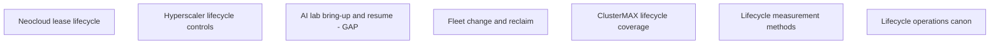

# Lifecycle certification research

Question: Which lifecycle faults can rack-bench measure during a two-hour tenant certification window?
Research date: 2026-10-11.

Audience: GB300-class rack operators and GPU tenants in Chennai, India.
Expected answer: seven evidence briefs and a measured bench design with explicit limits.
Scope: contract signature, first useful GPU-hour, lease changes, reclaim, and offboarding.
Exclusions: project changes, live destructive tests, and repeat internet or storage research.
Sources: provider documentation, standards, test methods, fleet papers, and operations books.

The seven nodes use independent sources. No node needs another node's result.
The bench design uses all seven results. N03 and N07 include replacement briefs from a second evidence pass.
N07 closes its book-citation gap. N03 keeps a bounded gap for MosaicML's numeric spot-use fraction.

| Node | Question | Dependencies | Acceptance condition | Child | State |
| --- | --- | --- | --- | --- | --- |
| N01 | What lifecycle controls and gaps do neoclouds publish? | None | Sourced provider matrix; product limits; bounded missing evidence | neoclouds | done |
| N02 | What lifecycle controls and deletion rules do hyperscalers publish? | None | AWS/Azure/GCP controls; current NIST; safe test limits | hyperscalers | done |
| N03 | What bring-up and resume faults do named AI labs show? | None | Named-lab mechanisms accepted; numeric MosaicML spot fraction remains unverified | ai-labs-g2 | gap |
| N04 | How do large fleets control change and reclaim? | None | Sourced change, drift, drain, and reclaim mechanisms | large-companies | done |
| N05 | What does ClusterMAX measure in Lifecycle? | None | Current criteria; measured methods; bounded published omissions | clustermax | done |
| N06 | Which research methods support lifecycle measurements? | None | Scheduler mechanisms; failure methods; two-hour statistical limits | academia | done |
| N07 | Which books best support lifecycle operations? | None | Ranked editions/chapters, 3–5 techniques per book, and explicit spine | books-g2 | done |

[Bench design](docs/lifecycle-bench-research.md) gives failure modes, suite tables, tickets, and the reading list.
[Handoff](ORCHESTRATOR-REPORT.md) gives category verdicts, artifact paths, and limits.
[Evidence checks](evidence-checks.md) shows the orchestrator's decisive source checks.

[O’Reilly source report](oreilly/research.md) adds eleven independent source nodes and bounded lessons.
[O’Reilly aggregate](oreilly.md) records edition, chapter, and canon decisions.
`nodes/` indexes accepted evidence. Category files keep the complete returned briefs.

No live rack test runs during this research. No source statement produces a measured PASS.

## N01: Measure the lease transaction

Question: What lifecycle controls and gaps do neoclouds publish?
This node separates a usable resource from a successful API response.
A lifecycle transaction records resource states in sequence.

Providers describe different stop, start, and data-persistence rules.
[Nebius](https://docs.nebius.com/compute/virtual-machines/preemptible) gives 60 seconds before preemption stop.
Attached volumes persist. Local SSD data does not.
[Runpod](https://docs.runpod.io/pods/manage-pods) warns that restart can return zero GPUs.
These rules require GPU enumeration after each change.

[CoreWeave Spot](https://docs.coreweave.com/platform/capacity-plans/spot-node-pools) excludes GB300 Superchip instances.
Its seven-minute maximum starts at warning. Drain starts after two minutes.
Do not use this maximum as a guaranteed application checkpoint budget.
Do not use this policy as proof of spot support for this rack.

Example: time a test request until a correct GPU operation completes.
Record rejected requests, retries, and pending requests, not only completed launches.
A small export and termination drill can test tenant-visible offboarding.
It cannot prove physical-media sanitization or future bill accuracy.

The reviewed sources do not give comparable provisioning distributions or per-tenant wipe attestations.
This is a bounded source gap, not proof of market-wide absence.
The bench design uses these distinctions with N02's deletion limits.
Full evidence: [neoclouds brief](neoclouds.md), sections 2–5; [node record](nodes/N01.md).

## N02: Keep deletion and sanitization separate

Question: What lifecycle controls and deletion rules do hyperscalers publish?
This node keeps compute-state results separate from data-wipe results.

AWS Capacity Blocks, Azure Spot, and GCP DWS expose different lifecycle controls.
The exact product, SKU, region, and configuration determine feature support.
[GCP Spot](https://docs.cloud.google.com/compute/docs/instances/spot) excludes A4X and bare-metal instances.
Its default pre-notice is zero. Its shutdown period is best effort, up to 30 seconds.
Do not transfer a generic VM policy to an NVL72 rack.

[NIST SP 800-88 Rev. 2](https://csrc.nist.gov/pubs/sp/800/88/r2/final) supersedes Rev. 1.
The [FAQ](https://csrc.nist.gov/files/pubs/sp/800/88/r2/final/docs/sp800-88r2-faq.pdf) separates verification from validation.
Verification checks successful technique completion. Validation accepts the result against data sensitivity and residual risk.
Cryptographic erase needs valid encryption boundaries and traceable key zeroization.

The FAQ includes cloud and logical storage, not only retired physical disks.

Example: terminate a disposable VM and inventory its remaining disks and snapshots.
Failed tenant readback shows access denial within the tested scope.
It does not show backup expiry, key zeroization, or media destruction.

[Google's deletion description](https://docs.cloud.google.com/docs/security/deletion) shows a much longer deletion pipeline.
That source states May 2024 status and cites Rev. 1.
Do not treat an older provider description as proof of Rev. 2 adoption.

The bench design keeps live results separate from sanitization evidence review.
Full evidence: [hyperscalers brief](hyperscalers.md), sections 2–5; [node record](nodes/N02.md).

## N03: Check named-lab mechanisms and restored state

Question: What bring-up and resume faults do named AI labs show?
This node separates node registration, useful work, and correct training continuation.

[OpenAI](https://openai.com/index/scaling-kubernetes-to-7500-nodes/) blocks normal scheduling until GPU preflight tests pass.
Its MPI jobs halt when one participating pod dies.
[EleutherAI GPT-NeoX](https://github.com/EleutherAI/gpt-neox) gives isolated setup, container paths, and multi-node launch instructions.
Its historical dependency ranges do not prove current deployed pins. Record the resolved environment.
These primary passages close the setup-evidence gap for EleutherAI.

[Hugging Face](https://huggingface.co/docs/accelerate/en/usage_guides/checkpoint) names model, optimizer, RNG, and scaler state.
Handle mid-epoch data position explicitly. Weights alone do not show training continuation.
[Composer](https://docs.mosaicml.com/projects/composer/en/stable/notes/resumption.html) uses run identity and checkpoint paths for autoresume.
[MosaicML](https://www.mosaicml.com/blog/mosaicml-streamingdataset) reports continuation across 8, 32, and 128 GPUs.
Matching loss curves within numerical limits do not prove correct resume for every application.

[Meta](https://engineering.fb.com/2025/07/22/data-infrastructure/how-meta-keeps-its-ai-hardware-reliable/)
describes fault isolation, node quarantine, and continuation from a checkpoint.
[DeepSeek-V3](https://arxiv.org/html/2412.19437v1#S3) describes H800 infrastructure, not a tested interruption runbook.
[Anthropic](https://www.anthropic.com/news/improving-alignment-security-efforts) describes rollback and environment recertification after training defects.
These accounts do not establish GB300 thresholds or general state-restoration guarantees.

Example: save a complete fixture checkpoint, stop its process, and continue the next optimizer step.
Compare progress, optimizer, data position, and RNG state against a declared control.
Reject an incomplete checkpoint copy. State the numerical equivalence level.
Keep process simulation separate from actual provider events.

Keep verified cold and warm cache conditions separate. Reserve the final 20 minutes for cleanup.

Gap: the reviewed MosaicML sources do not establish a numeric spot-use fraction.
The numerator, denominator, and measurement period remain unknown.
This gap limits quantitative spot-use conclusions, not the accepted named-lab mechanisms.
The bench design uses those mechanisms with N06's measurement limits.
Full evidence: [AI labs brief](ai-labs.md), sections 1–7 and Gaps; [node record](nodes/N03.md).

## N04: Compare intended and actual fleet state

Question: How do large fleets control change and reclaim?
This node distinguishes requested configuration, applied configuration, and useful readiness.

Fleet systems use staged changes, bounded disruption, health checks, and rollback.
The briefs describe Twine, Facebook configuration management, Borg, and Azure Fleet Manager.
Their historical papers do not show current controls on this Chennai rack.

[Azure rollout documentation](https://learn.microsoft.com/en-us/azure/kubernetes-fleet/concepts-rollout-strategy)
separates resource application from readiness.
The same page lists conflicting readiness-delay defaults: 10 seconds and 60 seconds.
Read the live policy. Do not select one value without evidence.
A rollout status does not replace a functional GPU check.

Example: compare all accessible tray manifests before and after a disposable job-level change.
Record image, driver, firmware, topology, expected heterogeneity, and missing observations.
Rollback must restore actual state. A desired-state record alone is not enough.
One rack cannot show fleet-wide drift absence or rollout safety.

Task reclaim, machine reuse, and media sanitization are separate operations.
[Microsoft](https://learn.microsoft.com/en-us/compliance/assurance/assurance-data-bearing-device-destruction)
describes device-disposal records and chain of custody.
Those published controls are not per-asset proof for this rack.
The bench design uses N02's sanitization boundary and N06's sample limits.
Full evidence: [large companies brief](large-companies.md), sections 2–8; [node record](nodes/N04.md).

## N05: Use ClusterMAX methods without false equivalence

Question: What does ClusterMAX measure in Lifecycle?
This node gives the nearest public comparison and defines its evidence boundary.

The current [Lifecycle page](https://www.clustermax.ai/criteria/lifecycle) lists 15 Key Requirements.
The list mixes onboarding, documentation, commercial terms, configuration, and audit-log controls.
Its five audit-log requirements include API queries, export, and 90-day retention.
A short live event check cannot prove retention across 90 days.

The [3.0 method](https://newsletter.semianalysis.com/p/clustermax-30-the-industry-standard)
times fresh-cache installs, per-tier imports, and serving readiness.
It also describes pod churn, PVC cycles, and reboot recovery in reliability testing.
Reboot recovery requires a changed boot ID and fresh-pod GPU access.
The public audit does not show the internal performance/reliability harness.

Example: run a bounded PVC cycle with teardown timing and verified readback.
Readback extends the published description. The public text does not specify this check.
Do not claim equivalent coverage to its multi-day allocations and eight-hour burn-in.
Do not reboot the whole rack merely because another evaluator describes that method.

The published method lacks a uniform contract-to-useful-work clock and wipe-verification protocol.
Provider provisioning anecdotes exist. They are not a common provisioning benchmark.
Keep private testing unknown; do not claim that SemiAnalysis never performs it.
The bench design adds explicit tenant transaction and offboarding evidence.
Full evidence: [ClusterMAX brief](clustermax.md), sections 2–6; [node record](nodes/N05.md).

## N06: Report observations, not unsupported fleet statistics

Question: Which research methods support lifecycle measurements?
This node defines event clocks, sample units, and limits on observations.

[Borg: The Next Generation](https://research.google/pubs/borg-the-next-generation)
compares eight May 2019 clusters with an older trace.
Its findings show workload dependencies and between-cluster differences.
Historical job-failure rates do not predict this rack's hardware reliability.

[Schroeder and Gibson](https://www.cs.toronto.edu/~bianca/papers/dsn06.pdf)
use long failure records and find variable repair times and failure distributions.
Their records describe failures handled by administrators, not every error-log line.
Keep fault onset, detection, ticket time, and restoration separate.
Count incidents and affected GPUs separately when one shared fault affects many devices.

Example: retain a request still pending at the two-hour cutoff as a censored observation.
A missed operational deadline can still be a measured failure.
Censoring must not erase that failure or invent a completion time.

Calculation: ten independent trials have about 9.6% probability of containing a slowest-1% sample.
Three hundred have about 95.1%, from `1 - 0.99^n`.
Even that probability does not give a precise p99 estimate.
One rack's requests can share caches, queues, and common failure causes.
Two hours cannot establish provisioning p99, fleet MTBF, or lease-wide availability.

The bench design shows per-attempt durations, exposure, sample counts, and explicit limits.
Full evidence: [academia brief](academia.md), sections 2–7; [node record](nodes/N06.md).

## N07: Use a verified operations spine

Question: Which books best support lifecycle operations?
This node selects process guidance. It does not set GPU certification thresholds.
The recommended spine is Workbook, Practice, then Building Secure and Reliable Systems.

The [Workbook contents](https://sre.google/workbook/table-of-contents/) verify objectives, canaries, and lifecycle ownership chapters.
Its [chapter 18](https://sre.google/workbook/engagement-model/) includes readiness, deprecation, shutdown, and removal of references.
Use these controls to name each transition, owner, and measured outcome.

The [Practice publisher preview](https://api.pageplace.de/preview/DT0400.9780133415070_A28528899/preview-9780133415070_A28528899.pdf)
verifies third-edition launch, maintenance, datacenter lifecycle, and decommissioning headings.
Chapter 26 is Running a Datacenter. Chapter 34 is Maintenance Windows.
Sections 7.6.2–7.6.3 separate decommissioning and data security.

The preview shows copyright 2017. The [author](https://everythingsysadmin.com/books.html) shows a November 2016 availability announcement.
Headings show scope. They do not prove every detailed procedure in the full text.

[Building Secure and Reliable Systems](https://google.github.io/building-secure-and-reliable-systems/raw/toc.html)
places Data Sanitization within chapter 18. It checks recovery integrity. It does not check physical-media erasure.
Chapter 9 includes explicit revocation and intended-state checks.
Example: revoke a disposable credential, then test fresh authentication and an existing session separately.

The [SRE first edition](https://sre.google/sre-book/table-of-contents/) adds inspected reliability and launch guidance.
The [second-edition contents](https://learning.oreilly.com/library/view/-/9798341607675/?orm_source=mcp)
verify September 2026, Capacity Planning, and How SRE Supports AI.
Add this edition separately. Keep first-edition chapter numbers with first-edition passages.
Contents show subject coverage. They do not prove full chapter procedures or GB300 acceptance thresholds.

Use Kubernetes reading only when the tenant interface uses Kubernetes.
Manning verifies Kubernetes in Action's [rollout](https://livebook.manning.com/book/kubernetes-in-action/chapter-9),
[controller events](https://livebook.manning.com/book/kubernetes-in-action/chapter-11), and [scaling](https://livebook.manning.com/book/kubernetes-in-action/chapter-15) sections.
This first-edition text replaces the unverified Kubernetes: Up and Running chapter list.
Use [current drain documentation](https://kubernetes.io/docs/tasks/administer-cluster/safely-drain-node/) for actual operational semantics.

The canon adds edition-specific evidence and optional facility/controller supplements.
The [eleven-source review](oreilly/research.md) keeps four material source gaps explicit.
Check separate evidence for full chapter procedures, current GB300 plugin behavior, and OEM maintenance.

NIST Rev. 2 remains a separate standard. Logical deletion does not prove sanitization.
The bench reading list keeps these limits.
Full evidence: [books brief](books.md), sections 1–5 and Gaps; [node record](nodes/N07.md).
