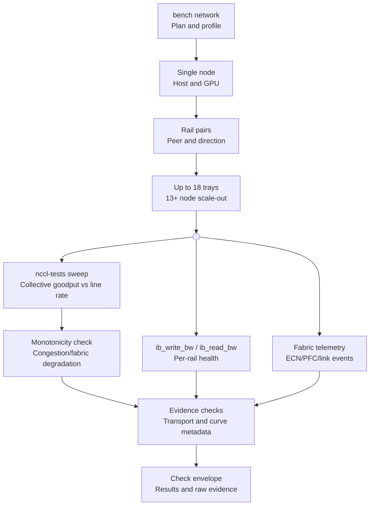

# GPU rack fabric briefing

## Purpose

Our customers use AI compute for distributed training.
Slow GPU communication makes those training runs longer.
We check the rack network before your compute purchase.
You keep a report with measured results and clear limits.

## Part A — What we test

Use `bench network` as a proposed stage of the rack-bench tool.
The identifiers below show a proposed design, not existing rack-bench commands.
The tables show design recommendations, not measured results from the Chennai rack.
Target: GB300 NVL72-class rack, 18 trays, Chennai, India.
Window: two hours for network checks, including setup and report creation.

Scope: east-west fabric. This fabric sends data between GPU hosts. This report
keeps north-south internet and storage checks out of scope. GB300 uses
NCCL. RCCL evidence shows comparisons from AMD systems only.

Use measurements from the target rack for PASS. Do not use provider
ratings, advertised rates, or configuration flags as PASS evidence. A
preflight PASS does not show success for every future job.

No researcher runs the target rack. No researcher makes measurements of
its present fabric. Public sources show no evidence for the Chennai rack's
exact transport, topology, or acceptance thresholds. A local trial must
check the two-hour budget. The report therefore shows a test design, not a
rack certification.

Use this proposed architecture to put measured evidence in the Check envelope.

Check repeated curve regressions and algorithm/protocol metadata before a congestion or fabric-degradation conclusion.

The proposed suite checks these items:

- Transport: the path that a collective uses. Options: RDMA, NVLink, or a
  TCP fallback. RDMA: direct memory access across the network. NVLink: the
  GPU link inside the rack.
- Collectives: AllReduce, AllGather, and AlltoAll, across a message-size
  sweep. Collective: one operation that all ranks run together. Rank: one
  process, usually on one GPU.
- Rails: expected ports, link rates, and physical planes.
  Rail: one logical communication path. Plane: one physical set of switches and cables.
- Per-rail RDMA write and read speed in both directions. Latency: the delay
  of one small message.
- Concurrent rails: the speed of all rails together against the isolated
  sum.
- Sampled tray pairs: the speed between selected trays, and rank placement.
- Launchers: MPI and PyTorch. Launcher: the program that starts each rank.
- Loaded latency: the delay under load against the idle delay.
- Counters: byte, error, pause, ECN, CNP, and retry changes. ECN: a
  congestion mark on a packet. CNP: a congestion message back to the
  sender.
- SHARP, optional: reduction work inside the switch. We run it only as a
  separate comparison.
- Cleanup and a post-test canary. Canary: a small fresh test after the main
  load.

Other terms in this briefing:

- HCA: a host channel adapter, the RDMA network card.
- QP: a queue pair, the work queues for an RDMA endpoint.
- Endpoint: a host at either end of a test path.
- GID: an RDMA address entry for a port.
- ECMP: equal-cost multipath. The switch uses several paths for different flows.
- PFC: priority flow control, pause messages for selected Ethernet priorities.
- `algbw` and `busbw`: two NCCL-tests bandwidth figures. `busbw` uses a
  model, not a NIC byte counter.
- MNNVL: multi-node NVLink within a shared NVLink domain.
- NVLink domain: the GPU group that uses NVLink for communication.
- EFA: AWS's fabric adapter for GPU communication. Libfabric: the software layer that EFA uses.
- perftest: a set of RDMA speed tools, such as `ib_write_bw`.
- Scale-up: GPU traffic inside the NVLink domain.
  Scale-out: GPU traffic between separate GPU groups.
- Check envelope: the record that keeps each check's results and raw evidence.
- NCCL: NVIDIA's GPU collective communication library. RCCL: AMD's GPU collective communication library.
- NIC: network interface card. PCIe: the device-to-host data path inside a server.
- GDR: direct RDMA access to GPU memory. RC: reliable-connected RDMA transport.
- MPI: an interface for communication between processes. PyTorch: software for GPU training and process launch.
- SKU: a provider hardware-configuration name.
- TCPX, TCPXO, and gIB: Google's GPU communication plugins.
- PF: a physical NIC function. VF: a virtual NIC function. vPort: a virtual-port counter layer.
- UCX and NIXL: communication software paths that use separate workload checks.
- Sysfs ABI: Linux's counter-interface specification. PMA: InfiniBand performance-management counters.
- Saturation: a counter at its maximum value. Wrap: a counter starts again after its maximum value.
- S: payload bytes. t: elapsed time. n: rank count.
- Certification profile: the measured baseline, topology, and acceptance rules for the target rack.

### How we measure

Put the test boundary on record first: scale-up, scale-out, or mixed.
Put expected trays, GPUs, HCAs, ports, link rates, rails, and physical planes on record.
Put the actual tested endpoints and rank count on record.
Do not use an 18-tray sample as a complete directed-pair matrix.
An 18-tray matrix makes 306 directed tray pairs: `18 × 17` [calculated].
A representative sample does not show evidence for all 306 paths.

Use decimal GB/s and Gb/s explicitly. Keep GiB payload sizes separate.
For point-to-point tests, put payload throughput and the matching directional capacity in the report.
Do not make a ratio of one rail's result and all rails' advertised capacity.
Keep send, receive, and bidirectional totals separate.
Do not put duplex totals in a unidirectional denominator.

For collectives, keep elapsed time, `algbw`, and `busbw`.
NCCL-tests shows `algbw = S/t` for the operation's tested payload.
For AllReduce, NCCL-tests uses the correction factor `2(n−1)/n`.
Each rank sends `2S(n−1)/n` bytes across both ring phases under the ring model.
The ring model shows the same receive volume for each rank.
For AllGather and AlltoAll, use the documented operation-specific factor `(n−1)/n`.

Check the pinned NCCL-tests version and payload definition before calculation (academia §2–3; books §3).
`busbw` uses a model-based normalization, not a NIC byte counter.
Check network-only results against the topology's realizable capacity and measured counter changes.
Keep mixed NVLink/network results out of a simple NIC line-rate percentage.

Put acceptance thresholds in a versioned certification profile.
Use a matched, measured known-good baseline and the target topology.
Put the allowable variation, message-size regime, rank count, and minimum sample count in it.
Do not use universal 60%, 98%, monotonicity, or SHARP-gain rules (academia §7; neoclouds §5).
Curve dips start investigation. They do not automatically show misconfiguration.

Put sample count, warm-up, duration, median, and variation in the report for repeated points.
Keep within-run samples separate from between-run variation.
Do not put p95 or p99 in the report from NCCL aggregate timing alone.
Do not make rare-event reliability claims from a small sample (academia §7).

Linux shows `port_xmit_data` and `port_rcv_data` in four-octet units.
Its sysfs ABI shows these data counters as 64-bit fields.
Base PMA PortCounters uses a different format from optional extended counters (books §3).
The base specification uses saturation, not assumed modulo rollover.
Check the actual exported counter before a change calculation.
Source: [Linux InfiniBand sysfs ABI](https://www.kernel.org/doc/Documentation/ABI/stable/sysfs-class-infiniband).

### Proposed stages and two-hour budget

This budget shows an engineering estimate, not a measured GB300 schedule.
Check it on the target rack before a two-hour product promise.
Do not run competing phases concurrently unless the phase specifically checks contention.

| Minutes | Phase | Required evidence | Source basis |
| --- | --- | --- | --- |
| 0–10 | Inventory and initial counters | Topology, versions, expected rails, active rates, timestamps, reset state | books §4–6; hyperscalers §5 |
| 10–15 | Transport and QP canaries | Fresh QP, GPU-memory support, actual plugin/provider, rank placement | hyperscalers §2–5; neoclouds §2 |
| 15–35 | Isolated rails | RDMA write/read, both directions, small-message latency, selected sizes | academia §4, §6; clustermax §2.3 |
| 35–45 | Concurrent rails and sampled pairs | Aggregate result, per-rail changes, placement coverage | academia §3; large-companies §4 |
| 45–80 | NCCL sweeps | AllReduce/AllGather/AlltoAll, geometric 8 B–16 GB range, raw logs | clustermax §2.1; academia §3 |
| 80–90 | Launcher and scaling checks | PyTorch canary; representative size/rank points; MPI comparison | ai-labs §2–4; clustermax §2.1, §2.3 |
| 90–100 | Short loaded-latency phase | Latency inflation, throughput change, counters, GPU/CPU state | large-companies §4–5; academia §5–6 |
| 100–110 | Suspect-point repeat or optional SHARP comparison | Repeated evidence; verified feature use; same placement and payload | academia §7; neoclouds §3.2 |
| 110–115 | Cleanup and post-test canaries | Successful exit, fresh connection/collective, final counters | clustermax §3 |
| 115–120 | Certificate | Coverage, results, evidence links, uncertainty, explicit misses | academia §7 |

The budget does not make room for two full sweeps through both launchers.
Run the complete NCCL sweep through the primary production launcher first.
Use matched representative points through the second launcher.
Put that coverage limit in the report. Do not make a claim of identical full coverage.

A 16 GB point can use more memory than its nominal payload.
Check operation buffers, rank count, available GPU memory, and timeouts before launch.
If resources run short for a point, put SKIP and its reason in the report.

### Proposed checks and results

The identifiers below show proposed implementation identifiers.
They do not show existing rack-bench commands.

| Proposed check | Metric | Acceptance evidence | Limit or SKIP condition |
| --- | --- | --- | --- |
| `network.transport` | Plugin/provider, HCA/port, traffic changes | Logs and counters show the intended path | No path proof: no scale-out PASS |
| `network.rail.inventory` | Expected/active ports and rates | The measured inventory shows a match with the profile | Missing physical topology puts a limit on diagnosis |
| `network.rail.rdma` | Write/read GB/s; latency; errors | Every required rail shows a match with its matched profile | Unsupported GPU-memory backend: separate host result |
| `network.rail.aggregate` | Concurrent GB/s versus isolated sum | The measured aggregate shows a match with the topology-aware profile | The report must show shared endpoint resources |
| `network.pair.sample` | Directional matrix and placement | All declared sample pairs show a match with the profile | Do not make coverage claims for untested pairs |
| `network.collective.sweep` | Time, algbw, busbw, correctness | Each required operation/size shows a match with the profile | A missing size or operation makes an explicit coverage limit necessary |
| `network.collective.scale` | Throughput/time by rank count | The certificate shows the measured ranks and topology | No cross-rack peers: no wider scale-out claim |
| `network.launcher` | MPI/PyTorch completion and timing | Actual launch paths run to completion at declared sizes | Canary coverage does not make a second full sweep |
| `network.loaded_latency` | Idle/load latency and throughput change | Profile-specific limits with counter evidence | No switch access puts a limit on causal conclusions |
| `network.counters` | Byte/error/pause/ECN/CNP/retry changes | Valid interval, units, widths, reset checks | Missing telemetry shows an unknown value, not zero |
| `network.sharp` | Selected offload and matched on/off result | Actual selection plus measured comparison | Unsupported or unsafe: SKIP. Keep the baseline separate. |
| `network.post_canary` | Cleanup and fresh operation | A new QP and a collective run to completion after load | A failure removes the healthy-completion claim |

Use PASS only for complete, measured acceptance evidence.
Use FAIL for a measured violation of the declared profile.
Use SKIP for an unavailable or unsupported check.
Use INCONCLUSIVE when the measurements do not show the required result.

Put these proposed states into the project's supported report schema during implementation.
Do not silently use SKIP or INCONCLUSIVE as PASS.
A missing optional switch check does not remove a measured-throughput PASS.
It must still put a limit on the certificate's root-cause and configuration claims.

### Provider and version adapters

| Environment | Required distinction | Recommended adapter behavior | Evidence |
| --- | --- | --- | --- |
| Local RoCE/InfiniBand | Verbs transport, HCA/GID/topology, GPU-memory path | Put exact versions on record. Use supported perftest options. Check logs and counters | books §3–6; hyperscalers §5 |
| AWS EFA | `aws-ofi-nccl` plus Libfabric EFA | Check `fi_info -p efa -t FI_EP_RDM`. Use the documented EFA launch recipe | hyperscalers §2 |
| Azure ND family | SKU-specific IB/GDR and rail layout | Use the exact SKU recipe. Do not use H100 settings without checks | hyperscalers §3 |
| Google A3/A4X family | SKU-specific TCPX/TCPXO versus RDMA/gIB; NVLink subblock boundary | Check the SKU/plugin and the PF/VF counter layer. Keep network-tier settings separate | hyperscalers §11, §14 |
| UCX/NIXL workload | A different software path from NCCL | Put workload-specific UCX verification in the adapter when required | neoclouds §2.2 |

Do not put one provider's environment variables into every target.
EFA-capable perftest modes do not make conventional RC-verbs commands a valid EFA recipe.
Keep current NCCL GID guidance separate from provider-specific forced-GID recipes.
A network-tier flag does not show RDMA selection.

Google shows a warning about MRDMA VF `_phy` counters.
The output shows these counters.
Their values show no movement.
Use the documented vPort counters for those VFs.
A4X Max uses PFs and shows physical counters (hyperscalers §14).

Check counter movement during the test.
A static value does not show zero traffic.
Keep document versions and command provenance in each adapter.

### Why we test this

Our customers use GPU time for distributed training.
A slow fabric can make distributed GPU jobs slower. A healthy port does not show a healthy collective
path. Each test family below starts from one customer concern. Each family
uses a sourced case from our category briefs.

Research date: 2026-10-11.

This document uses seven category briefs:
[neoclouds](../neoclouds.md), [hyperscalers](../hyperscalers.md),
[ai-labs](../ai-labs.md), [large-companies](../large-companies.md),
[clustermax](../clustermax.md), [academia](../academia.md), and [books](../books.md).
Each brief shows primary sources. Each brief keeps observations, calculations, and inferences separate.

Some cases show an observed failure. Other cases show a public recipe or a
documented effect. A public recipe shows a method, not a failure. We do not
use any case below as a fault rate for one provider.

Public provider material shows useful configuration and test recipes.
It does not show a matched GB300 baseline for the Chennai rack (neoclouds §5–6).
ClusterMAX shows private performance tests, not public `cmax` performance commands (clustermax §1, §4).
The project must make its own repeatable evidence path.

Each entry shows the evidence, 2h coverage, and catching check.
Use “Yes” when the check can show a present fault. The check does not show the absence of other faults.
Use “Partial” when the certificate must show the missing evidence.

#### 1. A fast port does not show a healthy connection

Customer concern: the rack shows a fast speed test. A later job then shows a
hang.

Observed case, from a ClusterMAX audit:
ClusterMAX shows an Oracle MI355X case with 391 Gb/s on all eight rails.
The case then shows an RDMA teardown failure.
The ports still show ACTIVE at 400 Gb/s.
Peak throughput therefore does not show teardown health.
A post-test connection check shows that evidence (clustermax §3).

- **RDMA teardown or reconnect failure** — two-hour coverage: Yes.
  - Evidence: Oracle's teardown failure runs after its peak-rate result (clustermax §3).
  - Check process exit, cleanup completion, and a fresh post-test RDMA/collective canary.
- **Missing or downshifted rail** — two-hour coverage: Yes.
  - Evidence: Link inventory alone does not show degraded data paths (clustermax §2.3, §3; books §4).
  - Check expected ports, negotiated rates, QP creation, and isolated-rail throughput.
- **Short peak mistaken for stable capacity** — two-hour coverage: Partial.
  - Evidence: Few samples do not show intermittent faults and variability (academia §7; clustermax §2.4).
  - Use warm-up, timed repeats, sample counts, and a short sustained phase.

#### 2. A job can run on the wrong path

Customer concern: a collective runs to completion, but not on the RDMA
network.

Public design case, from Google:
A successful collective also does not show RDMA use.
Google shows an A4X Max/GB300 subblock with 18 instances and 72 GPUs on NVLink.
Different subblocks use its RoCE network (hyperscalers §14).
NVL72/MNNVL traffic can use NVLink across trays inside the scale-up domain.
NCCL `busbw` can show NVLink, PCIe, or network limits.

Keep the actual transport selection and traffic-counter changes (ai-labs §6; neoclouds §4.2; academia §3).
Use a cross-rack peer when the scale-up domain makes a valid RDMA test impossible.
Without that peer, put the scale-out limit in the report explicitly.

Observed case, from a ClusterMAX audit: the GID and plugin entry below.

- **Wrong transport or TCP fallback** — two-hour coverage: Yes.
  - Evidence: NCCL can use an unintended path. EFA uses Libfabric, not ordinary `NET/IB` (hyperscalers §2–5).
  - Keep plugin/provider logs. Check traffic counters during the test.
- **NVLink mistaken for scale-out RDMA** — two-hour coverage: Partial.
  - Evidence: Same-rack NVL72 traffic can run inside the NVLink domain (ai-labs §6; neoclouds §4.2).
  - Use verified network isolation or a cross-rack peer. Keep production-layout results separate.
- **Wrong GID, HCA, topology file, or plugin** — two-hour coverage: Yes.
  - Evidence: ClusterMAX shows GID/plugin faults. Crusoe shows topology-specific configuration (clustermax §2.2; neoclouds §2.4).
  - Keep versions and configuration. Run a fresh QP canary before each test group.
- **Software drift or launch-path failure** — two-hour coverage: Yes.
  - Evidence: MPI and PyTorch use different launch paths (clustermax §2.1; hyperscalers §2–4).
  - Keep exact commands, versions, environment, rankfiles, and both launcher canaries.
- **SHARP feature mistaken for raw fabric health** — two-hour coverage: Partial.
  - Evidence: SHARP puts reduction work in the switch. Feature support does not show actual use (neoclouds §3.2; large-companies §4).
  - Keep baseline and SHARP results separate. Check the selection before a comparison of identical runs.
- **Rail/plane naming mistaken for path independence** — two-hour coverage: Partial.
  - Evidence: Logical HCA rails and physical planes show different topology levels (ai-labs §1, §6; neoclouds §4.2).
  - Use the physical topology map. Names do not show independent failure domains.

#### 3. A good average can keep one slow path out of view

Customer concern: total bandwidth shows a good value. One rail or path runs
slow.

Observed case, from Meta production RoCE:
Meta shows ECMP flow collisions in production training.
Partial rack allocation shows uneven uplink use and a >30% training degradation.
These cases show the Meta fabric, not a provider.
The ECMP entry below uses these cases.

- **One slow rail hidden by aggregation** — two-hour coverage: Yes.
  - Evidence: Aggregate bandwidth can keep unequal paths hidden (academia §3; neoclouds §3–4).
  - Put each rail's result on record before the concurrent-rail result.
- **Low ECMP entropy or bad placement** — two-hour coverage: Partial.
  - Evidence: Meta shows flow collisions and placement penalties (large-companies §2, §4).
  - Use different endpoint/rank placements and QP settings. Send a request for route and switch evidence.
- **Shared uplink, PCIe, or GPU feed limit** — two-hour coverage: Yes.
  - Evidence: Do not use healthy isolated-rail results as validation for concurrent rails (academia §3, §6).
  - Check concurrent throughput against the sum of isolated results. Check GPU/NIC locality and host load.
- **Directional or RDMA read/write asymmetry** — two-hour coverage: Yes.
  - Evidence: Operation roles and GPU-memory paths show asymmetry (academia §6; books §3).
  - Use matched parameters and swapped endpoints. Check host-memory tests against GPU-memory tests.
- **Collective-specific congestion** — two-hour coverage: Yes.
  - Evidence: AlltoAll uses a different traffic pattern from AllReduce (academia §3; ai-labs §2).
  - Run AllReduce, AllGather, and AlltoAll separately. Keep operation-specific results.

#### 4. Load and link changes can start congestion

Customer concern: the fabric runs well at idle. It runs slow under real
load or after a link change.

Observed case, from Meta production RoCE:
Meta shows degraded DCQCN tuning at 400G.
A failed uplink starts ECMP reassignment.
The new flows show collisions with existing flows.
These cases show the Meta fabric, not a provider.
The queue and link-flap entries below use these cases.

- **Queue buildup, incast, or PFC propagation** — two-hour coverage: Partial.
  - Evidence: RoCE congestion mechanisms show workload and policy dependence (large-companies §2, §5; academia §2, §5).
  - Check idle latency against loaded latency. Keep ECN/CNP, pause, drop, and retry counter changes.
- **ECN/PFC configuration error** — two-hour coverage: Partial.
  - Evidence: Host counters can show symptoms. They do not show switch thresholds (large-companies §5; clustermax §5).
  - Send a request for switch configuration and time-correlated telemetry. Do not put a cause in the report without evidence.
- **Link flap, rerouting, or recovery failure** — two-hour coverage: Partial.
  - Evidence: Meta and NetPilot show traffic changes after failures (large-companies §2; academia §5).
  - Check event history and counter changes. Put approved fault injection in a separate test.

#### 5. A slow job does not always show a network fault

Customer concern: the report puts the blame for a slow rank on the network.

Documented effect, from PyTorch guidance:
One rank can show a long all-reduce.
That rank shows a long wait for a slower rank.
The late rank shows a short wait.
This guidance shows a public effect, not a provider failure.
The rank straggler entry below uses this guidance.

- **Rank straggler outside the network** — two-hour coverage: Partial.
  - Evidence: Compute, CPU progress, data loading, and GPU throttling can make collectives slow (ai-labs §3–4; academia §6).
  - Keep rank timing, GPU clocks, CPU load, and transport/counter evidence.
- **Algorithm/protocol transition mistaken for a fault** — two-hour coverage: Yes.
  - Evidence: NCCL can use different execution paths across message sizes (academia §3; clustermax §2.2).
  - Keep algorithm/protocol metadata. Run the transition points again before you make a failure verdict.
- **Stale counters or wrong units** — two-hour coverage: Yes.
  - Evidence: The sources show interpretation changes from counter width, saturation, wrap, reset, and data units (books §3; academia §7).
  - Keep timestamps, raw values, units, widths, and reset state. Check movement during traffic.

### What the tests assume

The tests use these preconditions. We check some of them on the host.
Use the others as questions in Part B. Your answers show the fabric today.

- A versioned certification profile keeps a matched, measured known-good
  baseline for the target topology.
- A physical topology map shows logical rails against physical planes.
- The tests use a cross-rack peer or verified network isolation. Without
  either, the report shows a scale-out limit.
- Each GPU keeps enough free memory for the largest sweep point. If not,
  the point shows SKIP and its reason.
- All runs use the same pinned NCCL-tests version and perftest release.
- Switch access and time-correlated telemetry show evidence for a
  root-cause claim. Without them, the report puts a limit on causal
  conclusions.
- Approved fault injection runs only in a separate test.

#### What two hours cannot certify

Two hours do not make ClusterMAX's eight-hour concurrent GPU/network endurance evidence (clustermax §2.4).
The window does not show fleet-scale behavior beyond the available endpoints (hyperscalers §6; clustermax §5).
The window does not show a long-term flap rate.
It does not make rare congestion events impossible (neoclouds §4.2; academia §7).
The window does not show switch ECN/PFC correctness without switch access (large-companies §5).
The window does not show job recovery without an approved failure test (clustermax §3, §5; academia §5).

The window does not show validation for every training workload or transport stack (neoclouds §2.2; ai-labs §3–4).
A NCCL result does not make UCX/NIXL evidence.
A GB300 result does not make AMD/RCCL evidence.

### Proposed build work: implementation tickets

These tickets show the evidence path. They do not make project file changes during research.

| Ticket | Change | Acceptance test | Priority |
| --- | --- | --- | --- |
| NET-01 | Make topology and transport evidence records | The report must not show an unqualified RDMA PASS for a mixed NVLink/network fixture | P0 |
| NET-02 | Make a bounded per-rail perftest runner | Every expected rail shows write/read, directions, timestamps, parameters, and exit status | P0 |
| NET-03 | Make a concurrent-rail and pair sampling planner | The report shows tested pairs and untested paths. The aggregate keeps per-rail results. | P0 |
| NET-04 | Make an NCCL sweep and normalization parser | Golden fixtures check collective formulas, units, rank counts, and correctness errors | P0 |
| NET-05 | Make versioned acceptance profiles | An unknown baseline or denominator makes an INCONCLUSIVE result, never a fabricated percentage | P0 |
| NET-06 | Make counter collectors and interval calculation | Fixtures check four-octet units, width, wrap, reset, missing counters, and timestamps | P0 |
| NET-07 | Make cleanup timeouts and post-test canaries | The healthy-completion gate must show a FAIL for a peak-rate run with failed teardown | P0 |
| NET-08 | Make provider/version launch adapters | Fixtures show the differences between EFA, Azure SKU rails, A3 plugins, and GID-version guidance | P1 |
| NET-09 | Make rank/host telemetry correlation | A compute-delayed rank does not automatically make a network root-cause claim | P1 |
| NET-10 | Make short loaded-latency and optional SHARP modes | Keep baseline, contention, and offload results separate | P1 |
| NET-11 | Make report coverage and artifact manifest | The certificate shows scope, ranks, ports, sizes, samples, skips, misses, and raw artifact hashes | P0 |
| NET-12 | Put endurance and approved failure tests in smoke | Two-hour bench reports do not make eight-hour or failure-recovery coverage claims | P1 |

### Proposed build work: README corrections

The current README shows design targets, not measured implementation evidence.
Check [network design, lines 327–337](../../../README.md#L327-L337).

Remove the universal 60%/98% RoCE comparison unless a matched source and denominator show evidence for it.
Put a repeated, metadata-aware regression check in place of strict monotonicity.
Keep NIC payload goodput separate from collective `busbw`.
Make the NVL72/MNNVL transport-proof requirement explicit.
Keep logical rails separate from physical planes.

The README shows ClusterMAX as the source of link-flap/node-kill fabric injection.
Its public methodology does not show support for that attribution (clustermax §3, §5).
Make corrections at [lines 504–506](../../../README.md#L504-L506).
Keep approved fabric fault tests as independent roadmap work.
The existing [smoke design, lines 478–493](../../../README.md#L478-L493) shows the longer-test boundary.

## Part B — Discovery questions

We send these questions to the operator and the tenant before the visit.
Your answers show the conditions behind each check.

### Topology

- How many trays and GPUs does the rack use?
- Which HCAs and ports does each tray use? Which link rates do they show?
- How many rails and physical planes does the fabric use?
- Can you send a physical cabling-to-device map?
- Which switch tiers send traffic between trays?

### Rail count and peers

- Do all expected rails show an active link at the profile rate?
- Can we use a cross-rack peer outside the scale-up domain?
- May we run one rail at a time before the concurrent run?
- May we keep a fixed rank placement for the sampled tray pairs?

### SHARP availability

- Do the switches run SHARP?
- Can SHARP run safely inside our window?
- May we run a matched comparison with SHARP off and on?

### Telemetry access

- May we check switch counters during the runs?
- Can you send time-correlated telemetry for our windows?
- Which counter units and widths do your switches use?
- When do your counters start again from zero?
- Can your NOC send link and route event history?

### Maintenance windows

- May we use a two-hour window with no other heavy jobs?
- May we run warm-up passes, timed repeats, and a short loaded phase?
- May we run cleanup and a post-test canary after the main sweep?
- May we run a separate, approved fault-injection test at a later date?

## Part C — The default configuration we look for

Use this setup for the strongest evidence.
Send us a note if your setup shows less for an item.
We run safe checks within the available scope.
The report shows each difference.

| Item | What we look for | If you have less |
| --- | --- | --- |
| Topology map | Physical map of trays, HCAs, ports, rates, rails, planes | Logical names only; diagnosis shows a limit |
| Rails | All expected rails active at the profile rate | A downshifted rail; the report shows it |
| Peers | A cross-rack peer outside the scale-up domain | No peer; the report shows a scale-out limit |
| Baseline | A matched, measured known-good baseline | An unknown baseline makes INCONCLUSIVE, never a percentage |
| Telemetry | Switch counters and time-correlated telemetry | No switch access; causal conclusions show a limit |
| SHARP | Safe use for a matched off/on comparison | Unsupported or unsafe; the check shows SKIP, and we keep the baseline |
| Window | Two quiet hours, setup and report included | Fewer runs; the report shows reduced coverage |
| Launchers | Both MPI and PyTorch paths on the hosts | One path; the report shows a coverage limit |
| Memory | Enough GPU memory for the largest sweep point | Short memory; the point shows SKIP and its reason |
| Scale | Endpoints for the full tray unit and sampled pairs | Fewer endpoints; no wider scale-out claim |

### What we bring

- We send the check design, the measurement rules, and the two-hour
  budget. The suite shows proposed build work, not an implemented command.
- We use this plan to run the checks ourselves.
  Your team uses the report without a person at each run.
- You keep the report. It shows coverage, results, evidence links,
  uncertainty, and explicit misses.
- Use two-hour results only for measured checks within their declared coverage.
  Endurance and approved fault tests run as separate roadmap work.

Thank you for the answers, the window, and the telemetry access.

## Reading list

- [NCCL-tests performance formulas](https://github.com/NVIDIA/nccl-tests/blob/master/doc/PERFORMANCE.md).
  Use this source for operation-specific bandwidth interpretation.
- [NVIDIA NCCL networking troubleshooting](https://docs.nvidia.com/deeplearning/nccl/user-guide/docs/troubleshooting/networking_troubleshooting.html).
  Use this source for NIC, RDMA, and GPU-memory path separation.
- [linux-rdma perftest](https://github.com/linux-rdma/perftest).
  Check the installed release and supported memory/transport options.
- [ClusterMAX 3.0 methodology](https://newsletter.semianalysis.com/p/clustermax-30-the-industry-standard).
  Keep public methodology separate from public audit code.
- [Meta production RoCE](https://engineering.fb.com/2024/08/05/data-center-engineering/roce-network-distributed-ai-training-at-scale/).
  Check the workload-specific routing and congestion account.
- [DCQCN paper](https://conferences.sigcomm.org/sigcomm/2015/pdf/papers/p523.pdf).
  Check the congestion mechanism, testbed assumptions, and RDMA operation details.
- [CoreWeave NCCL triage](https://docs.coreweave.com/support/sunk/articles/what-do-nccl-errors-mean).
  Use the measured-baseline method without assuming NVL72 multi-tray traffic always uses RDMA.
- [DeepSeek infrastructure](https://arxiv.org/html/2505.09343v1).
  Keep its V3/H800-era topology separate from the GB300 target.
- [PyTorch straggler mitigation](https://pytorch.org/blog/straggler-mitigation).
  Check host and compute causes before naming a network fault.
- [Books and reference canon](../books.md).
  Use current tool documents for commands. Use books for mechanisms and diagnosis.
- [Eleven-source O'Reilly supplement](../oreilly.md) and [source lessons](../oreilly/research.md).
  - Keep the operational reading spine unchanged.
  - Use Shanley for targeted native-InfiniBand architecture context.
  - Use Dutt selectively for Ethernet fabric architecture.
  - Keep dated Linux/TCP/IP sources conditional on a host/bootstrap question.
  - ISBN 020163354X shows TCP/IP Illustrated Volume 2, not Volume 1.
  - Do not put first-edition VandenBrink chapters in the second edition.
  - The [final retrieval retry](../oreilly/RETRY.md) checks four remaining source gaps.
  - Indexed evidence shows Dutt's selected chapter titles.
  - No source shows the complete primary TOC.
  - Prowse's public InformIT TOC uses a separate ISBN from the supplied O'Reilly course.
  - White's author announcement shows a January 26, 2023 session.
  - The supplied 2025 session attribution shows no verification.
  - VandenBrink 2e shows no verified TOC and no consistent publication dates.
  - Catalog and TOC evidence does not show RDMA/NCCL/ECN/PFC procedures or measured PASS.
