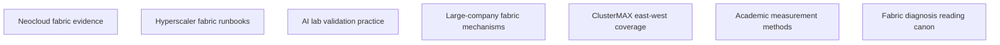

# East-west fabric research

Question: Which checks make an east-west fabric quality diagnosis within a two-hour GB300 rack certification window?

Research date: 2026-10-11.

Audience: rack-bench developers and datacenter operators in Chennai, India.
Target: GB300 NVL72-class rack with 18 trays.
Expected answer: seven evidence briefs, a failure-mode catalog, suite tables, and implementation tickets.
Scope: RDMA rails, NCCL collectives, topology, congestion, routing, failures, SHARP, scale, and telemetry.
Exclusions: north-south internet, storage design, project code changes, and live fabric tests.
Sources: primary technical documents, provider documents, papers, and exact local file evidence.

The map shows seven independent evidence branches.
Each branch starts without another branch's result.
The distilled report uses all seven branches.
A `done` state shows accepted research, not a certified fabric.
Each lesson shows its evidence limits.

| Node | Question | Dependencies | Acceptance condition | Child | State |
| --- | --- | --- | --- | --- | --- |
| N01 | What fabric evidence can neocloud tenants use? | None | Keep measurements, claims, configuration, and missing disclosure separate. | neoclouds | done |
| N02 | How do hyperscalers check GPU fabrics and make diagnoses? | None | Show versioned configuration, verification, and diagnosis evidence. | hyperscalers | done |
| N03 | How do AI labs check for communication failures at scale? | None | Put topology, collective patterns, overlap, and rank delays into the checks. | ai-labs | done |
| N04 | Which large-company mechanisms show fabric failures? | None | Keep production mechanisms, papers, and tenant-visible checks separate. | large-companies | done |
| N05 | What does current ClusterMAX check? What does it keep untested? | None | Check suite details. Keep public audit separate from private tests. | clustermax | done |
| N06 | Which academic methods show congestion and collective limits? | None | Show formulas, measurement controls, counter meaning, and limits. | academia | done |
| N07 | Which references make fabric diagnosis most reliable? | None | Put books and technical documents in rank order with tool-specific limits. | books | done |

## N01: Neocloud fabric evidence

What checks can a tenant run independently?
This question keeps provider capability claims separate from PASS evidence.
Use the term rail for a logical communication path. Use the term plane for physical topology.
Do not use one rail as evidence of one independent plane.

Nebius shows 400 Gb/s per GPU NIC and 3.2 Tb/s per eight-GPU VM.
These numbers show capability, not the Chennai rack's measured throughput.
CoreWeave shows NCCL recipes and a measured-baseline diagnosis method.
Crusoe shows topology files. Lambda shows fabric and link-health descriptions.
The reviewed pages show no comparable measured GB300 rail tables.

Run each rail separately. Then run all required rails at the same time.
Keep baseline collectives separate from SHARP tests.
SHARP puts reduction work into switches. Its presence alone shows no evidence of actual use.
A NCCL PASS alone shows no evidence for UCX/NIXL health.

NVL72 traffic can use NVLink across trays, not RDMA.
Check transport logs and traffic-counter changes. Or use a cross-rack peer.

Use N02 for transport-specific checks. Use N06 for bandwidth interpretation.
Gap: public evidence shows no target-rack thresholds or continuous flap rates.

Sources: [Nebius fabric](https://docs.nebius.com/compute/clusters/gpu),
[CoreWeave diagnosis](https://docs.coreweave.com/support/sunk/articles/what-do-nccl-errors-mean),
[full brief](neoclouds.md), [accepted node record](nodes/N01.md).

## N02: Hyperscaler fabric runbooks

Which transport does the benchmark actually use?
The answer shows which command, expected logs, and useful counters to use.
AWS EFA uses `aws-ofi-nccl` and the Libfabric EFA provider.
It does not use the ordinary NCCL verbs `NET/IB` path.
AWS shows `fi_info -p efa -t FI_EP_RDM` and provider-selection logs.
A successful launch alone shows no GPU-memory RDMA or balanced-rail evidence.

Azure ND H100 shows dedicated InfiniBand connections for its eight GPUs.
Google A3 High/Edge uses TCPX. A3 Mega uses TCPXO.
A3 Ultra uses RoCE/MRDMA with gIB.
These stacks use different check procedures.
Google's network-tier setting shows no RDMA selection evidence.

Google's GB300 A4X Max uses an 18-instance, 72-GPU NVLink subblock.
Different subblocks use RoCE. An intra-subblock collective can therefore run without RDMA.

Keep a record of the exact SKU, versions, topology, command, environment, and selected plugin.
NCCL 2.21+ normally uses dynamic RoCE GID selection.
ClusterMAX shows a provider-specific forced-GID workaround.
Keep that exception separate from the general default guidance.
Do not put index 3 on every RoCE fabric.

Use N07 for version-matched tool guidance.
Gap: public sources show no portable switch thresholds or complete HNDR diagnosis runbook.

Sources: [AWS EFA](https://docs.aws.amazon.com/AWSEC2/latest/UserGuide/efa-start-nccl.html),
[Google GPU networking](https://docs.cloud.google.com/compute/docs/gpus/gpu-network-bandwidth),
[NCCL networking](https://docs.nvidia.com/deeplearning/nccl/user-guide/docs/troubleshooting/networking_troubleshooting.html),
[full brief](hyperscalers.md), [accepted node record](nodes/N02.md).

## N03: AI lab validation practice

Does a slow collective show a network fault?
No. A late communication start on one rank keeps another rank waiting.
Use the term rank for one participating process in the collective.
Use the term straggler for a rank. That rank makes shared progress late.

PyTorch shows how late compute or data preparation makes another rank's synchronization time longer.
Keep a record of collective entry, exit, GPU state, and CPU progress.
Check these timestamps against rail throughput and counter changes.
Do not use synchronization time alone as evidence for a network cause.

Meta shows topology and routing effects on collective performance.
DeepSeek shows an eight-plane topology for V3's H800 infrastructure.
That topology shows no evidence for the GB300 rack's topology.

AllReduce, AllGather, and AlltoAll make different demands on the fabric.
Run each pattern across small and large payloads.
Keep standalone collective results separate from compute-overlap results.
Overlap can make communication time invisible or use compute resources.

Use N04 for congestion mechanisms. Use N06 for measurement controls.
Gap: public lab reports show no validated GB300 thresholds or tested two-hour schedule.

Sources: [PyTorch stragglers](https://pytorch.org/blog/straggler-mitigation),
[DeepSeek infrastructure](https://arxiv.org/html/2505.09343v1),
[full brief](ai-labs.md), [accepted node record](nodes/N03.md).

## N04: Large-company fabric mechanisms

Why can a collective run slowly with healthy links?
Flow placement, routing, queues, and congestion control make changes to shared path capacity.
ECMP puts flows on equal-cost paths.
Low flow entropy can put many flows on one path.
PFC puts selected Ethernet priorities on pause. ECN puts congestion marks on packets for transport response.

Meta shows ECMP collisions and placement-sensitive performance.
Host throughput can show a symptom but not its switch-side cause.
Send a request for time-correlated queue, route, pause, drop, and link-event evidence.
Without that evidence, keep the cause unconfirmed.
An ECN or CNP increase can show a working congestion response.
Do not make every pause or congestion mark a failure.

Use the term Swift for Google's delay-based congestion control.
Jupiter shows production network-engineering evidence.
Microsoft Sirius shows prototype and simulation evidence, not production proof.
Keep those evidence classes separate.
Use approved fault tests only outside the default non-destructive bench.

Use N05 for comparisons of published suite coverage. Use N07 for device-specific counter definitions.
Gap: the bounded search does not show the “self-serving fabric” seed title.

Sources: [Meta RoCE](https://engineering.fb.com/2024/08/05/data-center-engineering/roce-network-distributed-ai-training-at-scale/),
[Google Swift](https://research.google/pubs/swift-delay-is-simple-and-effective-for-congestion-control-in-the-datacenter),
[full brief](large-companies.md), [accepted node record](nodes/N04.md).

## N05: ClusterMAX east-west coverage

Which ClusterMAX checks can the project run again?
The public `cmax` tool shows audit checks, not the private performance suite.
ClusterMAX 3.0 shows collective sweeps from 8 B to 16 GB.
It shows MPI and PyTorch paths, per-rail RDMA, scaling, and endurance tests.
Its eight-hour concurrent GPU/network burn-in runs longer than the two-hour bench window.

Prime Intellect's example shows 13 nodes. Google's example shows 16 nodes.
Neither example shows the suite's overall maximum scale.
ClusterMAX removes NVLink in described NVL72 tests for scale-out traffic isolation.
Keep scale-out-isolated results separate from production-layout results.

An Oracle example shows 391 Gb/s on all eight rails and then an RDMA teardown failure.
The ports still show ACTIVE at 400 Gb/s.
Check cleanup completion and run a fresh post-test connection canary.
Do not use peak throughput in place of that evidence.

The public methodology shows no link-flap/node-kill injection during collectives.
Do not use the project README alone as evidence for those ClusterMAX tests.
Use N06 to check curve interpretation and bandwidth formulas.
Gap: the public sources do not show private commands, thresholds, raw results, and several fault-test methods.

Sources: [ClusterMAX 3.0](https://newsletter.semianalysis.com/p/clustermax-30-the-industry-standard),
[public cmax](https://github.com/SemiAnalysisAI/clustermax),
[full brief](clustermax.md), [accepted node record](nodes/N05.md).

## N06: Academic measurement methods

How can the suite make correct comparisons of different collective results?
`algbw` shows operation throughput. `busbw` uses a collective-specific traffic correction.
Do not use either value as a direct byte count through the NIC.

For an S-byte ring AllReduce, each rank sends `2S(n−1)/n` bytes across both phases.
The ring sends the same volume to each rank. Use n for the rank count.
NCCL-tests uses `2(n−1)/n` to correct AllReduce algorithm bandwidth.
Its AllGather and AlltoAll correction uses `(n−1)/n` with their defined payload accounting.
Check the pinned tool's definition before calculation.

Small messages show fixed latency. Large messages show throughput limits.
Algorithm and protocol changes can make valid steps or dips.
Do not make strict bandwidth monotonicity a requirement.

Run suspect points again and keep algorithm/protocol metadata.
Check isolated rails against concurrent rails and both directions.
Keep host-memory and GPU-memory paths separate.

Use N07 for tool and counter limits.
Gap: the evidence shows no matched current GB300 RoCE-versus-InfiniBand comparison.
These papers show no universal line-rate percentage.

Sources: [NCCL-tests formulas](https://github.com/NVIDIA/nccl-tests/blob/master/doc/PERFORMANCE.md),
[DCQCN](https://conferences.sigcomm.org/sigcomm/2015/pdf/papers/p523.pdf),
[full brief](academia.md), [accepted node record](nodes/N06.md).

## N07: Fabric diagnosis reading canon

Which references make diagnosis reliable?
Books show measurement method. Current tool and device documents show commands and counters.
Gregg's Systems Performance shows utilization, saturation, and error checks.

Jain shows experiment and statistical methods. Kurose and Ross shows network fundamentals.
None of them makes a current RDMA or switch manual unnecessary.
Use the [eleven-source supplement](oreilly/research.md) for optional architecture and host context.

Shanley shows native-InfiniBand concepts. Dutt shows optional Ethernet architecture context.
Use ISBN 020163354X for TCP/IP Illustrated Volume 2.
Catalog and TOC evidence shows no current RDMA procedures or measured PASS.

Use version-matched NCCL, perftest, and fabric-manager documents first.
Use matching perftest client/server versions and parameters.
Check the build for local GPU-memory support. Do not make GB300 support an assumption.
Perftest latency uses half the round-trip time. Asymmetric paths can make that estimate wrong.

Keep raw counters, units, widths, timestamps, and reset state.
Do not use historical errors as evidence for an error during the test.
Counter units and counter width show different properties.
InfiniBand data counters use four-octet units.
Base PMA counters run into saturation. Optional extended counters use wider fields.

Check the exported counter type before calculating its change.
Do not use host counters as proof for every switch queue's health.
`ibdump` shows capture limits and an announced move to `mstflint`.
Do not use a clean capture as proof for a lossless fabric.

Use all seven lessons in the [distilled suite design](docs/network-bench-research.md).
Gap: the evidence shows deployed firmware, privileges, switch access, and the two-hour execution time as unknowns.

Sources: [Gregg](https://www.brendangregg.com/systems-performance-2nd-edition-book.html),
[perftest](https://github.com/linux-rdma/perftest), [ibdump](https://github.com/Mellanox/ibdump),
[Linux counter ABI](https://www.kernel.org/doc/Documentation/ABI/stable/sysfs-class-infiniband),
[full brief](books.md), [accepted node record](nodes/N07.md).
