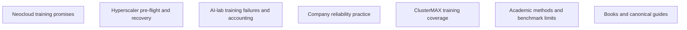

# Training-run health research

Question: What can a two-hour rack test show before a tenant starts a 30–90-day training run?

Research date: 2026-10-11.

Rack-bench maintainers, operators, and training tenants: Use this report for one GB300-class NVL72-class rack, 18 trays, Chennai, India.

Research readers: Use seven sourced briefs and a proposed measured training suite.

Rack-bench maintainers: Keep vendor-only PASS claims, unsafe default fault injection, and multi-week reliability guarantees out of scope.

Rack-bench maintainers: Keep this report as research, not rack measurements.

Readers: Use the [catalog supplement](oreilly.md) for ten source notes; keep the seven category nodes unchanged.

Readers: Use its [separate report](oreilly/research.md) for the supplement map and lessons.

## Node map

Each node uses an independent category search.
Each lesson can run without another category's result.
The proposed suite uses all seven results.

## Node table

| Node | Question | Dependencies | Acceptance condition | Child | State |
| --- | --- | --- | --- | --- | --- |
| N01 | What claims do neoclouds make for long training runs? | None | Keep claims, measured interruptions, recovery tools, and gaps separate. | neoclouds | done |
| N02 | What must hyperscaler tenants check before long runs? | None | Use AWS, Azure, and GCP recipes; show recovery limits and test needs. | hyperscalers | done |
| N03 | What do public AI-lab runs show about training health? | None | Check interruption denominators, MFU, resume state, and loss triage. | ai-labs | done |
| N04 | What company practices show training failures and keep them inside limits? | None | Show telemetry, straggler screening, restart, and GB300 transfer limits. | large-companies | done |
| N05 | What training health does ClusterMAX show, and what does it not show? | None | Check current methodology, reliability criteria, public tooling, and bounded gaps. | clustermax | done |
| N06 | What academic methods can tenants use for training validation? | None | Check recovery papers, failure traces, stability, and MLPerf boundaries. | academia | done |
| N07 | Which books and guides can this bench use? | None | Make a ranking of relevant chapters and docs; keep coverage separate from evidence. | books | done |

## N01: Availability is not training progress

The question keeps provider promises separate from measured job behavior.
An availability SLA makes service downtime and remedies explicit.
Goodput shows useful training progress over time or paid capacity.
Checkpoint rollback and restart remove useful time.
Thus availability and goodput make two different measures.

CoreWeave shows checkpoint signal handling and straggler detection.
Nebius shows Soperator persistence and separate preemptible-VM limits.
Lambda shows reserved clusters and ephemeral-storage limits.
Together shows active and passive health checks.
These descriptions show mechanisms, not multi-week outcomes.

ClusterMAX shows a Together health-check timeout that removes active jobs.
It shows one Nebius GB300 recovery with a duration of 8h40m.
Neither event shows a provider-wide recovery-time distribution.
Check the actual job recovery path before the lease.
Keep maintenance, storage, and replacement terms separate from rack health.
Use the [brief](neoclouds.md), [record](nodes/N01.md), and
[ClusterMAX source](https://newsletter.semianalysis.com/p/clustermax-30-the-industry-standard).

## N02: Check the actual launcher and transport

The question shows tenant checks before a long run.
A replacement node does not put the training state back.
AWS shows configurations that start a job again from the beginning.
The tenant must check supported auto-resume and checkpoint behavior.

AWS's EFA recipe checks the selected NCCL transport in logs.
Azure shows health agents, topology, and drain state.
Google A3 guides show NCCL plugin and launcher constraints.
These recipes do not show interchangeable GB300 settings.
Put the installed versions, rank map, and actual transport in the record.

A termination notice makes a difference only when the trainer uses it.
Check signal-to-checkpoint time against the applicable notice window.
Keep lease expiry and replacement capacity as separate questions.
Two hours cannot show future capacity or notice delivery.
Use the [brief](hyperscalers.md), [record](nodes/N02.md),
[AWS EFA recipe](https://docs.aws.amazon.com/AWSEC2/latest/UserGuide/efa-start-nccl.html), and
[AWS recovery guide](https://docs.aws.amazon.com/sagemaker/latest/dg/sagemaker-hyperpod-resiliency-slurm-auto-resume.html).

## N03: Count useful work and correct recovery

The question makes public training runs the health evidence.
Meta shows 466 interruptions during a 54-day Llama 405B snapshot.
The total shows 47 planned and 419 unexpected interruptions.
The hardware percentages use the unexpected interruptions as the denominator.
Some table percentages do not make a match with the printed counts.
Do not make a rack survival forecast from this fleet record.

MFU makes a comparison between declared model FLOPs and a precision-specific peak.
Its meaning keeps a dependence on the model, token count, and measured interval.
Show useful tokens/s and full-window goodput beside MFU.

BLOOM shows optimizer, tensor-parallel, and RNG synchronization defects.
A restart can run with its state still incorrect.
Check the resumed state against an uninterrupted control on the same remaining batches.
Keep records of optimizer, scheduler, RNG, data position, and step counters.
Use the [brief](ai-labs.md), [record](nodes/N03.md),
[Meta paper](https://arxiv.org/html/2407.21783v3), and
[BLOOM chronicles](https://github.com/bigscience-workshop/bigscience/blob/master/train/tr11-176B-ml/chronicles.md).

## N04: Diagnose the first stalled rank

The question keeps detection, diagnosis, exclusion, and recovery in scope.
Each step of synchronous training uses every required rank.
One slow rank can make a throughput reduction across the allocation.
A collective timeout does not show the original fault.
A rank can run into a loader stall before the collective starts.

MegaScale uses heartbeats, rank timing, traffic metrics, and diagnostic tests.
Meta uses repeated health checks and historical suspect-node evidence.
These methods make a link between training symptoms and resource identity.
Keep per-rank spans for compute, communication, input wait, and checkpoints.
Put these spans together with device and fabric events.

Silent corruption can put incorrect values inside the numeric limits.
A normal loss curve does not show correct computation.
Known-answer steps make limited checks, not complete silent-error coverage.
Two hours cannot make historical screening or delayed numerical effects visible.
Use the [brief](large-companies.md), [record](nodes/N04.md),
[MegaScale](https://www.usenix.org/system/files/nsdi24-jiang-ziheng.pdf), and
[Meta hardware methods](https://engineering.fb.com/2025/07/22/data-infrastructure/how-meta-keeps-its-ai-hardware-reliable/).

## N05: Keep ClusterMAX evidence types separate

The question checks current coverage instead of an inherited market claim.
ClusterMAX 3.0 shows Llama 3.1 8B and GPT-OSS MoE training.
It also shows an eight-hour combined compute/network burn-in.
Its public cmax tool makes only a configuration audit.
Thus, do not make a synthetic-only description of ClusterMAX.

The inspected public methodology does not show numerical resume equivalence.
It does not show a standardized loss acceptance procedure for the named pretraining runs.
Its fault drills make time measurements for detection, drain, and return to service.
These endpoints do not show restored training progress.

Keep audit, workload performance, burn-in, recovery, and convergence results separate.
The proposed bench puts explicit state comparison and progress accounting in place.
This shows a public-method gap, not unknown private procedures.
A two-hour suite cannot run the eight-hour burn-in.
Use the [brief](clustermax.md), [record](nodes/N05.md),
[methodology](https://newsletter.semianalysis.com/p/clustermax-30-the-industry-standard), and
[public cmax](https://github.com/SemiAnalysisAI/clustermax).

## N06: Test the checkpoint transaction

The question checks recovery mechanisms and benchmark boundaries.
Checkpoint staging, persistence, and publication make three different operations.
CheckFreq keeps the data position and keeps snapshot separate from persistence.
MegaScale also keeps host staging separate from remote writes.
A staged snapshot alone does not make a durable checkpoint.
Remove incomplete generations and use the previous complete generation.

Oobleck uses replicas to make the state again.
Varuna uses elastic configurations and checkpoint-based recovery with background copying.
Do not put these mechanisms under one generic recovery-method label.

MLPerf Closed uses time to its defined quality target as the metric.
MLPerf Open makes arbitrary stopping criteria possible, with reported quality.
General checkpoint optionality makes one exception: Qwen3.5 post-training.
That scoring exception does not check crash-recovery correctness.
Two fault-free hours do not show a useful multi-week failure bound.
Use the [brief](academia.md), [record](nodes/N06.md),
[CheckFreq](https://www.usenix.org/system/files/fast21-mohan.pdf), and
[MLPerf rules](https://github.com/mlcommons/training_policies/blob/master/training_rules.adoc).

## N07: Use guides for executable mechanisms

The question puts practical guides and relevant books in rank order.
Megatron Bridge shows restart, checkpoint, preemption, and straggler features.
Its rerun state machine makes NaN and loss-spike investigation easier.
NVIDIA puts an experimental label on this feature.
Straggler detection does not put a stop to training by default.
Check enabled features and release constraints before the drill.

PyTorch Distributed Checkpoint makes distributed save/load mechanisms available.
The trainer still keeps ownership of its complete resume-state contract.
API support does not show successful restoration on this rack.

Designing Machine Learning Systems and Reliable Machine Learning make systems and monitoring context available.
MLOps Engineering at Scale makes pipeline context available, not NVL72 certification.
AI Engineering keeps a lower priority for pretraining reliability.
Publisher access limits keep some conclusions inside the visible contents.
No book shows a universal two-hour GB300 PASS threshold.
Use the [brief](books.md), [record](nodes/N07.md),
[Megatron Bridge](https://docs.nvidia.com/nemo/megatron-bridge/latest/training/resiliency.html), and
[PyTorch DCP](https://docs.pytorch.org/docs/stable/distributed.checkpoint.html).

## Proposed suite and handoff

The [distilled document](docs/training-bench-research.md) keeps the failure catalog, check families, and implementation tickets.
The [orchestrator report](ORCHESTRATOR-REPORT.md) shows evidence checks and category verdicts.

The tenant must make a selection of workload, checkpoint target, thresholds, and numerical tolerances.
The two-hour result shows the observations and the exercised recovery paths.
It does not show multi-week survival, full convergence, or all-fault recovery.
Keep all artifacts inside this research run directory.
The parent must put the staged document at the requested project destination.
