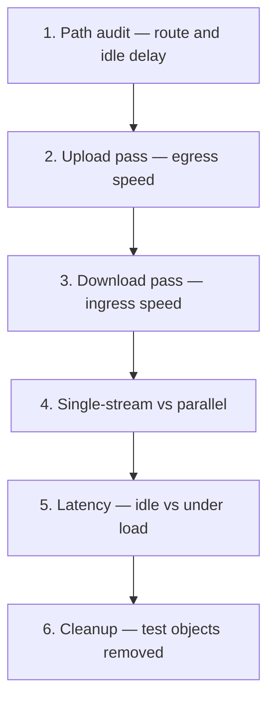
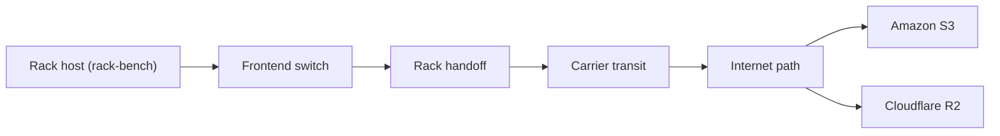
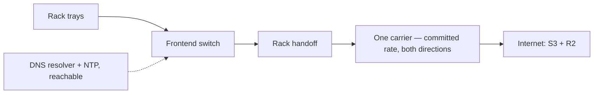

# Datacenter network briefing

## Purpose

We plan to put GPU racks in your datacenter. Before that, we want to test the
internet path they will use. We will not ask you to buy anything or to contact
an outside party. We ask for your time, your answers, and the loan of hardware
you already own.

Each run produces a network health report. We share it with you the same day,
and you keep it. It shows the speed, the latency, and the route quality that
we measured. The numbers apply to the paths we tested, at the times we tested
them.

## Part A — What we test

Our tool is called rack-bench. It runs on one Linux host and needs no GPUs. One
full run takes 5 to 15 minutes. We will ask to run it a few times, at peak and
off-peak hours.

A full run has six stages. The last stage removes the test objects:

The tool measures the real internet path from a rack handoff:

- Sustained upload speed to cloud storage (Amazon S3 and Cloudflare R2)
- Sustained download speed from cloud storage
- Speed with one stream, and speed with parallel streams
- Request latency: time to first byte, at rest and under load
- Path MTU behavior: the largest packet size the path carries
- TCP retransmits: how much data the path sends twice
- DNS speed: how fast the host resolves names
- The route: which carrier and which networks carry our traffic to each cloud

Your traffic leaves the rack, crosses your carrier, and reaches each cloud:

When the rack has more than one ISP, we run the same passes once per
ISP. The report then compares the ISPs side by side.

### Why we test this

Our customers buy AI compute. They pull large datasets in and push model
checkpoints out. Both moves use the same internet path. We measure that path.
The report shows only what we measured.

### What the tests assume

We check some of these ourselves when we get access to the host. The others
become questions in Part B. They describe your datacenter as it stands today,
not as it should be.

- A quiet Linux host sits near the rack handoff
- The host NIC speed matches the circuit speed
- Small tools are present: mtr, traceroute, ss, and NTP
- The TCP buffer size covers the path bandwidth multiplied by the round-trip
  time
- A DNS resolver and time servers are reachable
- No proxy stands on the egress path
- A written committed rate exists, so every number has a reference

## Part B — Discovery questions: your datacenter today

### 1. Hardware you can lend

- Which CPU servers can you lend us?
- How many cores and how much RAM does each server have?
- What NIC speed does each server have?
- Where does the server sit? Which rack, which switch?

### 2. Access

- Do we get sudo on the host?
- If not, will you install packages for us? We need mtr-tiny and traceroute.
- May we run our own Python tool? The tool has no external package needs.

### 3. The internet circuit today

- What internet service feeds that rack today?
- What is the port speed? What is the committed rate?
- Which carrier provides it?
- Is the service shared with other customers, or dedicated?
- What burst policy applies above the committed rate?

We also want to know how the rack handles more than one ISP:

- How many internet circuits feed that rack? One, or several?
- Does each circuit come from a different ISP?
- Are all circuits active at the same time, or does one wait as a
  standby?
- How does traffic choose a circuit? Routing rules, BGP, or a
  firewall policy?
- Can we pin the test host to one circuit at a time, so we measure
  each ISP on its own?
- If a circuit drops, does traffic move to another one? How long
  does that take?

### 4. Path placement

- Can our test host land on the same switch and VLAN that the future GPU rack
  will use?
- Which rack position will the GPU rack take?

### 5. Carriers and exchanges

- How many carriers enter the building?
- Which carriers can our test host reach directly?
- Do you hold ports at an internet exchange, such as NIXI or Extreme-IX?

### 6. Addressing

- Do the hosts get public IP addresses, or NAT?
- Is there one egress address, or several?

### 7. Support services

- Which DNS resolver serves the hosts?
- Which NTP servers serve the hosts?
- Does a proxy, a firewall, or traffic scrubbing stand on the egress path?

### 8. Test windows and evidence

- May we run tests of 5 to 15 minutes at different hours, peak and off-peak?
- Can your NOC share port utilization counters during our runs?

## Part C — The default configuration we look for

This is the setup that gives the strongest results. If you cannot
match an item, tell us. We test anyway. The report then states the
difference.

| Item    | What we look for                         | If you have less                |
|---------|------------------------------------------|---------------------------------|
| Host    | One Linux server, quiet, near the rack   | Any quiet Linux host            |
| Cores   | 8 or more                                | Fewer cores; runs take longer   |
| NIC     | 10 GbE, or the circuit speed             | 1 GbE; the report says 1G       |
| Place   | Same switch and VLAN as the future rack  | Any port near the handoff       |
| Access  | sudo on the host                         | You install two packages        |
| Circuit | One committed rate, both directions      | Shared; the report says shared  |
| ISPs    | Two circuits from two ISPs; we test each | One circuit; we test that one   |
| Path    | Public IP, no proxy on the egress path   | NAT; the report says NAT        |
| Service | DNS resolver and NTP reachable           | We agree on references first    |
| Windows | Six runs of 5-15 min, peak and off-peak  | Fewer runs; the report says so  |

The default circuit looks like this:

Send your answers to Aviral. He replies with a test plan in a few
days. Tests start only after you approve the plan.

### What we bring

- We bring the tool, the cloud accounts, and the credentials.
- We run every test ourselves. No one needs to watch a run. You may
  help with two small things: install two packages, or read port
  counters during a run. Both are optional.
- You get the report. It shows the speed, the latency, and the route
  quality that we measured on your internet path.

Thank you for the hardware and the time. This work helps both sides.
