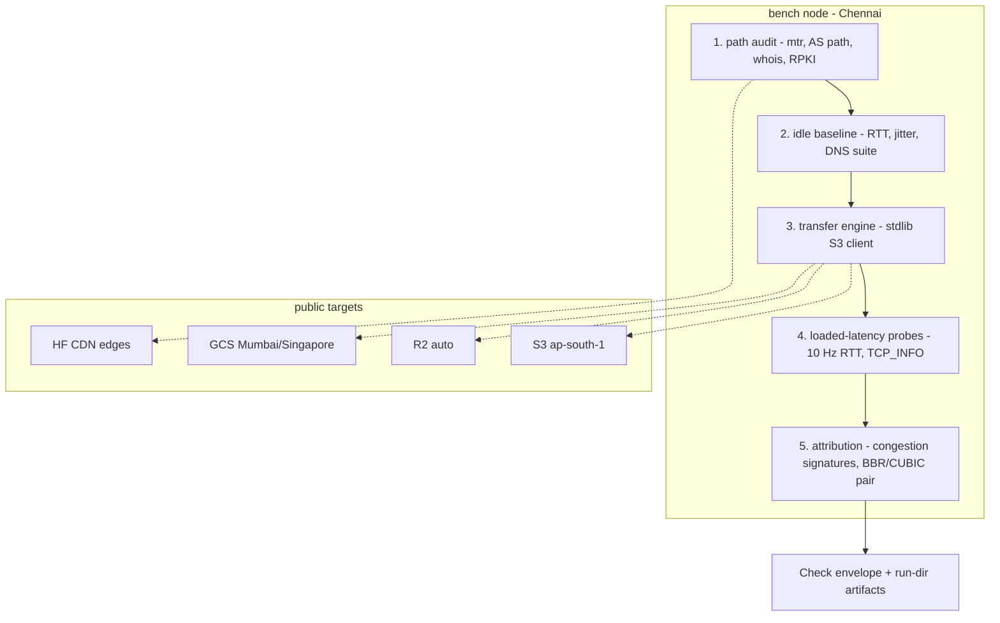
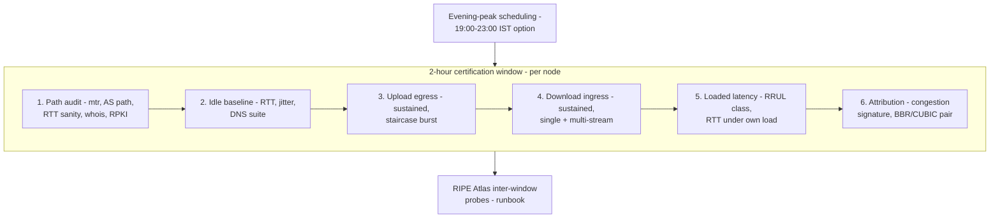
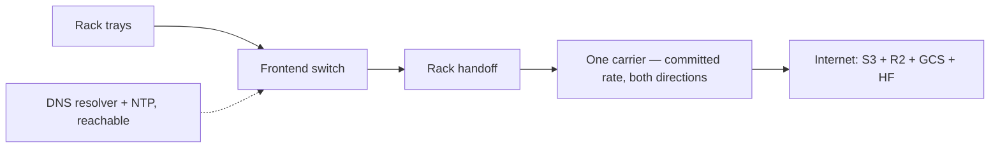

# Internet quality briefing

## Purpose

We plan to put GPU racks in your datacenter. Before customers pay, we
test the internet path those racks will use. We will not ask you to
buy anything or to contact an outside party. We ask for your time,
your answers, and the loan of hardware you already own.

Each run produces a network health report. We share it with you, and
you keep it. It shows the sustained speed, the loaded latency, and
the route quality that we measured. It also states what the test
window could not measure. The numbers apply to the paths we tested,
at the times we tested them.

## Part A — What we test

Our tool is called rack-bench. The internet command is
`rack-bench bench internet`. It runs on one Linux host and needs no
GPUs. One certification run covers a two-hour window per node. We ask
to run it at peak and off-peak hours. The evening peak in India runs
roughly 19:00–23:00 IST.

The bench runs on one architecture. Each instrument maps to one
concept under test:

A certification window runs six stages per node:

The tool measures the real internet path from a rack handoff:

- Sustained upload speed to cloud storage (Amazon S3, Cloudflare R2,
  Google Cloud Storage, and Hugging Face CDN edges)
- Sustained download speed from the same clouds
- Speed with one stream, and speed with parallel streams
- Burst behavior: a line-rate burst first, then the steady rate that
  follows
- Request latency: time to first byte, at rest and under load
- Loaded latency: round-trip time while our own transfers run
- Path MTU behavior: the largest packet size the path carries
- TCP retransmits: how much data the path sends twice
- Congestion cause: whether our transfer filled the pipe, or an
  upstream link was already full
- DNS speed and DNS correctness: how fast the host resolves names,
  and whether the answers are sane
- The route: which carrier and which networks carry our traffic to
  each cloud, who owns the egress address, and whether the route is
  valid

The current checks cover the core: path audit, sustained upload and
download, TTFB, PMTUD, and retransmit ratio. The research adds five
check families and one reporting rule:

| Check family | Catches | Evidence base |
| --- | --- | --- |
| `latency.loaded` (RRUL-class, idle vs loaded) | bufferbloat, queue management | academia §3.4; large-companies §2.2 |
| `transfer.staircase` (burst-then-observe) | policer/shaper below port rate | academia §2.4.1; neoclouds §1.13 |
| `tcp.congestion` (NormDiff+CoV, CUBIC flows) | self vs external congestion attribution | academia §2.4.3 |
| `tcp.cc_differential` (BBR + CUBIC pair) | loss-imposed ceiling; true path capacity | academia §4; large-companies §4.2 |
| `dns.{resolver,mtu,nxdomain}` + `path.ownership` | DNS pathologies; reseller fronting | academia §2.1; clustermax §3.2 |
| Percentile reporting (p50/p95/p99 + 80/80 rule) | tail behavior; consistency | academia §2.5, §5.1; large-companies §7 |

### What a pass looks like

Default threshold bands apply to the certification profile. Until
then, `expected: null` and PASS = measured. Loss <1% is the AIM
full-points band. Jitter must stay <10 ms. Loaded−unloaded inflation
warns above 20 ms and fails above 50 ms. TCP efficiency must be
≥99%. Transfer Time Ratio must be ≤1.2. Buffer delay must be ≤10% of
baseline RTT. Sustained aggregate throughput must reach ≥80% of
contracted port rate for ≥80% of the window (80/80, FCC). Each band
cites its source in the report.

Chennai targets: S3 ap-south-1 (Mumbai), R2 auto via R2 auto
(endpoint naming alone does not prove physical cache location), GCS
Mumbai/Singapore, and HF CDN edges US/EU. The path audit records IX
presence (DE-CIX Chennai, Extreme IX, NIXI). It also records whether
cloud egress stays domestic or transits Singapore (neoclouds §5).

### Why we test this

Our customers buy AI compute. They pull large datasets in and push
model checkpoints out. Both moves use the same internet path. A
tenant asks one direct question: can this node pull a 45 TB FineWeb
dataset and push 4.5 TB checkpoints at the promised rate for the full
lease (ai-labs §1.5, §3)? The measured industry median is 3.4 Gbps.
At this rate, a FineWeb pull takes ~30 hours. A 405B checkpoint
upload takes ~3.6 hours at the median 2.8 Gbps upload rate
(ai-labs §1.5, §3.3). We measure that path. The report shows only
what we measured.

The market cannot answer this question. No neocloud publishes a
sustained north-south throughput number, committed rate, loaded
latency, jitter, loss, path audit, or WAN SLA (neoclouds §6).
ClusterMAX 3.0's Networking dimension has 10 criteria. All cover
east-west fabric, and none cover north-south (clustermax §2). Its
internet evidence uses minutes-scale convenience probes: a 22.1 GB
NGC pull, a ~15 GB model pull, and a Cloudflare speedtest
(clustermax §3). The public `cmax` CLI has no internet test code
(clustermax §4). These probes found low rates: Crusoe 0.47–0.78 Gbps,
Bitdeer ~0.8 Gbps, and Firmus 0.25 Gb/s to NGC (neoclouds §4.1).
These rates equal roughly 0.24–0.4% of the 200 GbE NIC. The same
nodes advertise east-west fabrics at line rate.

Hyperscalers publish caps, not certifications. AWS documents a
5 Gbps single-flow ceiling and lower internet-gateway caps. Google
Cloud publishes 3 Gbps per internet flow and 7/25 Gbps per instance
to external destinations. Azure says "expected, not guaranteed" and
publishes no public-internet path SLA (hyperscalers §1, §3, §4.1).
Measurement science is mature. It includes RFC 6349, Cloudflare AIM,
and flent/RRUL. No one applies it to a datacenter node's uplink
(academia §1, §7; large-companies §7). The two sides meet only in
`bench internet`.

Each family below answers one customer concern. "2h" means the check
can detect the mode during a two-hour certification window.

#### Throughput masquerades

- **The promised rate must survive the whole transfer, not the first
  ten seconds.** Customers move terabytes, not megabytes. Paperspace
  rate-limits any VM that sustains ≥1 Gbps for >10 s. It then reduces
  the rate to 200 Mbps. PowerBoost-style head-starts inflate short
  speed tests. STN shaped speedtest traffic to game synthetic probes.
  Real downloads then crawled (neoclouds §1.13; academia §5.1;
  clustermax §3.2). 2h: **yes** — use sustained windows and discard
  slow-start data. Follow the FCC's last-5-seconds retention rule
  (academia §5.1). Also run a burst-then-observe staircase probe.
- **A hidden policer can sit below the port rate.** Token-bucket
  shapers show a rate staircase after the burst ends (ShaperProbe,
  academia §2.4.1). 2h: **yes** — run burst trains. The staircase
  measures the committed rate.
- **One stream cannot fill a fast circuit.** AWS documents a 5 Gbps
  single-flow limit, regardless of instance size. GCP documents
  3 Gbps per unique 5-tuple to internet destinations. Documented
  remedies include placement groups, ENA Express, and MPTCP. These
  remedies work only inside a cloud. Parallel streams are the only
  answer on a public path (hyperscalers §1.1, §3.1). 2h: **yes** —
  report the single-stream rate as information. Certify aggregate
  throughput over N parallel streams.
- **A slow test is not always a slow internet.** Window and BDP
  constraints masquerade as slow internet. At 25 Gbps and 250 ms RTT,
  BDP equals 781.25 MB decimal. This is an example calculation, not a
  Chennai measurement. RFC 7323 §§2.2–2.3 permits a maximum encoded
  receive window of 1,073,725,440 bytes. This exceeds the example
  BDP. Therefore, TCP's protocol window maximum does not inherently
  stop one flow from meeting the example target rate. Actual
  throughput depends on negotiated scaling, socket buffers, receive
  window, congestion window, and path conditions. A configured
  `tcp_wmem` maximum alone does not prove a per-flow ceiling. An
  effective 4 MiB flight limit at 250 ms would cap throughput at
  ~134 Mbps. This is an effective limit, not the configured maximum.
  2h: **yes** — record live settings and flow state. Measure one-flow
  and parallel-flow rates separately. Calculate BDP from measured
  RTT. Keep host constraints separate from measured path constraints.
  Sources: books §4; RFC 7323 §§2.2–2.3; tcp(7); Azure's window×RTT
  table, hyperscalers §2.2.
- **A synthetic test can be gamed.** The corpus documents only one
  provider gaming case: STN shaped speedtest endpoint traffic
  (clustermax §3.2). 2h: **yes, by design** — use multiple endpoints
  (S3, R2, GCS, HF, NGC), fixed checksummed payloads, and a
  synthetic-vs-real agreement check.

#### Congestion and queueing

- **Latency must stay low while the link carries load.** Access-path
  buffers of 128–256 KB add 125 ms–1 s of latency under load. This is
  bufferbloat (Netalyzr, academia §2.1). Cloudflare's AIM rubric
  gives zero points for a loaded−unloaded difference >50 ms. It gives
  the best score for a difference <10 ms (large-companies §2.2).
  RFC 6349 defines Buffer Delay (academia §1.6). 2h: **yes** — run an
  RRUL-class load (4+4 best-effort streams, flent `rrul_be` precedent,
  academia §3.4). Run 10 Hz RTT probes and a TCP_INFO RTT series.
  Measure the idle baseline first.
- **Congestion follows the clock.** The 2014 Cogent peering dispute
  reduced throughput only during the evening peak. The Indian
  equivalent is roughly 19:00–23:00 IST (academia §6.1). 2h:
  **partial** — schedule loaded tests during the evening peak for
  worst-case certification. Add the window's IST time-of-day to the
  certificate. Declared miss: measure the congestion duty cycle over
  weeks.
- **Congestion collects at a network boundary.** Ping the near and
  far router of each interdomain link to locate congestion at an AS
  boundary (TSLP, academia §2.4.2). For example, the Comcast↔TATA
  peering signature starts near ~18 ms and rises above 30 ms in the
  evening. 2h: **yes** — run continuous near/far pings around every
  AS hop in the mtr path for the full window.
- **We must know whose congestion it is.** NormDiff + CoV on the
  slow-start RTT series classify the cause of congestion. They show
  whether a transfer saturated the rack's committed rate
  (self-induced, good) or reached an already-full upstream link
  (external, blameable). Run this check on CUBIC only. BBR controls
  the buffering that the signature reads. Discard flows with fewer
  than 10 slow-start samples (academia §2.4.3). 2h: **yes** — collect
  data from every bulk transfer. This gives the certificate a causal
  sentence, not only a number.

#### Loss and TCP pathologies

- **Loss hides from vendor dashboards.** No CloudWatch or ENA counter
  publishes retransmissions. Google's perfdiag reads `netstat -s`
  deltas. NTttcp reports a retransmit column. Kernel counters are the
  only source (hyperscalers §1.6, §2.2, §3.2). 2h: **yes** — collect
  `nstat` deltas per transfer. Calculate TCP Efficiency =
  (bytes − retransmitted)/bytes (RFC 6349, academia §1.6).
- **Not all loss is equal.** Timeout-driven retransmits signal severe
  loss or a stall. Dup-ACK fast retransmits signal single-packet loss
  (Fall & Stevens ch. 14, books §3). 2h: **yes** — separate the
  counters. Treat an RTO-heavy window as a fail-side investigation
  trigger. Fast-recovery symptoms do not prove single-packet loss by
  themselves. Put the quantitative threshold in the certification
  profile, not the bench (books §3).
- **Some loss is only reordering.** Out-of-sequence data at the
  receiver disguises ~71% loss in tier-1 data. DSACK evidence helps
  separate reordering from loss, but does not prove the cause.
  Duplicate receipt has several causes. Keep sequence evidence,
  capture conditions, and independent counters together
  (academia §2.6; books §3). 2h: **partial** — use TCP_INFO
  reordering counters and DSACK accounting.
- **Small packets must pass too.** Luckie found forward-path PMTUD
  failure at 30% of jumbo-capable targets. Medina found it at 17% of
  web servers. AWS documents NACL-filtered ICMP type-3/code-4 as an
  active failure mode. Default ping/traceroute sizes do not trigger
  this failure (academia §2.8; hyperscalers §1.4). 2h: **yes** — send
  DF-set 1500 B probes in both directions. Use scamper-style
  localization (~14 probes to the offending hop). The check is
  already specified as `internet.
.tcp.pmtud`.
- **Loss punishes some congestion controls.** CUBIC collapses on a
  long, lossy path. At 10 Gbps over 100 ms RTT, loss must stay below
  0.000003%. BBR measures the path's real limits (BtlBw + minRTT) and
  ignores loss. The CUBIC/BBR throughput difference also detects loss
  (academia §4; large-companies §4.2). 2h: **yes** — run one 60 s BBR
  flow and one 60 s CUBIC flow per endpoint-direction. Log delivery
  rate.

#### DNS and reachability

- **Name resolution can fail quietly.** Resolver MTU below path MTU
  affected 15% of Netalyzr sessions. EDNS failures on padded replies
  affected 13%. NXDOMAIN wildcarding affected 29% (academia §2.1).
  2h: **yes** — probe padded replies and check NXDOMAIN. Identify the
  resolver. Repeat resolution of all artifact hosts across the
  window.
- **An outage can hide in one direction.** Partial outages made up
  67% of detected outages. A quarter affected only the reverse path.
  The control plane stays silent when the data plane fails (Hubble,
  academia §2.2). 2h: **partial** — transfers cover the forward path.
  Use looking glasses for the reverse path, as in the path audit.
  RIPE Atlas queries toward the rack's prefix provide inter-window
  continuity (academia §5.4).
- **Routes can be hijacked.** RPKI-validating networks alone rejected
  the Tata (AS4755) hijack of 1.1.1.0/24. Free monitoring tools
  include bgp.tools, Cloudflare Radar API, RIPEstat, and BGPStream
  (large-companies §8). 2h: **yes** — record AS path and RPKI
  validity per target in the path audit. Report these values, but do
  not gate.
- **The seller may not own the network.** A whois check on the
  machine's public IP reveals aggregators that resell other clouds'
  capacity (clustermax §3.2). 2h: **yes** — run one whois check on
  the egress IP.

#### What a two-hour window honestly cannot certify

We state the limits in every report. A 95% bound for loss tails
below ~1e-3 needs ~10⁶ probes (academia §1.3). A two-hour window
cannot measure the diurnal duty cycle. It cannot certify WAN failover
and convergence. These need ISP coordination. The IREN single-ISP
anecdote shows this unmeasured risk (clustermax §3.3). A two-hour
window cannot certify DDoS absorption, continuous route-integrity
monitoring, or p99 stability with fewer than ~10⁴ samples. The
certificate states the window, sample counts, and these declared
misses in every report. Latency and loss change first under stress,
while throughput is the blunt metric (COVID-era finding,
academia §6.2). The report order reflects this finding.

### What the tests assume

We check some of these ourselves when we get access to the host. The
others become questions in Part B. They describe your datacenter as
it stands today, not as it should be.

- A quiet Linux host sits near the rack handoff
- The host NIC speed matches the circuit speed
- Small tools are present: mtr, traceroute, ss, and NTP
- The TCP buffer size covers the path bandwidth multiplied by the
  round-trip time
- A DNS resolver and time servers are reachable
- No proxy stands on the egress path
- A written committed rate exists, so every number has a reference

## Part B — Discovery questions: your datacenter today

These questions match our datacenter network briefing. We repeat
them here so this document stands alone.

### 1. Hardware you can lend

- Which CPU servers can you lend us?
- How many cores and how much RAM does each server have?
- What NIC speed does each server have?
- Where does the server sit? Which rack, which switch?

### 2. Access

- Do we get sudo on the host?
- If not, will you install packages for us? We need mtr-tiny and
  traceroute.
- May we run our own Python tool? The tool has no external package
  needs.

### 3. The internet circuit today

- What internet service feeds that rack today?
- What is the port speed? What is the committed rate? Is the
  committed rate written down?
- Which carrier provides it?
- Is the service shared with other customers, or dedicated?
- What burst policy applies above the committed rate?

We also want to know how the rack handles more than one ISP:

- How many internet circuits feed that rack? One, or several?
- Does each circuit come from a different ISP?
- Are all circuits active at the same time, or does one wait as a
  standby?
- How does traffic choose a circuit? Routing rules, BGP, or a
  firewall policy?
- Can we pin the test host to one circuit at a time, so we measure
  each ISP on its own?
- If a circuit drops, does traffic move to another one? How long
  does that take?

### 4. Path placement

- Can our test host land on the same switch and VLAN that the future
  GPU rack will use?
- Which rack position will the GPU rack take?

### 5. Carriers and exchanges

- How many carriers enter the building?
- Which carriers can our test host reach directly?
- Do you hold ports at an internet exchange, such as NIXI or
  Extreme-IX?

### 6. Addressing

- Do the hosts get public IP addresses, or NAT?
- Is there one egress address, or several?

### 7. Support services

- Which DNS resolver serves the hosts?
- Which NTP servers serve the hosts?
- Does a proxy, a firewall, or traffic scrubbing stand on the egress
  path?

### 8. Test windows and evidence

- May we run certification windows of two hours at different hours,
  peak and off-peak?
- The evening peak matters most. It runs roughly 19:00–23:00 IST.
  May we test inside it?
- Can your NOC share port utilization counters during our runs?

## Part C — The default configuration we look for

This is the setup that gives the strongest results. If you cannot
match an item, tell us. We test anyway. The report then states the
difference.

| Item    | What we look for                         | If you have less                |
|---------|------------------------------------------|---------------------------------|
| Host    | One Linux server, quiet, near the rack   | Any quiet Linux host            |
| Cores   | 8 or more                                | Fewer cores; runs take longer   |
| NIC     | 10 GbE, or the circuit speed             | 1 GbE; the report says 1G       |
| Place   | Same switch and VLAN as the future rack  | Any port near the handoff       |
| Access  | sudo on the host                         | You install two packages        |
| Circuit | One committed rate, both directions      | Shared; the report says shared  |
| ISPs    | Two circuits from two ISPs; we test each | One circuit; we test that one   |
| Path    | Public IP, no proxy on the egress path   | NAT; the report says NAT        |
| Service | DNS resolver and NTP reachable           | We agree on references first    |
| Windows | Two-hour runs, peak and off-peak, with the evening-peak option | Fewer runs; the report says so |

The default circuit looks like this:

Send your answers to Aviral. He replies with a test plan in a few
days. Tests start only after you approve the plan.

### What we bring

- We bring the tool, the cloud accounts, and the credentials.
- We run every test ourselves. No one needs to watch a run. You may
  help with two small things: install two packages, or read port
  counters during a run. Both are optional.
- You get the report. It shows the sustained speed, the loaded
  latency, and the route quality that we measured on your internet
  path. It also lists the declared misses: what this window could
  not certify.

Thank you for the hardware and the time. This work helps both sides.

## Implementation tickets

1. **Loaded-latency instrument** — use stdlib parallel transfers, 10 Hz
   RTT probes, and per-second TCP_INFO sampling. Measure idle first.
2. **Burst staircase probe** — send a line-rate burst, then observe the
   rate step. Detect token buckets in the bucket curve.
3. **CC pair runner** — pin CUBIC and BBR per flow (`ss -i` reads the
   active algorithm). Log delivery rate, RTT, and retransmits at 1 s
   resolution. Export BtlBw/minRTT à la ndt7.
4. **Congestion-signature classifier** — collect the transfers' own
   slow-start RTT series. Use NormDiff + CoV. Discard flows with fewer
   than 10 samples. Apply the CUBIC-only guard.
5. **TSLP near/far pings** — run continuous pings around each AS hop
   for the full window. Report inflation per interconnect.
6. **DNS pathology suite** — test EDNS padded replies, resolver
   identity, and NXDOMAIN wildcard. Measure resolution latency across
   the window.
7. **Whois ownership check** — add this check to the path audit.
8. **Percentile + sample-count reporting** — report p50/p95/p99 and
   state N. Show the 80/80 consistency view. Add a declared-misses
   block to every report.
9. **Evening-peak option + IST stamp** — schedule tests with
   `--peak-window`. Record the certified time-of-day regime in the
   certificate.
10. **Evidence bundle** — use perfdiag/`gcloud storage diagnose --export`
    as a precedent. Create a tar.gz of logs, counters, and per-second
    series for escalation (hyperscalers §3.3).
11. **RIPE Atlas runbook** — run inter-window probes toward the rack
    prefix from Indian/global probes. Add the runbook at the report
    stage.

## Reading list

Seven research briefs support this document, one for each category:
`docs/research/internet-research/{neoclouds,hyperscalers,ai-labs,large-companies,clustermax,academia,books}.md`.
Each claim above has a citation in its brief. The companion design
doc (`docs/internet-performance.md`) defines terms, lists the provider
matrix, and describes the CLI. This document provides its evidence:
what fails on a node's internet path, who proved it, and which check
detects it.

`docs/research/internet-research/books.md` keeps the ranked eight books and
the four-book internet-bench spine:

1. **Gregg, Systems Performance, 2nd edition:** methodology;
   Chapters 2, 10, and 12.
2. **Fall & Stevens, TCP/IP Illustrated, Volume 1, 2nd edition:**
   TCP options, retransmission, windows, congestion control, PMTUD.
3. **Grigorik, High Performance Browser Networking:** free text at
   https://hpbn.co/; Chapters 1–2 cover latency and BDP.
4. **Jain, The Art of Computer Systems Performance Analysis:**
   statistics and experimental design for measured PASS decisions.

Keep Sanders's Practical Packet Analysis, 3rd edition, as the main
practical capture supplement. The publisher confirms Chapters 6, 8,
and 11 cover CLI analysis, transport, and slow-network diagnosis. Use
current Wireshark documentation for classifier rules. Its labels alone
do not prove wire loss or an RTO.

The 15-source O'Reilly catalog supplement is in
`docs/research/internet-research/oreilly.md`. Selective additions:

- DNS and BIND, 5th edition: Chapters 2, 6, and 12–14 cover resolver
  behavior and DNS fault evidence.
- DNS and BIND on IPv6: Chapters 1 and 5. Use Chapter 4 only when
  DNS64 applies.
- Pro DNS and BIND: optional DNS background. The separately titled
  2011 BIND 10 book is not a verified second edition.
- Content Delivery Networks: Chapters 2–4 cover request routing,
  goodput, object size, and latency context.
- Sloan, Network Troubleshooting Tools: optionally SKIM Chapters 4
  and 12. Do not blanket SKIP the book.
- Schroder, Linux Networking Cookbook: optionally SKIM Chapter 19.
  This book is separate from Sloan's book.
- Nath's packet-analysis book and Greer's video: optional practice,
  not replacements for Sanders. Chow's and White's events are optional
  introductions.
- VandenBrink, Linux for Networking Professionals, 2nd edition:
  HOLD until release dates and complete contents agree.

Catalog visibility does not prove full-text or recording entitlement.
No catalog source establishes rack performance or a new PASS threshold.
Read the modern web set with the spine: the BBR ACM Queue paper;
"Making Linux TCP Fast"; RFCs 6349, 7323, 9000, 6298, 1191, and 4821;
current CUBIC guidance (RFC 9438 and successors); tcp(7), ss(8), and
current ip-sysctl documentation.
