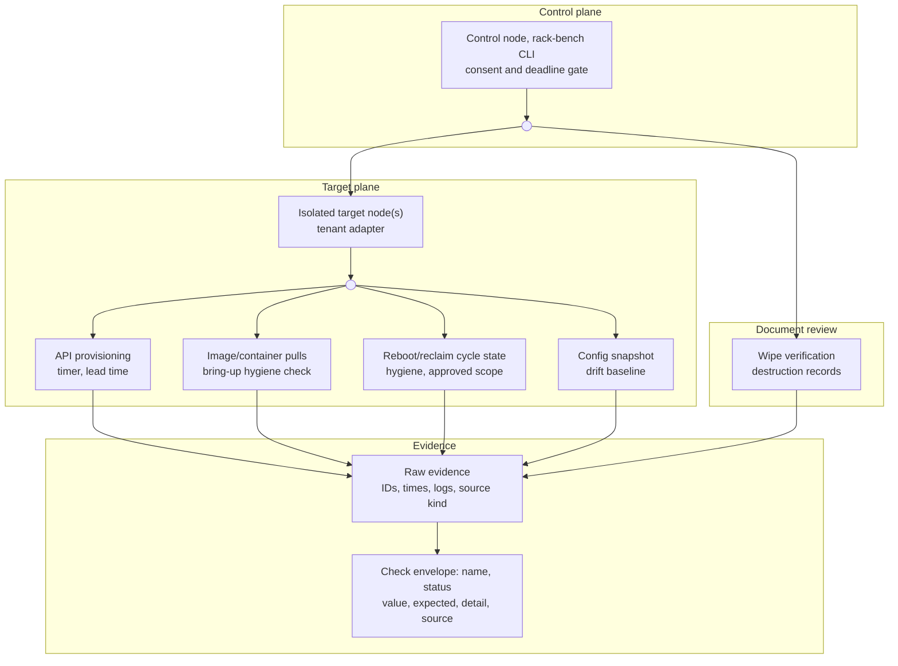

# Lifecycle bench research: failure modes and suite design

## Purpose

We plan to test the lease lifecycle on your GB300-class rack.
We ask for your time, your answers, and approved test scope on disposable resources.

Each run produces a lifecycle evidence report. You keep it. It records every
attempt, skip, and limit. The numbers apply only to the test resources and window.

This file gives the evidence base for `bench lifecycle`. It does not give measured rack results.
All proposed checks below are design inferences.

Research date: 2026-10-11.

## Part A — What we test

We use rack-bench. Keep the stages audit → bench → smoke.
Audit records inventory. Bench measures the approved target.
Smoke stays in its own report.
Put approved lifecycle fault checks inside bench.

This document proposes the `bench lifecycle` category. Some lifecycle checks
review documents. They work like audit checks. They cannot produce measured
PASS.

The target is a GB300 NVL72-class rack. It has 18 trays. It sits in Chennai,
India. The window is two hours. It covers lifecycle checks, setup, and report.
The scope covers lease and node lifecycle operations.

GPU, fabric, internet, storage, training, and serving checks stay in their own reports.
PASS requires measurements. SLA documents cannot supply PASS evidence.
Use existing GPU or application canaries only as lifecycle readiness markers.
Do not add separate performance sweeps.

The tool measures the lease lifecycle from first request to final exit:

- Request, allocation, boot, and GPU-ready times
- Cold and warm environment bring-up times
- Correct useful work on all requested ranks
- Pod/PVC cycle times from mount to release
- Checkpoint resume and the next correct step
- One reversible change and its rollback
- Per-tray configuration drift against the approved baseline
- Current audit events and their export
- A small export and its external usability
- Access denial after test identity revocation
- Hidden steps in a named documentation task
- Response milestones for one agreed support ticket

### Bench-run architecture

The proposed bench-run architecture uses this path from control node to target nodes and the Check envelope.

Use approved isolated targets for reboot and reclaim checks.
The wipe stage checks records, not physical erasure.
Keep document-review results separate from measured PASS.

### Why we test this

The tenant question starts at contract signature and ends at offboarding.
How fast, clean, and reliable is each step to the first useful GPU-hour and back out?
A fast GPU cannot remove a provisioning queue, broken image, lost checkpoint, or stale credential.

The reviewed market sources describe controls. They do not give comparable lifecycle distributions
(neoclouds §2–5; hyperscalers §2–3). This review does not prove that providers publish no such data.
ClusterMAX 3.0 adds strong operational probes and 15 published Lifecycle requirements
(clustermax §2–4). It times installs, imports, pod/PVC cycles, serving readiness, and reboot recovery.

Its public method does not define a uniform contract-to-useful-work clock or wipe-verification protocol
(clustermax §5). Provider provisioning anecdotes exist. They do not define a common measurement method.

The proposed opening is a reproducible tenant transaction. It records states and explicit limits.
Keep documents, direct observations, simulations, and calculations separate.
Two hours can show a working path. Two hours cannot prove that the whole lease stays reliable
(academia §2, §6). Internet and storage benches retain their own performance checks.

Lifecycle measures whether those resources enter, change, recover, and leave service correctly.
The customer concerns below show proposed mitigations, not measured results from this rack.

#### Provisioning and API delivery

A customer can lose paid time while an unusable allocation shows a running state.
Runpod shows that restart can return zero GPUs after a capacity change (neoclouds §3.2).
The provisioning timer checks request, allocation, readiness, and first correct useful-work timestamps.
The API transaction check keeps rejected requests and checks documented retry behavior.
Source: [Runpod Pod management](https://docs.runpod.io/pods/manage-pods).

#### Image and container bring-up

A customer can lose working days to a broken environment before useful work starts.
EleutherAI shows environment-isolation warnings and historical dependency ranges (ai-labs §3.1).
ClusterMAX separates fresh-cache setup and package imports (clustermax §3.1).
The pull check measures bring-up time and checks the image digest and resolved environment.
Keep cold and warm results separate. A new directory does not prove an empty host cache.

Sources: [GPT-NeoX](https://github.com/EleutherAI/gpt-neox),
[ClusterMAX method](https://newsletter.semianalysis.com/p/clustermax-30-the-industry-standard).

#### Reboot and reclaim state

A customer needs a real restart and usable returned capacity, not only a successful response.
ClusterMAX checks a changed boot ID and GPU access from a fresh pod (clustermax §3.1).
The approved reboot/reclaim cycle checks identity, workload state, allocation release, and return to useful work.
Use only approved isolated targets. No default whole-rack reboot follows from this method.
Source: [ClusterMAX method](https://newsletter.semianalysis.com/p/clustermax-30-the-industry-standard).

#### Interruption and state continuation

A customer can lose progress when a restart loads weights but omits training state.
Hugging Face names optimizer, RNG, and scaler state; mid-epoch data position needs separate handling (ai-labs §4.4).
The lifecycle fixture checks the saved state and next-step result after a controlled interruption.
Keep simulated signals separate from provider events. Training performance stays in the training report.
Source: [Accelerate checkpoint guidance](https://huggingface.co/docs/accelerate/en/usage_guides/checkpoint).

#### Wipe evidence and tenant exit

A customer needs evidence that old data and access do not survive decommissioning.
Google's May 2024 deletion description uses separate logical-deletion and backup-expiry stages (hyperscalers §4).
The wipe-verification stage checks scoped data-destruction records, not physical erasure in this window.
The exit checks verify disposable-credential denial, residual resources, and usable exported data.
Namespace deletion and failed readback do not prove media sanitization.
Sources: [Google deletion](https://docs.cloud.google.com/docs/security/deletion),
[NIST SP 800-88 Rev. 2](https://csrc.nist.gov/pubs/sp/800/88/r2/final).

#### Configuration drift and rollback

A customer needs actual restored state after a change, not only an updated desired-state record.
Azure Fleet Manager separates resource application from readiness (large-companies §4).
The configuration snapshot supplies a drift baseline for every accessible tray.
The reversible change check compares actual state before change and after rollback.
One rack does not show fleet-wide drift absence.
Source: [Azure rollout strategy](https://learn.microsoft.com/en-us/azure/kubernetes-fleet/concepts-rollout-strategy).

#### Documentation, support, and audit evidence

A customer needs usable instructions, useful support, and evidence of each lifecycle action.
ClusterMAX reports onboarding and permission failures and checks documentation and exportable audit logs (clustermax §§2–4).
The documentation drill keeps undocumented steps and manual-help counts.
The support drill separates automated receipt, human response, diagnosis, and resolution.
The audit check finds the current run's create/change/delete/revoke records.
Sources: [ClusterMAX Lifecycle criteria](https://www.clustermax.ai/criteria/lifecycle),
[ClusterMAX method](https://newsletter.semianalysis.com/p/clustermax-30-the-industry-standard).

#### Provider-redundancy evidence

A customer needs a usable control and support path during a provider-path outage.
ClusterMAX reports a user account of weekend outages at Together's IREN Prince George site.
That account names a single ISP; it does not supply an independently measured failover test.
The provider-redundancy evidence review checks upstream, management, and support-path records.
It shows missing evidence without repeating internet performance or failover tests.
Reuse the [prior internet brief](../research/internet-research/clustermax.md), §3.3.

Source: [ClusterMAX method](https://newsletter.semianalysis.com/p/clustermax-30-the-industry-standard).

### What the tests assume

We check some of these during the run. The others become questions in Part B.
They describe your service as it stands today, not as it should be.

- One actual tenant interface serves the target rack
- The interface documents create, describe, change, and delete operations
- Safe disposable targets exist for mutation and cleanup
- Consent covers paid resources, disruption, and approved target IDs
- The team knows the image digest, architecture, and lock hash
- Resize and migration use documented operations only
- Tray manifests and audit logs permit export
- A recorded documentation revision exists for the named task
- You allow one agreed nonurgent support ticket
- Scoped wipe and provider-path records exist for document review

### Named-lab evidence after the second pass

OpenAI describes a GPU preflight gate before scheduling normal work (ai-labs §1.1).
EleutherAI publishes isolated setup, containers, hostfiles, and multi-node launch instructions (ai-labs §1.2, §3).
Its README contains historical dependency guidance and version ambiguity. Record the actual resolved environment.
Hugging Face names model, optimizer, RNG, and scaler state. Data position needs separate handling (ai-labs §4.4).

MosaicML documents autoresume and reports an 8→32→128 GPU continuation example (ai-labs §4.1).
These first-party examples do not establish current rack thresholds or spot-use prevalence.
Meta describes fault isolation, node quarantine, and checkpoint continuation (ai-labs §1.4, §4.2).
DeepSeek-V3 describes H800 infrastructure and stable pretraining, not a tested interruption runbook (ai-labs §4.3).
Anthropic describes checkpoint rollback, environment review, and recertification after defects (ai-labs §4.6).
Its environment review does not define an immutable GPU image policy or a general state-restoration specification.

The proposed bench adapts these mechanisms. It does not copy a lab's unverified acceptance threshold.
Capture the manifest, expected ranks, complete checkpoint ID, step counter, and data position.
Require correct useful work before and after the controlled interruption.
A weights-only export does not prove training continuation or offboarding portability.
Keep process signals separate from actual provider interruption events.

### Failure-mode catalog

Format: mode, evidence, two-hour feasibility, and catching check.
“2h” means the check is possible within the category budget and stated access and safety limits.

#### Provisioning and control-plane faults

- **API acceptance masquerades as delivery.** Providers separate creating, starting, and running states
  (neoclouds §3.1; hyperscalers §3.1). 2h: **partial** — record request, allocation, boot, GPU readiness,
  and first correct GPU work. A request that remains pending at cutoff is not a completed delivery.
- **Historical lead time disappears.** A bench that starts on a ready node misses the procurement queue
  (academia §2.1; clustermax §5.1). 2h: **no for earlier history** — attach verified order timestamps.
  Label missing contract history. Never subtract an invented signature time.
- **Quota, IAM, or capacity blocks launch.** Lambda documents quota limits; ClusterMAX reports launch
  and permissions failures (neoclouds §3.1; clustermax §5.1). 2h: **yes for the tested path** — use
  tenant credentials and retain rejected requests. Record actionable error text and manual interventions.
- **Retry duplicates resources.** Borg uses idempotent mutations to support retries
  (large-companies §3.1). 2h: **yes if supported** — repeat a documented idempotent request with
  the same key. Count created resources. Do not assume every create API supports idempotency.
- **“Running” hides missing GPUs.** Runpod start can return zero GPUs after capacity changes
  (neoclouds §2, §3.2). 2h: **yes** — compare requested and observed GPU counts before useful work.

#### Image, container, and useful-work faults

- **Warm cache hides cold setup.** ClusterMAX separates fresh package caches and PVC warmup
  (clustermax §3.1). 2h: **yes, bounded** — report verified cache state and separate cold/warm times.
  A new environment directory does not prove registry layers or host caches are cold.
- **Image or dependency drift breaks imports.** EleutherAI gives dependency ranges and environment-isolation warnings
  (ai-labs §3.1). The bench proposes immutable manifests as a control. This is not a claimed lab policy.
  2h: **yes** — capture image digest,
  CPU architecture, lock hash, resolved packages, driver/CUDA/NCCL versions, and actual command.
- **Local health hides distributed failure.** OpenAI describes whole-job failure after a training pod dies.
  EleutherAI gives multi-node launch instructions (ai-labs §1.2).
  2h: **yes for the stated allocation** — use a short separate multi-node collective.
  Check every rank. Keep full network and GPU performance sweeps in their own categories.
- **Green dashboard hides unusable work.** OpenAI gates new GPU nodes with active preflight tests
  (ai-labs §1.1). The proposed bench also requires useful work.
  2h: **yes** — require a correct GPU result and all-rank completion.
  For a training fixture, require finite loss and an optimizer-step advance.
- **Pod/PVC teardown hangs.** ClusterMAX measures pod churn and PVC teardown cycles
  (clustermax §3.1). 2h: **yes** — create, mount, write, sync, read back, delete, and wait for release.
  Readback extends the published method; storage performance remains outside this test.

#### Interruption, change, and migration faults

- **Notice budget differs from policy headline.** Nebius documents 60 seconds before stop.
  CoreWeave starts drain after two minutes, inside a seven-minute maximum
  (neoclouds §3.2). 2h: **partial** — test handler and checkpoint time against the configured signal.
  CoreWeave Spot excludes GB300. Its policy is prior art, not this rack's spot capability.
- **Shutdown grace masquerades as advance notice.** GCP separates pre-notice from best-effort shutdown;
  AWS rebalance is not a fixed warning window (hyperscalers §2). 2h: **partial** — label actual provider
  events separately from simulated signals. Do not certify spontaneous notice delivery from simulation.
- **Restart loads weights but loses progress.** Composer separates initialization from resume.
  Hugging Face names training-state components and explicit data-position handling
  (ai-labs §4.1, §4.4). 2h: **yes with a fixture** — compare model, optimizer, step, sampler, and RNG state.
  Check the next step against a control within a declared numerical tolerance.
- **Incomplete checkpoint becomes “latest.”** Resume needs a complete generation, not only files
  (ai-labs §4.5, inference). 2h: **yes** — remove one shard from a disposable copy.
  Require rejection or fallback to the previous complete generation.
- **Resize or migrate silently changes topology.** Twine migration uses stop/restart, not live migration
  (large-companies §2.1). 2h: **partial** — test only a documented operation.
  Record downtime, identity, rank count, and NVLink-domain placement before and after change.
  Do not call stop/recreate live migration.
- **Drain destroys healthy work or blocks forever.** Twine coordinates application state;
  Borg bounds disruption (large-companies §2–3). 2h: **partial** — use an isolated test allocation.
  Record termination grace, checkpoint outcome, blocked placement, and return to useful work.
- **Reboot “success” misses actual reboot or GPU return.** ClusterMAX requires a changed boot ID
  and GPU access from a fresh pod (clustermax §3.1). 2h: **optional** — use operator-approved scope.
  Check useful work after reboot. Never reboot all 18 trays by default.
- **Desired state masquerades as applied state.** Facebook distributes configuration asynchronously;
  Azure separates rollout state and readiness (large-companies §2.2, §4). 2h: **yes locally** — compare
  intended and actual manifests. Test a reversible job-level change and rollback on a disposable canary.

#### Reclaim, offboarding, and assurance faults

- **Stopped compute leaves data and charges.** Persistent disks can survive instance shutdown or deletion
  (neoclouds §3.4; hyperscalers §4.4). 2h: **yes for visible resources** — inventory owned disks,
  snapshots, images, volumes, jobs, identities, and reservations. Delete only run-owned artifacts.
- **Access revocation leaves working sessions.** Security guidance calls for explicit revocation
  (books §1.3). 2h: **yes, bounded** — test fresh authentication, old token use, and an existing
  disposable session separately. Record session policy and any remaining access.
- **Export reports success without usable data.** Offboarding needs a customer-controlled destination
  (neoclouds §3.4). 2h: **yes for a small fixture** — export, verify hashes, then open or resume it
  outside the source environment. Use prior internet economics, not a new fee survey.
- **Logical deletion masquerades as sanitization.** NIST Rev. 2 defines sanitization outcomes;
  provider backups and media processes remain separate (hyperscalers §4; large-companies §5).
  2h: **no for full assurance** — verify tenant-visible deletion and inspect scoped evidence separately.
  Failed readback, `rm`, format, and namespace deletion do not prove media sanitization.
- **Incomplete wipe evidence hides scope.** Clear, Purge, and Destroy differ; cryptographic erase needs
  valid key and copy controls (hyperscalers §4.1–4.3). 2h: **document review only** — check asset identity,
  method, tool/version, result, verification, validation, timestamps, exceptions, and responsible actor.
  A certificate is evidence, not an independent destructive test.
- **Audit claims hide missing actions.** ClusterMAX requires detailed, queryable, exportable audit logs
  (clustermax §2). 2h: **yes for current actions** — find each create/change/delete/revoke event.
  Check actor, resource, time, outcome, API filters, export, and authorized access boundaries.
  A two-hour run cannot prove 90-day retention.
- **Support bot response masquerades as help.** Public SLA terms do not prove actual support quality
  (neoclouds §5; clustermax §4.2). 2h: **partial** — send one agreed nonurgent test ticket.
  Record automated receipt, first human response, useful diagnosis, and resolution separately.
- **Good documentation still needs hidden expert steps.** ClusterMAX reviews onboarding usability
  (clustermax §4). 2h: **yes for a named task** — follow the recorded documentation revision.
  Count failed steps, undocumented commands, manual help, and completion time.
- **One good rack masquerades as fleet compliance.** Small canaries can miss scale faults
  (large-companies §2.2; academia §4, §6). 2h: **yes for observed drift only** — compare all accessible
  tray manifests. State coverage as checked trays / expected trays, not provider-wide compliance.

#### What a two-hour window honestly cannot certify

The certificate states these limits on every run:

- Procurement lead-time distributions, provisioning p99, or delivery-date reliability across orders.
- Spontaneous preemption frequency, guaranteed warning delivery, or replacement under future capacity scarcity.
- Lease-wide availability, fleet MTBF/MTTR, correlated-failure rates, or long rollout bake-time safety.
- Whole-rack maintenance recovery without approved tests and sufficient recovery time.
- Transparent live GPU migration or arbitrary world-size resume unless the exact path runs successfully.
- Physical-media sanitization, complete backup expiry, key destruction, or cross-tenant memory isolation.
- Full dataset offboarding throughput, future egress bills, final invoice accuracy, or export SLA compliance.
- Long-term support SLA, weekend escalation quality, and 90-day audit retention from one short drill.
- Fleet-wide drift absence, legal-hold completion, India-law compliance, or real-model convergence.

Academia §6 gives the sample limits. Hyperscalers §4 gives the deletion limits.
No-failure observation is not proof of long-term reliability.

### Measurement rules

PASS means rack-bench measures the stated result. Vendor claims never produce measured PASS.
Keep functional correctness findings beside measurement status. Wrong results do not become success.
Leave unapproved numeric expectations unset. Record actual duration, errors, and coverage.

Unsupported or unauthorized tests carry a skip reason. Missing evidence does not produce PASS.
A pending request carries a censored observation. An operational deadline breach remains a measured failure.

### Proposed two-hour budget

| Time | Work | Boundary |
| --- | --- | --- |
| 0–10 min | consent, scope, clocks, baseline, start support ticket | reserve owned resources; no production mutation |
| 10–35 min | one provisioning transaction, cold/warm environment, useful-work gate | retain pending/error outcomes |
| 35–45 min | bounded pod/PVC or scheduler allocation cycles | use actual tenant interface |
| 45–65 min | committed checkpoint, controlled process interruption, resume and negative control | synthetic fixture only |
| 65–80 min | one reversible job-level change and rollback | resize/migrate can replace this slot if approved |
| 80–90 min | fleet snapshot, current audit events, docs/support observations | report checked-tray coverage |
| 90–100 min | small export and external verification | no bulk-throughput claim |
| 100–120 min | release, revoke, residual cleanup, final evidence and misses | keep this cleanup reserve |

The design allocates 120 minutes. It does not guarantee that each platform completes within this budget.
An operator reboot replaces another slot. It does not silently extend the budget.
Stop new mutations when recovery time or cleanup reserve becomes insufficient.

A bench that starts on provisioned hardware skips provisioning measurement explicitly.
Collect non-disruptive per-tray manifests across all 18 trays when access permits.
Use bounded concurrency and record inaccessible trays. One interruption drill does not cover every tray.

### Default tenant-safe checks

| Check | Measures | Catches | Evidence base |
| --- | --- | --- | --- |
| `lifecycle.context` | product/SKU, permissions, IDs, expected 18-tray manifest | wrong scope and unsupported operations | neoclouds §2; hyperscalers §3.1 |
| `lifecycle.provision.request` | request→allocation→boot→GPU-ready events | queue, quota, IAM, false delivery | neoclouds §3.1; academia §2.1 |
| `lifecycle.api.transaction` | documented create/describe/change/delete outcomes | duplicate resources, bad errors, stuck state | large-companies §3.1; neoclouds §4 |
| `lifecycle.environment.cold` | verified cache conditions; pull/install/import phases | hidden warm path, ABI or image failure | clustermax §3.1; ai-labs §2 |
| `lifecycle.environment.warm` | repeat launch with retained caches and same digest | slow repeat use, inconsistent identity | ai-labs §2–3 |
| `lifecycle.useful_work` | correct GPU work on all requested ranks | false readiness, allocation/topology error | ai-labs §1 |
| `lifecycle.pod_pvc.cycle` | mount/write/sync/read/delete/release time | stuck mount or teardown, wrong persistence | clustermax §3.1 |
| `lifecycle.resume.simulated` | checkpoint→process stop→state restore→next correct step | false resume, lost or repeated progress | ai-labs §4–5 |
| `lifecycle.change.rollback` | disposable job change and return to known-good state | desired/actual mismatch, failed rollback | large-companies §2.2, §4 |
| `lifecycle.drift.snapshot` | per-tray actual manifest versus approved baseline | missing trays, inconsistent versions/config | large-companies §6–8 |
| `lifecycle.audit.events` | current action logs, filters, export, access | absent or misleading lifecycle records | clustermax §2 |
| `lifecycle.offboard.export` | small fixture export and external hash/use check | unusable export and format lock-in | neoclouds §3.4; ai-labs §3.2 |
| `lifecycle.offboard.release` | termination, allocation release, residual artifact inventory | orphan job, retained disk or entitlement | hyperscalers §4.4 |
| `lifecycle.offboard.revoke` | fresh and existing access after test identity revocation | stale credential or session | books §1.3 |
| `lifecycle.docs.task` | named task completed from recorded docs | hidden expert steps | clustermax §4 |
| `lifecycle.support.contact` | agreed ticket response milestones | unreachable channel or auto-reply confusion | neoclouds §5 |

These names are proposals, not registered checks.
The current runner registers only `internet` at `rack_bench/bench/runner.py:12–15`.
See large-companies §8.3 for exact local evidence.

### Operator-only and evidence-only extensions

| Check | Required access | Evidence and limit |
| --- | --- | --- |
| `lifecycle.boot.cold` | isolated target, approved BMC/site procedure | power/boot/link/GPU/useful-work times; no default rack-wide power cycle |
| `lifecycle.reboot.recover` | approved tray/node scope and recovery plan | changed boot ID, fresh allocation, correct GPU work, topology recheck |
| `lifecycle.preemption.provider` | supported SKU and provider test mechanism | real event and recovery; simulation never substitutes for this result |
| `lifecycle.resize` | documented operation and approved spare capacity | old/new shape, downtime, persistence, first useful work |
| `lifecycle.migrate` | documented target and topology-safe placement | destination identity and restored state; record live versus stop/recreate |
| `lifecycle.reclaim.isolation` | two authorized disposable identities | tested access separation only; no forensic cross-tenant probing |
| `lifecycle.sanitization.evidence` | provider/operator assurance records | document scope and record quality; never label this independent wipe verification |

GCP Spot excludes A4X and bare-metal instances. CoreWeave Spot excludes Superchip instances, including GB300.
Use exact live SKU support, not generic cloud capability (hyperscalers §2.3; neoclouds §2).

### Sanitization evidence boundary

Use NIST SP 800-88 Rev. 2, not Rev. 1 as the current guideline (hyperscalers §4.1).
Clear uses logical techniques against ordinary recovery from user-addressable storage.
Purge makes target-data recovery infeasible with state-of-the-art laboratory techniques.
Destroy adds loss of media usability. Choose the method against data sensitivity and disposition.

Verification checks immediate technique completion. Validation accepts effectiveness and residual confidentiality risk.
Rev. 2 directs media-specific technique selection to standards such as IEEE 2883.
Do not select a generic overwrite command for every SSD.
For selective cryptographic erase, prove that target data remains inside the relevant encrypted boundary.

Require traceable key zeroization. Check copies, snapshots, wrapping keys, and plaintext history.
The [NIST FAQ](https://csrc.nist.gov/files/pubs/sp/800/88/r2/final/docs/sp800-88r2-faq.pdf)
gives these boundaries in Q2, Q5, Q7, Q9, and Q13.
Evidence review cannot independently prove the provider executes the method correctly.
GPU HBM and other volatile state need separate platform evidence; media deletion does not certify them.

### Provider and version adapters

Use one actual tenant interface first. Do not add every provider SDK by default.
Check exact SKU support, permissions, API versions, and approved target IDs.
Keep unsupported operations outside mutation and cleanup paths.

| Proposed adapter | Required boundary | Proposed behavior | Evidence |
| --- | --- | --- | --- |
| Tenant provider API | Exact SKU, region, resource owner, documented operations | Keep request IDs and actual states. Check documented idempotency before retries. | neoclouds §§2–4; hyperscalers §3 |
| Kubernetes tenant interface | Actual interface, server version, named operator and plugin | Check resources, events, and readiness. Keep object status separate from useful work. | books §§1.5–1.6; oreilly §§7–8, §12 |
| Bare-metal/BMC control | Approved isolated target and OEM/site recovery procedure | Check boot ID, topology, and return to useful work. No default rack-wide power cycle. | clustermax §§3, 6; large-companies §8 |
| Provider interruption events | Exact supported SKU and configured notice channel | Keep real events separate from simulated signals. Check actual notice and recovery times. | neoclouds §3.2; hyperscalers §2 |
| Sanitization and provider-path records | Named assets, methods, results, and source kind | Check scoped records and missing evidence. No measured wipe or redundancy PASS from documents. | hyperscalers §4; prior internet ClusterMAX §3.3 |

### Result contract and CLI shape

Proposed command: `rack-bench bench lifecycle [--profile quick|certify]`.
Use standard `--json`, `--run-dir`, `--only`, `--skip`, and `--show-command` behavior.
Proposed lifecycle inputs: `--tenant-manifest`, `--adapter`, `--hosts`, `--image-digest`, and `--deadline`.
Require explicit cost consent for paid resources. Require separate disruption consent and approved target IDs.
A generic `--yes` must not authorize whole-rack reboot, media wipe, or production eviction.

Each result records run ID, request ID, UTC time, IST display time, monotonic duration, and clock uncertainty.
Record provider, SKU, region/site, adapter/API version, scheduler, image, firmware, driver, and topology.
“First useful GPU-hour” uses first validated useful work as a bench proxy, not one elapsed billable hour.
The contract defines billing and acceptance separately.
Keep per-attempt states, retries, errors, deadline, censoring, and manual-help count.

Record evidence kind: direct observation, simulation, provider document, or calculation.
State useful-work completion, checkpoint equivalence level, cache conditions, and checked-tray coverage.
Redact credentials and sensitive tenant content. Hash the evidence bundle and preserve raw error outputs.
Keep claim-review outcomes outside the measured category PASS.

### Implementation tickets

1. **Lifecycle result contract.** Add event/state records, observation kind, scope, clock uncertainty, and explicit misses.
   Acceptance: reports retain every attempt and never label document-only checks measured PASS (academia §2, §7).
2. **Tenant manifest and consent gate.** Read exact SKU, 18-tray expectation, ownership, adapter permissions, and safe targets.
   Acceptance: unsupported operations skip; unowned resources cannot enter mutation or cleanup paths (hyperscalers §3).
3. **Small lifecycle adapter interface.** Start with one actual tenant interface, not seven cloud SDKs.
   Acceptance: request, describe, supported stop/change, and delete return recorded IDs and states (neoclouds §4).
4. **Provisioning clock.** Separate procurement history from measured request-to-useful-work phases.
   Acceptance: timeouts remain visible; request acceptance never means GPU delivery (academia §2.1, §6).
5. **Environment runner.** Use digest-pinned, architecture-correct fixture and explicit cache-state reporting.
   Acceptance: cold/warm outcomes remain separate; imports and GPU work confirm readiness (ai-labs §1–3).
6. **Churn and persistence fixture.** Run bounded scheduler or pod/PVC cycles with seeded data and readback.
   Acceptance: teardown completes or reports stuck state; cleanup targets only owned resources (clustermax §3.1).
7. **Resume correctness fixture.** Save model/optimizer/progress state and exercise controlled process interruption.
   Acceptance: next step matches the declared control tolerance; incomplete generations cannot silently resume (ai-labs §4).
8. **Change and rollback fixture.** Change only a disposable job parameter or image by default.
   Acceptance: actual state returns to baseline; resize/migrate reports exact supported semantics (large-companies §2–4).
9. **Tray drift report.** Compare all accessible tray manifests with the approved baseline before and after tests.
   Acceptance: report coverage, expected heterogeneity, unknown fields, and differences without claiming fleet-wide absence
   (large-companies §6–8).
10. **Offboarding transaction.** Export a small fixture, verify externally, terminate, release, revoke, and reconcile artifacts.
    Acceptance: reports show residual resources and sessions; cleanup errors remain failures (neoclouds §3.4; books §1.3).
11. **Audit, documentation, and support drill.** Bind named tasks and actions to logs, doc revisions, and one agreed ticket.
    Acceptance: distinguish auto-reply, human response, diagnosis, and resolution; do not certify long-term SLA (clustermax §2, §4).
12. **Sanitization evidence record.** Map scoped assurance records to NIST SP 800-88 Rev. 2.
    Acceptance: separate verification from validation; do not treat logical deletion as Purge (hyperscalers §4).
13. **Operator extensions.** Add approved BMC/reboot, resize, migration, and provider-event tests only after site procedures exist.
    Acceptance: no default firmware update, PCIe reset, wipe, shared drain, or full-rack power cycle (clustermax §6).
14. **Report and longer observation handoff.** Keep per-run durations and sample counts; export events for later lease monitoring.
    Acceptance: no inferred provisioning p99, MTBF, or support-SLA result from two hours (academia §6).

These tickets describe future work. This research changes no implementation. It runs no certification tests.

### Source reading behind these checks

Seven sourced research briefs support this document, one per category:
`docs/research/lifecycle-research/{neoclouds,hyperscalers,ai-labs,
large-companies,clustermax,academia,books}.md`. Each brief lists source links, claim markers, and gaps. This file uses their section references.
`oreilly.md` adds eleven source notes, edition checks, and limited canon changes.
`oreilly/research.md` gives that supplement's map, source states, and short lessons.

`books.md` keeps five ranked titles, adds SRE second edition, and gives optional facility/controller supplements.
`oreilly.md` reviews all eleven catalog items and retains material chapter and course-identity gaps.
The core spine remains Workbook → Practice → Building Secure and Reliable Systems (books §4).
Keep inspected SRE first-edition passages. Use second-edition contents for current subject coverage.
Add Kubernetes reading only for an actual Kubernetes tenant interface.

1. **The Site Reliability Workbook**, first edition (2018): chapters 2–5, 11, 16–21.
   Start with observable objectives, monitoring, load, canaries, and lifecycle ownership (books §1.1).
2. **The Practice of System and Network Administration**, volume 1, third edition.
   The author announces November 2016 availability. The publisher preview gives copyright 2017.
   Use chapter 19 for launch; chapters 32–34 for change, verification, and maintenance.
   Use §26.2 for datacenter lifecycle and §56.7 for service deployment and decommissioning.
   Sections 7.6.2–7.6.3 separate decommissioning and data security (books §1.2).
   The preview verifies headings and pages, not every full chapter procedure.
3. **Building Secure and Reliable Systems**, first edition (2020): chapters 8–9, 14, 16, and 18.
   Use containment, explicit revocation, intended-state checks, recovery drills, and sanitization boundaries.
   Chapter 18 contains “Data Sanitization.” It checks recovery integrity, not physical-media erasure.
   Its quarantine guidance concerns potentially compromised assets, not routine tenant retirement (books §1.3).
4. **Site Reliability Engineering**, first edition (2016): chapters 3–7, 17–18, 27, and Appendix E.
   Use objectives, useful signals, repeatable tests, and launch review (books §1.4).
   This first edition has no standalone Capacity Planning chapter.
   **Second edition**, September 2026: add chapters 7, 13–18, and 20 (books §1.4.1).
   Chapter 15 is Capacity Planning. Chapter 20 is How SRE Supports AI.
   Its contents include lifecycle engagement, restore testing, state visibility, and continuous hardware qualification.

   The publisher record gives the month, not September 16. Do not transfer first-edition chapter numbers.
   Contents verify subject coverage, not unread procedures or rack acceptance thresholds.
5. **Kubernetes in Action**, first edition (2017): chapters 9, 11, and 15.
   Manning verifies rollout/rollback, controller events, scaling metrics, and disruption sections (books §1.5).
   Use current Kubernetes documentation for actual drain and disruption-budget behavior.
   The older book does not define current GB300 device-plugin behavior.

Optional supplements (books §1.6; oreilly §§6–12):
- **Data Centre Essentials**, 2023: chapters 6–7 for commissioning, handover, and operational maintenance.
  Primary Wiley-VCH contents close the earlier mirror-only chapter gap. Keep facility and tenant procedures separate.
- **Kubernetes Operators**, February 2020: application recovery, upgrade, cleanup, reconciliation, and operator versioning.
  Use only for an actual operator-based interface. Operator status does not prove useful GPU work.
- **Kubernetes Programming with Go**, December 2022, copyright 2023: chapters 7 and 10–12.
  Use for client/controller engineering and testing, not a rack operations runbook.
- **Operator Framework Book**, **Practical SRE**, and both video nodes retain material evidence gaps.
  Do not promote unverified chapters or the unidentified video into the core spine.

Primary papers: Borg (EuroSys 2015), Borg: The Next Generation (EuroSys 2020), and Omega (EuroSys 2013).
Primary papers: Twine (OSDI 2020) and Facebook configuration management (SOSP 2015).
Use failure-trace papers for method, not GB300 failure predictions (academia §3–4).
Use [NIST SP 800-88 Rev. 2](https://csrc.nist.gov/pubs/sp/800/88/r2/final) for media sanitization.
Provider documents that still cite Rev. 1 do not prove provider adoption of Rev. 2 (hyperscalers §4.1).

### Evidence limits

No live rack result supports this document. Numeric time budgets are design choices. They are not certified thresholds.
EleutherAI's GPT-NeoX README now supplies named setup and launch evidence (ai-labs §1.2, §3.1).
MosaicML's numeric spot-training fraction remains unresolved (ai-labs Gaps).
Provider wipe attestations, export SLAs, support performance, and GB300-specific change support need direct evidence.

Manning now verifies the selected Kubernetes chapters and sections (books §1.5).
Full Limoncelli and SRE second-edition procedures still need separate review (books Gaps).
The team has no confirmation of current GB300 plugin behavior or actual tenant-interface semantics.
O’Reilly access varies by URL. No authenticated MCP session supports this review.

Four supplement nodes retain material chapter, release-date, or course-identity gaps (oreilly Gaps).
Azure's rollout page gives conflicting readiness-delay defaults; read live configuration instead (large-companies §4.1).
The parent must confirm safe NVL72 maintenance and the exact tenant interface before implementation.

## Part B — Discovery questions: your rack and lease today

### The tenant interface and provider API

- Which tenant API or interface serves this rack?
- Which product and SKU does the lease use?
- Which API versions and permissions does the interface expose?
- Which operations does the interface document: create, describe, change, and delete?
- Does the API document idempotent retries?
- Who owns each resource we may create or delete?

### Images and environment

- Which image registry serves the tenants?
- Can we pin an image digest and architecture?
- Which driver, CUDA, and NCCL versions do the trays run?
- Do cold caches exist for a first-run measurement?

### Spot and interruption terms

- Does the SKU support Spot or preemption?
- Which notice channel and notice budget apply before a stop?
- Can the provider trigger a real interruption event for testing?
- Which drain and shutdown grace periods apply?

### Reclaim, wipe, and attestations

- Which approved procedure reclaims a node or tray?
- Do scoped data-destruction records exist per asset?
- Which method, tool version, and verification do they show?
- Do upstream, management, and support-path records show provider redundancy?
- Who attests to wipe scope and validation?

### Offboarding, documentation, and support

- Can tenants export data to a customer-controlled destination?
- Which documentation revision covers a named lifecycle task?
- Which support channel answers one agreed nonurgent ticket?
- Can audit logs export current create, change, delete, and revoke events?

## Part C — The default configuration we look for

This setup gives the strongest evidence. If you cannot match an item, tell us.
We test anyway. The report states the difference.

| Item | What we look for | If you have less |
| --- | --- | --- |
| Rack | GB300 NVL72-class rack, 18 trays | Another rack; the report states the target |
| Window | Two hours, including setup and report | A shorter window; fewer checks run |
| Interface | One actual tenant API with documented operations | Read-only access; mutation checks skip |
| Consent | Cost and disruption consent with approved target IDs | No disruption consent; operator checks skip |
| Images | Digest-pinned, architecture-correct fixture | A floating tag; the report records the resolved digest |
| Spot | Supported SKU, notice channel, and a real event | Simulation only; the report labels it simulated |
| Reclaim | Approved isolated target and recovery procedure | No approval; the reboot and reclaim cycle skips |
| Wipe | Scoped records with method, result, and validation | Missing records; the review reports the gap |
| Redundancy | Upstream, management, and support-path records | No records; the review reports missing evidence |
| Offboarding | Customer-controlled export destination | Provider-only export; the export check reports the limit |
| Documentation | Recorded revision for a named task | Unrecorded docs; the drill counts hidden steps |
| Support | One agreed nonurgent ticket | No ticket; the support drill skips |
| Audit | Queryable, exportable current-action logs | No export; the audit check records the limit |
| Trays | Access to all 18 tray manifests | Partial access; the report states checked trays |

### What we bring

- We bring the tool, the fixtures, and the evidence harness.
- We run every check ourselves, inside the approved scope.
- We keep real provider events separate from simulated signals.
- You get the lifecycle evidence report. It records every attempt, skip, and limit.
- We never label document-only checks measured PASS.

Thank you for the rack time and the answers. This work helps both sides.

## Reading list

- See the Source reading section in Part A for full chapter-level guidance.
- The seven category briefs live under `docs/research/lifecycle-research/`.
- The O’Reilly supplement adds eleven source notes in `oreilly/`.
