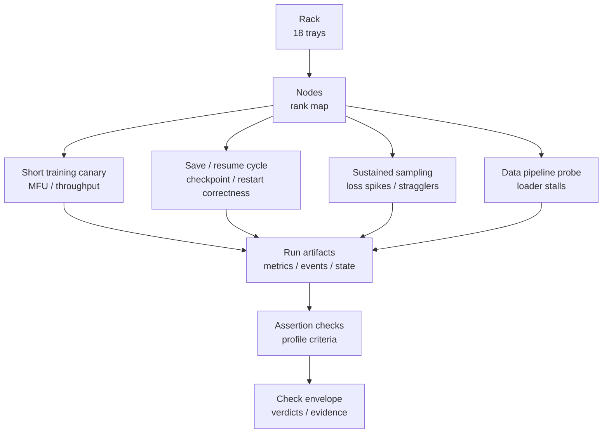

# Training rack briefing

Research date: 2026-10-11.

## Purpose

Our proposed bench checks your training workload on one GB300 NVL72-class rack in Chennai, India.
The rack uses 18 trays.
The plan uses a two-hour `bench training` window before a 30–90-day lease.
The window uses setup, tests, and reporting time.
This document shows proposed checks; it shows no rack measurements.

The design puts training-run validation in scope.
It keeps GPU-device and fabric checks separate.
Your time, your workload answers, and approved recovery drills make the bench possible.

Use PASS only with measurements from the target rack.
PASS must show measured assertions for the named workload.
Vendor specifications do not make PASS evidence.

## Part A — What we test

We use the name `bench training` for the proposed tool.
The tickets below show proposals, not a delivered implementation.
The staged design makes no rack measurements today.

Keep all check names below as proposals.
Keep existing category tests separate.
`bench training` uses their artifacts but checks actual forward, backward, and optimizer work.
It does not make GPU, fabric, storage, internet, inference, or lifecycle tests unnecessary.

This table shows the proposed 120-minute schedule.

| Minutes | Activity | Result |
| --- | --- | --- |
| 0–10 | Make the profile final; keep health and rank-map records. | Complete provenance and pre-run counters. |
| 10–25 | Run known-answer steps and reference/control branches. | Numerical baseline and state checks. |
| 25–80 | Run full-rack training with representative input. | Throughput, MFU, rank timing, loss, and thermal series. |
| 80–105 | Put state in a checkpoint, remove a worker, start again, and check state. | Checkpoint commit, recovery timing, resume result. |
| 105–115 | Remove a save in flight, or run the checkpoint-rejection check. | Prior-generation recovery and explicit rejection. |
| 115–120 | Keep final counters; make the evidence summary. | Counter deltas, coverage, verdicts, and misses. |

Run telemetry collection through the complete window.
Put checkpoint time in reserve, based on measured state size and backend performance.
If a representative restore runs past the budget, show incomplete coverage.
Do not use a tiny checkpoint without a statement of the size difference.

Put the agreed input and container in place before the timed window; keep staging records separate.
Do not start process interruption without operator approval.
Do not put PCIe reset, hardware-error injection, or power removal in the default suite.

The bench puts these measurements on record:

- Useful tokens/s and step-time p50/p95 after warmup
- MFU from a declared formula, useful tokens, and precision peak
- Wall-clock goodput over the complete window
- Per-rank compute, communication, and input-wait spans
- Loss, gradient norm, and batch IDs per step
- Checkpoint save, publication, and restore timings
- Recovery timing: detection, relaunch, load, first valid step

Use this architecture for workload checks and the Check evidence envelope.

### Why we test this

You check one concrete question: can this rack run a 54-day training workload?
Use more than a fast GPU benchmark for a 30–90-day commitment.
The run must also keep correct updates, usable data, checkpoints, and recovery.

**Recovery and checkpoints.**
Your concern: unexpected interruptions can remove useful progress from a long run.
Llama 3 shows 419 unexpected interruptions in a 54-day snapshot (ai-labs §2).
Mitigation: checkpoint and resume checks show restored state, and a canary runs after each restart.

Meta shows 466 interruptions during a 54-day Llama 405B snapshot.
This total shows 47 planned interruptions and 419 unexpected interruptions.
Approximately 78% of unexpected interruptions show confirmed or suspected hardware issues.
The paper puts 58.7% of unexpected issues on GPUs.
Some printed table percentages show a mismatch with their counts.
Keep the prose denominators; do not make silent repairs in the table.

Meta shows more than 90% effective training time despite these interruptions.
These fleet observations do not show this rack's future failure rate.
Check ai-labs §2 and [Meta §3.3.4](https://arxiv.org/html/2407.21783v3#S3.SS3.SSS4).

**Numerical canary and loss screening.**
Your concern: valid-looking updates can still make wrong state.
BLOOM shows RNG and tensor-parallel state defects after restart (ai-labs §§3.2, 5).
Meta shows silent in-range corruption (large-companies §5).
Mitigation: numerical reference checks and loss screening use correlated evidence.

**Accounting.**
Your concern: a high MFU number can keep weak useful progress hidden.
PaLM shows the original MFU definition (ai-labs §4; academia §3).
Mitigation: the accounting checks use a declared MFU formula and full-window goodput.
Throughput checks keep post-warmup performance separate from pauses.

**Straggler and data checks.**
Your concern: one slow node can make useful progress smaller.
MegaScale shows that synchronous training cannot run ahead of slow ranks (large-companies §3).
Mitigation: sustained sampling shows per-rank outliers.

Your concern: a data stall can make a false hardware verdict.
MegaScale and BLOOM show loader stalls with fabric-fault symptoms (large-companies §3.3; academia §4).
Mitigation: the loader probe keeps input wait separate from compute and collectives.

**Workload profile and adapters.**
Your concern: wrong launcher or transport settings can make false results.
Hyperscalers show platform-specific transport and launcher constraints (hyperscalers §§2, 9).
Mitigation: profile and adapter checks keep versions, rank map, and transport on record.

**Incomplete saves.**
Your concern: an interrupted save can make an incomplete generation.
CheckFreq shows staging and persistence as different operations (academia §§2.2, 4.3).
Mitigation: the checkpoint-reject drill removes incomplete generations from use.
It checks recovery from the prior complete generation.

**Load and temperature.**
Your concern: static checks can keep load-dependent faults or later performance changes hidden.
Meta shows load-dependent faults and 1–2% diurnal throughput variation (large-companies §2; ai-labs §2.3).
Mitigation: the canary and sustained sampling check numerical state and load telemetry.
Keep pre/post error counters, clocks, power, temperature, and throttling on record.

**Health checks and job recovery.**
Your concern: health checks can remove active work.
Node repair does not necessarily start the job again.

Public provider evidence shows availability terms and recovery mechanisms.
It does not show comparable multi-week job interruption distributions for the reviewed neoclouds.
Health checks can also start interruptions.
ClusterMAX shows Together checks that start an incorrect drain of active nodes after diagnostic timeouts.
It shows one Nebius GB300 end-to-end recovery event of 8h40m.

Mitigation: check active/passive health policy.
Run intrusive diagnostics only on isolated allocations.
Recovery drills use the actual launcher and check restored progress.
Do not use these events as provider-wide MTTR estimates.
Check neoclouds §§8–9 and [ClusterMAX 3.0](https://newsletter.semianalysis.com/p/clustermax-30-the-industry-standard).

**Lease end and replacement.**
Your concern: allocation removal or missing replacement capacity can remove long-run progress.
Lambda shows ephemeral-data removal at lease end (neoclouds §8.3).
Mitigation: handoff checks keep notice, durable-storage ownership, and replacement responsibility on record.
Capacity terms can remove allocations or make changes to them (hyperscalers §3).
These checks do not show future replacement capacity.

ClusterMAX 3.0 already shows real dense and MoE training workloads.
It also shows an eight-hour combined compute/network burn-in.
Its public `cmax` tool still runs as a configuration audit.
The inspected public methodology does not show numerical resume equivalence or multi-week survival.
Do not put ClusterMAX in a checkpoint-only or synthetic-only category.
Explicit training-state correctness and progress accounting make the proposed difference.

Keep this as a bounded public-method gap, not a claim about private procedures.
Check clustermax §§2–3 and [public cmax](https://github.com/SemiAnalysisAI/clustermax).

A successful drill shows an exercised recovery path.
It does not show 54-day survival or all-SDC absence.

### Failure-mode catalog

“2h” shows feasibility inside the proposed window, under workload and checkpoint-size limits.
A “Yes” check can make the fault visible; it does not show every occurrence.

| Failure mode | Evidence and mechanism | 2h | Catching check |
| --- | --- | --- | --- |
| Missing ranks or wrong topology | Hyperscalers §§2, 9: transport and topology must use platform-specific setup. | Yes | Keep unique ranks, device identities, tray mapping, and selected transport. |
| High MFU with weak accounting | AI-labs §4; academia §3: FLOP convention, precision peak, and time make different MFU values. | Yes | Show the formula, useful tokens, precision peak, and measured interval. |
| Fast steps but poor progress | AI-labs §§2, 4; large-companies §§4, 6: recovery and pauses can make useful progress smaller. | Yes, short window | Show steady-state throughput and full-window goodput separately. |
| Slow GPU or tray | Large-companies §3: synchronous training cannot run ahead of slow ranks. | Partial | Check repeated per-rank compute and communication spans. |
| Timeout with wrong diagnosis | Large-companies §3.2: a rank can run into a stall before the collective starts. | Yes | Put collective sequence, rank logs, loader wait, and fabric counters on one timeline. |
| Data-loader starvation | Large-companies §3.3; academia §4: data waits can show fabric-fault symptoms. | Partial | Check cache states and keep input-wait logs per step. |
| Load-dependent hardware error | Large-companies §2: static checks can keep transient faults hidden. | Partial | Run actual training; check pre/post error counters and load telemetry. |
| Thermal throughput decline | AI-labs §2.3: Meta shows 1–2% diurnal variation. | Partial | Keep logs of clocks, power, temperature, throttling, and throughput over time. |
| Loss spike or non-finite update | AI-labs §3; books §2: numerical and hardware causes make two different classes. | Partial | Keep loss, gradient norm, batch IDs, rank state, and hardware logs. |
| Silent in-range corruption | Large-companies §5: silent corruption can put errors inside valid-looking gradients. | Partial | Run known-answer steps again and check reference state. |
| Weights-only recovery | AI-labs §§3.2, 5: optimizer, TP, and RNG defects can make recovery invalid. | Yes | Check full resume state against an uninterrupted control. |
| Partial checkpoint selection | Academia §§2.2, 4.3: staging and persistence make two different operations. | Yes | Remove the process during an in-flight save; do not use incomplete generations. |
| Async save mistaken for durable save | Academia §2.1; large-companies §4.3: host staging starts before persistence. | Yes | Keep snapshot, persistence, and publication completion records separate. |
| Automatic node repair without job resume | Hyperscalers §2.1; neoclouds §8: repair and resume make two different outcomes. | Partial | Remove a worker; check launcher action and restored progress. |
| Health check drains active work | Neoclouds §8.4: intrusive diagnostics and timeouts can make false failures. | Partial | Check the active/passive policy; run tests only on isolated allocations. |
| Restart loop on a suspect node | Large-companies §4.1: repeated retries can make interruption costs larger. | Partial | Check exclusion, bounded retries, and visible resource identity. |
| Lease expiry or missing replacement | Hyperscalers §3: capacity terms can remove allocations or make changes to them. | No future proof | Keep terms, notice handling, replacement ownership, and untested risks on record. |

### Two-hour limits

- A 30–90-day failure rate or a 54-day completion probability.

- Rare silent-error absence, component aging, or all data-dependent faults.

- Day/night or seasonal Chennai cooling and power behavior.

- A recovery-time tail distribution from one or two drills.

- Full tenant-model convergence or quality after trillions of tokens.

- Checkpoint retention through long periods or correlated storage/site failures.

- Multi-rack contention or replacement capacity outside the tested allocation.

- Correctness for different frameworks, precision, topology, data, or model recipes.

A 54-day interval makes 1,296 hours: 648 times the test window.
This ratio shows duration, not reliability.
Academia §5 shows why zero events do not put a useful bound on long-run rates.
Do not use pooled GPU-hours to keep common rack failure modes hidden.

### Measurement rules

Make the profile final before the run.
Keep a record of model architecture, initialization, sequence length, global batch, microbatch, optimizer, and learning-rate schedule.
Keep a record of precision, accumulation precision, parallelism, activation recomputation, seeds, and kernel determinism settings.
Keep a record of dataset identity, sample IDs, packing/padding policy, cache state, loader configuration, and checkpoint target.
Check the actual GPU count and tray participation; do not use the advertised count.

Use a small deterministic reference for state correctness.
Use a representative rack-scale dense workload for performance and stalls.
Use an MoE workload when the tenant's workload uses expert collectives.
Use MoE in part of the dense window; do not silently make the two-hour budget larger.
A small workload does not show 405B convergence or checkpoint-scale recovery.
Check ai-labs §§4–6, hyperscalers §9, and clustermax §2.3.

Make one definition for useful tokens: non-padding training tokens in valid optimizer updates.
Show the effect of packing, masking, auxiliary objectives, and MoE routing on that count.
Do not use total MoE parameters as dense activated FLOPs.
Keep HFU and MFU separate; do not use executed recomputation as necessary model FLOPs.

`MFU = useful_model_FLOPs_per_token * useful_tokens_per_second / (GPU_count * precision_peak_FLOPs_per_GPU)`

This formula must use a declared architecture-specific FLOP convention.
Show whether the precision peak uses sparsity.
Use a peak appropriate to the operations; mixed precision must use explicit assumptions.

Show the peak source, not only the percentage.
Show warmup exclusion and interval boundaries.
Keep useful tokens/s beside MFU.
Check ai-labs §4 and academia §3.

`wall_clock_goodput = unique_accepted_training_tokens / complete_elapsed_seconds`

Setup, warmup, validation, checkpoints, stalls, and recovery make up the denominator.
Do not put rolled-back or replayed progress in the count two times.
Keep a separate record of executed tokens when useful.
Show paid GPU-hour goodput only with support from actual allocation and billing records.
Do not use service uptime, device utilization, or MFU as useful progress.
Check neoclouds §5 and large-companies §4.2.

For recovery, keep checkpoint age and progress lost before restart on record.
Keep event detection, diagnosis, replacement, relaunch, state load, and warmup separate.
Also keep time to the first valid update and time to previous progress on record.

Expected rollback can run batches again; show those repeats.
Make silent data skipping or unexplained order changes a FAIL.
One observed drill does not make an MTTR distribution.
Check ai-labs §5 and large-companies §4.

Put model shards, optimizer state, master weights, scheduler state, and applicable precision/scaler state in the checkpoint.
Put global step, consumed tokens, RNG state, sampler state, and data position in the checkpoint.
Put framework-specific FP8 history or other numerical state there when the trainer cannot run without it.

Keep a record of configuration, tokenizer, dataset, and parallelism identities.
Make each checkpoint at a complete optimizer-step boundary unless the format keeps partial accumulation.
Check every shard and the published generation manifest.
A host-memory snapshot does not make durable persistence.
A completed async submission does not necessarily make a completed write.

Check an uninterrupted control against a resumed branch with the same remaining batch sequence.
Check next sample IDs, step counters, learning rate, loss, gradients, and model/optimizer tensors.
Make absolute/relative tolerances explicit before the test.

Use bitwise equality only where deterministic execution makes it valid.
Check changed topology separately; a same-topology PASS does not show resharding correctness.
Remove incomplete, stale, or corrupt generations from use per the defined recovery policy.
Check ai-labs §5, academia §4.3, and books §2.2.

### Check and result matrix

| Proposed check | Procedure | Required evidence | Basis |
| --- | --- | --- | --- |
| `training.profile` | Make the recipe final; keep a list of ranks and transport. | Configuration hashes, actual rank map, versions, logs. | Hyperscalers §9; books §3. |
| `training.numerics` | Run seeded reference updates; check expected state. | Loss, gradients, finite checks, tensor differences, tolerance. | AI-labs §§3, 5; large-companies §5. |
| `training.throughput` | Run repeated post-warmup windows at full rack scale and keep the measurements. | Useful tokens/s, step-time p50/p95, sample count, time series. | AI-labs §4; academia §4. |
| `training.mfu` | Make the calculation: declared model FLOPs over measured time. | FLOPs/token formula, precision peak, GPU count, interval. | AI-labs §4; academia §3. |
| `training.rank_skew` | Check per-rank compute, communication, and wait spans. | Rank/tray identity, timing distributions, persistent outliers. | Large-companies §3; academia §2.1. |
| `training.input` | Use actual loader and storage path in declared cache states. | Batch IDs, input wait, storage/CPU counters, GPU idle. | Large-companies §3.3; books §4. |
| `training.checkpoint_commit` | Put complete state in the checkpoint; check publication and reload. | Shard inventory, hashes, commit marker, bytes, stage timings. | Academia §§2.2, 4.3; ai-labs §5. |
| `training.resume_equivalence` | Start again at a step boundary; check the remaining updates. | Counters, next batches, state tensors, validation loss. | AI-labs §5; books §2.2. |
| `training.recovery` | Remove an approved worker; start the run again through the actual launcher. | Detection, relaunch, load, first valid step, rollback. | Hyperscalers §2; large-companies §4. |
| `training.checkpoint_reject` | Remove the process during a save. Check the newest generation. Remove it from use if incomplete. Use the prior complete generation. | Explicit rejection; successful load of the prior complete generation. | Academia §4.3; ai-labs §6. |
| `training.loss_triage` | Put a software anomaly in an isolated reference run. | Synchronized evidence capture and correct event classification. | Books §2.1; large-companies §5. |
| `training.goodput` | Make a count of accepted unique progress over the complete window. | Progress counters, pauses, replay, skipped updates, billing basis. | AI-labs §4; neoclouds §5. |

Use `PASS`, `FAIL`, `NOT_TESTED`, and `INCONCLUSIVE` per assertion.
Use numeric gates only when the profile makes thresholds explicit before the run.

Without a threshold, show the measurement; do not make a performance PASS.

Unexplained rank loss, wrong collective output, invalid updates, or state mismatch make correctness assertions FAIL.
A retry does not remove the first failure.
Show every attempt, intervention, excluded component, and final configuration.
Keep short-run workload success separate from injected-recovery success.
Do not show this certificate as “54-day reliable” or “SDC-free.”

Suggested result text:
“This configuration completes the named workload during the stated interval.
The report contains measured throughput, numerical checks, and the tested recovery result.
The result does not establish multi-week reliability or full-run convergence.”

MLPerf Closed uses time to a defined quality target under benchmark rules.
Open can use different stopping behavior with reported quality.
General rules make checkpoint retention optional, with workload-specific exceptions.
Neither result makes interruption-recovery certification.
Check academia §3 and [MLPerf rules](https://github.com/mlcommons/training_policies/blob/master/training_rules.adoc).

### Provider and version adapters

Keep a record of container digest, code revision, driver, CUDA, NCCL, framework, firmware, launcher, and environment.
Use these pinned versions in every adapter and in the profile record.

NVIDIA's rerun state machine runs the work again on the same and different GPUs.
It can make numerical behavior distinct from hardware effects; NVIDIA puts an experimental label on it.
NVRx straggler detection keeps training running by default.
Check enabled features and constraints in the pinned release.
Check [Megatron Bridge resiliency](https://docs.nvidia.com/nemo/megatron-bridge/latest/training/resiliency.html).

### Implementation proposals

These tickets show proposed work; they do not show an existing `bench training` implementation.

1. **Profile schema.** Make fields for pinned workload, topology, precision, data, checkpoint, thresholds, and tolerance.

2. **Training runner.** Use the selected framework's existing trainer and launcher; do not make a new training framework.

3. **Reference branch.** Make seeded control/resume runs with full-state comparison and explicit determinism limits.

4. **Step telemetry.** Keep per-step loss, gradients, sample IDs, tokens, skipped updates, and phase timings.

5. **Rack telemetry join.** Put GPU, fabric, storage, and host events together by timestamp and rank/tray identity.

6. **Accounting module.** Make MFU and goodput calculations from declared conventions and measured progress.

7. **Checkpoint verifier.** Check generation publication, shard integrity, restore state, and next data position.

8. **Recovery drill.** Put operator-approved worker termination, bounded retries, and phase-specific timing in the drill.

9. **Incomplete-save drill.** Remove the interrupted generation from use; run from the previous complete generation.

10. **Verdict report.** Put per-assertion states, raw evidence paths, every attempt, and untested limits in the report.

11. **Long-run runbook.** Make runbook definitions for alerts, quarantine ownership, checkpoint cadence, retention, and periodic restore drills.

12. **Tenant handoff.** Keep maintenance notice, lease end, replacement capacity, response objectives, and billing treatment on record.

Use the existing report and artifact conventions when maintainers make the implementation-plan selection.
Keep the default suite safe and rack-local.
Keep scale-out topology and destructive fault drills as separate approved profiles.

### What the tests assume

Use this list to check the rack today, not a future state.

- A named workload with declared model, precision, parallelism, and data identity
- Operator approval for process interruption before each drill
- A default suite without PCIe reset, hardware-error injection, or power removal
- Durable checkpoint storage and the actual tenant launcher
- Thresholds and tolerances fixed in the profile before the run
- GPU, fabric, storage, internet, inference, and lifecycle tests run separately
- The pinned container, input, and staging in place before the timed window

## Part B — Discovery questions

Your answers make the bench profile.

### 1. Scheduler

- Which scheduler starts your training jobs?
- Does the scheduler start a job again after a node failure?
- Does it use a checkpoint, or does it run the job from the beginning?
- Which auto-resume settings does it use?

### 2. Checkpoint storage

- Which file system keeps your checkpoints?
- Do all ranks use one shared checkpoint path?
- Does the storage keep checkpoint data after a node loss?
- How much space does one checkpoint use?

### 3. Spot and preemptible policy

- Do you use spot or preemptible nodes for training?
- What notice does a preemption send?
- Can the trainer make a checkpoint from that notice?
- Do you keep a replacement node on site?

### 4. Checkpoint tools and state contract

- Which checkpoint tools does your trainer use?
- Does the saved state keep optimizer, scheduler, RNG, and data position?
- Do you check a restore before a long run?
- Does the checkpoint format keep partial accumulation?

### 5. Run window and approval

- Who must send approval for process interruption?
- Which hours can we use for the two-hour window?
- Can a maintenance notice start during the window?
- Which evidence do you keep from earlier runs?

## Part C — The default configuration we look for

This setup makes the strongest evidence.
If you use less, send us a note.
We run only approved checks.
The report shows the difference.

| Item | What we look for | If you have less |
| --- | --- | --- |
| Workload | A named tenant workload: model, data, parallelism, precision | We use a representative dense workload |
| MoE | An MoE workload when your job uses expert collectives | Dense only; the report shows the scope |
| Window | Two hours on the rack, setup to report | A shorter window; the report shows the limit |
| Checkpoints | Durable shared storage for complete checkpoint state | Local disk; the report shows the limit |
| Scheduler | Auto-resume that uses the actual launcher | Manual restart; we check the manual path |
| Approval | Operator approval for worker-removal drills | No drills; the report shows NOT_TESTED |
| Profile | Thresholds and tolerances fixed before the run | We show measurements without a performance PASS |
| Staging | Pinned container and input in place before the window | We put staging inside the window; the report shows it |

### What we bring

- We put the bench design, the measurement rules, and the report format in this document.
- We use the proposed bench steps with your team during the window.
- You keep the report.
- The proposed report shows measured throughput, numerical checks, and the tested recovery result.
- The tickets in Part A show proposals, not a delivered implementation.

We send our thanks for your time and hardware.

## Reading list

This document uses seven category briefs:
[neoclouds](../research/training-research/neoclouds.md), [hyperscalers](../research/training-research/hyperscalers.md),
[ai-labs](../research/training-research/ai-labs.md), [large-companies](../research/training-research/large-companies.md),
[clustermax](../research/training-research/clustermax.md), [academia](../research/training-research/academia.md), and [books](../research/training-research/books.md).
The briefs show source URLs and evidence limits.
Section references show sections in those briefs.

- Start with [Megatron Bridge resiliency](https://docs.nvidia.com/nemo/megatron-bridge/latest/training/resiliency.html) and [PyTorch Distributed Checkpoint](https://docs.pytorch.org/docs/stable/distributed.checkpoint.html). These guides show usable mechanisms and constraints, not rack reliability outcomes.

- Use [Llama 3](https://arxiv.org/html/2407.21783v3), [BLOOM chronicles](https://github.com/bigscience-workshop/bigscience/blob/master/train/tr11-176B-ml/chronicles.md), and [MegaScale](https://www.usenix.org/system/files/nsdi24-jiang-ziheng.pdf) for actual operational failures. Use [CheckFreq](https://www.usenix.org/system/files/fast21-mohan.pdf) for checkpoint staging and data-position recovery. Use [MLPerf rules](https://github.com/mlcommons/training_policies/blob/master/training_rules.adoc) for benchmark boundaries.

- Use *Designing Machine Learning Systems* Chapters 6, 8, and 10 for systems context. Use *Reliable Machine Learning* Chapters 4 and 9 for data and monitoring context. Keep these books at the same general reading priority. Their verified contents do not show executable rack-scale recovery procedures.

- Use *Machine Learning Platform Engineering* Chapters 8, 9, and 11 for training metrics, artifacts, and lineage. Its [public Chapter 9](https://livebook.manning.com/book/machine-learning-platform-engineering/chapter-9) shows TensorBoard, MLflow, and dataset management. Use these selected chapters before older cloud-specific pipeline material. Keep *MLOps Engineering at Scale* for cloud-specific pipeline context, not NVL72 fault certification. Keep framework recovery guides; the new title does not show full-book supersession.

- Use *Machine Learning System Design* Chapters 10 and 14 for optional pipeline-testing and monitoring reading. Its [public Chapter 10](https://livebook.manning.com/book/machine-learning-system-design/chapter-10) shows property-based testing.

- Use the [parallelism course](https://learning.oreilly.com/videos/-/9781806110896/?orm_source=mcp) for optional parallel layouts and checkpoint strategies. Its catalog does not show measured rack recovery results.

- Keep *Designing Deep Learning Systems* optional for training-service design. Keep the cloud video and vision book at lower priority for distributed pretraining validation. Do not use alternate audio/video formats as independent technical evidence. *AI Engineering* keeps lower priority for distributed pretraining reliability.

- Use Books §2 and the [catalog supplement](../research/training-research/oreilly.md) for verified coverage and access limits.

These reviewed sources do not show a universal GB300 two-hour PASS threshold.
