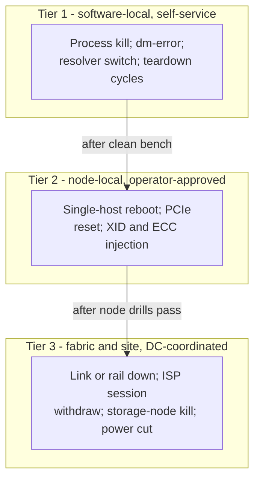

# Drills: controlled fault injection — research and suite design

A fourth stage: **audit → bench → drills → smoke**. Audit inventories a
healthy rack. Bench measures a healthy rack. Smoke soaks a healthy
rack. None of them can answer the tenant's real fear: *what happens
when something dies on day 12?* Drills inject a named fault under a
controlled window and measure the system's honest behavior.

Grounded in the seven research corpora: the storage corpus
(`.lavish/storage-research/`, `docs/storage-bench-research.md`) and the
six domain studies (gpu, network, lifecycle, training, inference,
internet-quality; `docs/*-bench-research.md` in their research
worktrees, to be merged). Section references below point into those
briefs, which carry the URLs.

## The contract

Inject one named fault. Measure five observables:

1. **Detection** — did any health signal fire (kernel log, ECC
   counter, XID, monitoring), and how fast?
2. **Attribution** — did the error surface at the right layer with the
   right identity (process, device, host, link), or was it swallowed?
3. **Containment** — blast radius: one process, one node, one rail, or
   the whole rack?
4. **Recovery** — the phase-separated timeline: detect → diagnose →
   relaunch/replace → state load → first valid work.
5. **Data outcome** — survived, torn (detected), or lost. Acknowledged
   data must never be lost.

**A drill FAILs only when the system lies.** A fault that produces a
clean error, a contained failure, and an honest recovery is a PASS
(observed). A fault that is silently retried, misattributed,
swallowed, or destroys acknowledged data is a FAIL. Everything else is
data. This is the grading contract the other stages already follow
(failure is data; PASS means observed) applied to the unhealthy path.

## Safety model — three tiers

Rules for every drill, all tiers:

- A pre-flight consent gate names the exact target IDs; `--yes` never
  authorizes Tier 2+ (lifecycle research: "a generic --yes must not
  authorize whole-rack reboot, media wipe, or production eviction").
- A named recovery path exists before injection; abort criteria and a
  cleanup reserve are declared up front.
- A post-drill canary proves return to useful work: fresh process,
  fresh connection or QP, verified read of pre-drill data.
- Tier 2 and 3 run one target at a time, never all 18 trays.
- Orphan sweep after every kill drill: every run-owned artifact is
  found and removed or reported.

## Check catalog

Names are proposals, not registered checks. Evidence pointers name
the domain brief and section that motivates each drill.

### Tier 1 — software-local

| Drill | Injects | Inspects | Evidence |
| --- | --- | --- | --- |
| `drills.storage.torn_save` | kill an in-flight verified save | incomplete generation rejected; prior complete generation loads; no torn manifest | training §checkpoint_reject; storage ai-labs §5 |
| `drills.storage.eio` | `dm-error`/`dm-flakey` on a scratch device | EIO reaches the caller; retried fsync never reports success for dropped data | hyperscalers §4.3 (fsyncgate); academia §probe |
| `drills.storage.orphan_sweep` | kill this suite's workers mid-write | cleanup finds every owned object; zero orphans | suite contract; lifecycle §offboard |
| `drills.storage.mount_flap` | unmount/remount an owned mount | mounts stay mounted; client errors, never silent hangs | clustermax storage §2; user-complaint corpus |
| `drills.storage.quota_fill` | fill a run-owned volume to its edge | behavior at DiskPressure-class thresholds, bounded | lifecycle §provisioning; clustermax §6 |
| `drills.process.kill_worker` | kill one rank/writer mid-workload | detection, relaunch, state load, first valid step, rollback accounting | training §recovery |
| `drills.process.resume_equivalence` | stop at a step boundary | remaining updates match an uninterrupted control | training §resume_equivalence |
| `drills.inference.server_kill` | kill the serving engine under load | in-flight requests error (not hang); endpoint recovery; first valid generation | inference §scheduling; lifecycle §useful_work |
| `drills.lifecycle.idempotency` | retry a create with the same key | no duplicate resources | lifecycle §provisioning (Borg) |
| `drills.lifecycle.change_rollback` | reversible job-level change | actual state returns to known-good | lifecycle §change |
| `drills.lifecycle.revoke` | revoke a test credential | old token fails, fresh auth works, session policy recorded | lifecycle §reclaim; books §1.3 |
| `drills.dns.resolver_kill` | take the primary resolver out | fallback works; resolution latency change recorded | internet §DNS pathologies |

### Tier 2 — node-local, operator-approved

| Drill | Injects | Inspects | Evidence |
| --- | --- | --- | --- |
| `drills.host.reboot` | reboot one approved host | boot ID changes; services return; ephemeral data gone, persistent data survives; useful work after | lifecycle §reboot; neoclouds #16 |
| `drills.gpu.xid_inject` | DCGM error injection on one GPU | monitoring-response time and attribution (tests the monitor, not the hardware — NVIDIA's own semantics) | gpu §injection semantics; clustermax §3 |
| `drills.gpu.pcie_reset` | PCIe bridge reset on one device | real XID 79; recovery; driver state | clustermax §3 (their published drill) |
| `drills.healthcheck_behavior` | run platform health checks during active tenant work | checks observe without draining active work (the Together false-drain failure) | training §health-check; neoclouds §8 |

### Tier 3 — fabric and site, DC-coordinated

| Drill | Injects | Inspects | Evidence |
| --- | --- | --- | --- |
| `drills.fabric.link_down` | one link or rail down | reroute convergence; collective recovery; no silent transport fallback (NCCL dropping to TCP must be disclosed) | network §transport; clustermax §teardown |
| `drills.fabric.teardown_under_load` | RDMA teardown during full-rate transfer | clean teardown vs hang (the Oracle 391 Gb/s rails + failed teardown lesson) | network §clustermax §3 |
| `drills.fabric.storage_node_kill` | kill a storage node / active MDS | client stall time; failover; blast radius (GPFS token hang is the failure mode) | parallel-fs §1.2; clustermax §3 |
| `drills.isp.withdraw` | withdraw one ISP session (multi-ISP site) | convergence time; route change; throughput dip duration | internet §WAN failover (the declared miss, now a drill) |
| `drills.power.cycle` | coordinated power cut to one rack segment | acknowledged data survives (the FAST'13 13-of-15 SSD lie test; Meta's standing PowerLoss Storm drills) | hyperscalers §5; academia §FAST'13 |

## What drills cannot certify

- Spontaneous provider events (real preemption needs provider
  support; simulation is labeled simulation, never a substitute —
  lifecycle §preemption)
- Multi-tenant neighbor faults and true noisy strangers
- Correlated rack-scale failures beyond the injected scope
- DDoS absorption and WAN behavior outside our ISPs
- MTTR distributions — one drill is one observation, not a tail
- Safety-limited injection depth: no firmware bricking, no media
  wipes, no production evictions in any default profile

## Relationship to the other stages

Drills run after a clean `bench` (a rack that fails at rest is not
worth breaking) and use bench-shaped fixtures: verified checkpoints
from the storage/training benches, canary collectives from the
network bench. Smoke remains the soak: sustained load, error ledgers,
availability accounting. A sensible certification day: audit (30 min)
→ bench (2 h) → Tier 1 drills (30 min) → smoke (4 h+), with Tier 2/3
drills scheduled around DC operations windows. Smoke may repeat light
Tier 1 drills between soak phases.

## Implementation tickets

1. Consent-gate and target-manifest plumbing (tier-aware; refuses
   Tier 2+ without named operator approval).
2. Injection adapters: process kill, dm-error mapping, resolver
   control, credential revocation — Tier 1 first.
3. Observable recorder: the five-observable record per drill, with
   pre/post health-counter deltas and phase timelines.
4. Post-drill canary framework (useful-work gate, fresh-QP check,
   verified read-back).
5. Orphan-sweep integration with the existing owned-key cleanup.
6. Tier 2 host adapters (BMC reboot, DCGM injection) behind the gate.
7. Tier 3 coordination runbook per DC (the partnership model: the DC
   pulls the link, we measure).
8. Verdict layer: the "fails only when the system lies" grading rules
   and declared-misses block.
