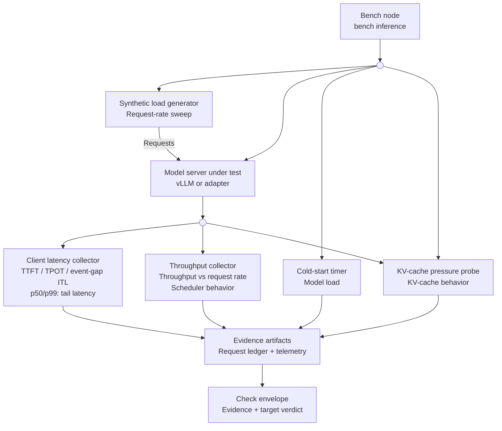

# Inference quality briefing

## Purpose

Your users use model outputs, not vendor rate claims.
This document shows proposed inference checks for a GPU rack in your datacenter.
The checks show usable serving capacity, not only GPU availability.
Part A shows the checks and the reasons for them. Part B shows our questions about your serving setup.
Part C shows the default setup for the strongest evidence.

Each proposed run makes one evidence report. You keep the report.
The report shows results only at measured operating points.

This document uses seven sourced briefs:
[neoclouds](file:///home/avirus/.herdr/worktrees/rack-bench/research-inference/.lavish/inference-research/neoclouds.md),
[hyperscalers](file:///home/avirus/.herdr/worktrees/rack-bench/research-inference/.lavish/inference-research/hyperscalers.md),
[ai-labs](file:///home/avirus/.herdr/worktrees/rack-bench/research-inference/.lavish/inference-research/ai-labs.md),
[large-companies](file:///home/avirus/.herdr/worktrees/rack-bench/research-inference/.lavish/inference-research/large-companies.md),
[clustermax](file:///home/avirus/.herdr/worktrees/rack-bench/research-inference/.lavish/inference-research/clustermax.md),
[academia](file:///home/avirus/.herdr/worktrees/rack-bench/research-inference/.lavish/inference-research/academia.md), and
[books](file:///home/avirus/.herdr/worktrees/rack-bench/research-inference/.lavish/inference-research/books.md).
Use the [nine-source O'Reilly supplement](file:///home/avirus/.herdr/worktrees/rack-bench/research-inference/.lavish/inference-research/oreilly.md) for bounded reading context.
`oreilly §N` references below show its numbered synthesis sections.
Each section reference below shows its claim URLs and evidence markers.
The design recommendations are inferences, not published rack measurements.

Research date: 2026-10-11.
Target: `rack-bench bench inference`, within audit → bench → smoke.
Rack context: GB300-class, NVL72-class, 18 trays, Chennai, India.
The checks in this document are proposals. The document makes no claim that project code already uses these checks.

### Delivery boundary

The requested project destination is `docs/inference-bench-research.md`.
The research write boundary makes a change to that destination impossible for this orchestrator.

## Part A — What we test

Our proposed tool command is `rack-bench bench inference`.
The tool runs inside the audit → bench → smoke sequence.
One certify run uses a fixed 120-minute budget.
The run uses eight timed stages. The budget table below shows each stage.
The suite name is `bench inference`.

### CLI proposal

`rack-bench bench inference --profile quick|certify --endpoint URL --model ID --workload FILE`

Proposed controls: `--hosts`, `--gpu-manifest`, `--rate`, `--burstiness`, `--max-concurrency`, `--duration`,
`--warmup`, `--timeout`, `--drain-timeout`, `--cache-policy`, `--slo-file`, `--quality-reference`, and `--yes`.
A launched-server mode also makes `--server-command` and explicit artifact/cache state necessary.
Use an existing versioned serving client before making another load generator.
Check its metrics and actual-send behavior before use of its results (ai-labs §2.2.1, §5).

The quick profile shows configuration, baseline, and one controlled load point.
It makes no certification of a full capacity curve or quantization fidelity.
The certify profile uses the fixed two-hour budget and shows every omitted check.
The smoke stage can make repeated runs of selected points over time with the same workload identity.
No research result shows the current existence of these CLI flags.

### Fixed two-hour certification budget

Put model files, server image, and evaluators in place before the timed run.
Pre-staging makes no cold download or cold engine-build performance measurement.
Use one declared model and serving configuration.

| Window | Check | Bound |
| --- | --- | --- |
| 0–15 min | Identity, documented launch, ready/first inference | Put a stop to startup measurement at budget; put unfinished startup on record |
| 15–30 min | Paired task-quality screening | Use a matching verified reference or show the check unavailable |
| 30–45 min | Warmup and low-rate shape baselines | Keep cold first request outside warm statistics |
| 45–75 min | Finite offered-rate sweep | Use a small set of discrete points; put drain time in reserve |
| 75–90 min | Mixed prefill/decode interference | Make a comparison of the short class against its isolated baseline |
| 90–105 min | KV pressure and prefix contrast | Put bounds on lengths, memory pressure, and reset cost |
| 105–115 min | Run one selected point again | Check client limits and telemetry drift |
| 115–120 min | Evidence and limits | Put raw artifacts, statuses, and sample counts on record |

The table shows a total of 120 minutes. It shows a diagnostic allocation, not a guaranteed full suite.
Drain and cache resets use time inside each window.
Reference loading, slow startup, and few requests can make complete coverage impossible.

If the server keeps an unavailable state, show dependent checks unavailable; do not make up results.
Do not make a capacity-boundary claim without measurement of the necessary points.
Do not make a rack-wide coverage claim without a record of every required resource.

Use an adaptive sweep around the observed latency limit when the tenant sends one.
Without a target, show measured curves and show target verdict `not-set`.
Do not make one frontier from different shapes, precisions, or cache conditions.
Keep the best measured passing point; make no interpolation of unmeasured capacity.

### Check families

All identifiers below are proposed names, not claims about existing repository checks.

| Proposed check | Measurement | Diagnosis | Evidence |
| --- | --- | --- | --- |
| `inference.identity` | Model, stack, precision, allocation, topology | Unmatched runs; incomplete rack coverage | ai-labs §11; clustermax §4 |
| `inference.load.ready` | Launch to discovery-ready | Process/model-load delay | clustermax §2; neoclouds §4.4 |
| `inference.load.first` | Launch to first valid generation | Ready endpoint without usable inference | ai-labs §8; clustermax §7 |
| `inference.baseline` | Low-rate short/long shape latency | Unloaded prefill/decode issues | neoclouds §6; academia §5.1 |
| `inference.rate.sweep` | Finite independent arrivals at discrete rates | Queue growth; usable-capacity limit | academia §4.2, §5.3 |
| `inference.concurrency` | Closed-loop or simultaneous saturation | Backend ceiling only | ai-labs §3, §5; hyperscalers §4.2 |
| `inference.scheduler.mixed` | Short-class latency with long-prompt traffic | Prefill/decode interference | academia §2.3; large-companies §3.1 |
| `inference.kv.pressure` | Active contexts, occupancy, queue, outcomes | Preemption, rejection, OOM, stalls | ai-labs §6.3; large-companies §3.3 |
| `inference.prefix.contrast` | No-reuse versus controlled prefix reuse | Cache-dependent speed claims | books §3.4; neoclouds §4.3 |
| `inference.quality.screen` | Reference/candidate task scores and lengths | Tested-task quantization regressions | academia §4.4; large-companies §3.4 |
| `inference.repeat` | Repeated selected rate plus telemetry | Short-window drift and inconsistent measurements | hyperscalers §5; large-companies §6 |
| `inference.evidence` | Raw samples, configurations, counts, omissions | Non-reproducible certificate | ai-labs §11; academia §4 |

This diagram shows the bench-run architecture and the evidence path into the Check envelope.

Do not make deprecated engine metrics necessary.
Use engine-specific adapters for queue, running/waiting requests, KV blocks, hits, and preemption.
Missing internal telemetry puts limits on causal diagnosis; it does not remove valid external latency.
Keep a record of GPU memory, power, temperature, clocks, errors, and utilization when available.
Correlated telemetry keeps value for diagnosis, but it makes no proof of the cause by itself.

### Measured items

The proposed checks show these items on the serving endpoint:

- Output, input, and request rates at each measured load point
- Aggregate output tokens/s divided by all allocated serving GPUs
- Time to first token (TTFT), from the send time and from the scheduled time
- Request time per output token (TPOT) and event-gap inter-token latency (ITL)
- p50 and p99 latency, with the sample count N
- Goodput: successful work within all declared gates
- Startup time to ready, and startup time to first valid output
- KV-cache occupancy, queue, preemption, rejection, and OOM events
- Prefix-cache hit rate, when the engine shows hit counters
- Task-quality scores against a matching reference
- Participating GPUs for each tray and replica

### Evidence and target verdicts

PASS shows a valid measurement, not vendor approval or a universal performance threshold.
A measured error or slow result keeps its status as evidence. The target verdict can still show `missed`.
Keep evidence status separate from target verdict (ai-labs §11; academia §4).

| Field | Allowed values | Meaning |
| --- | --- | --- |
| Evidence status | `measured`, `invalid`, `unavailable`, `skipped` | Valid data, bad measurement, missing capability, or explicit omission |
| Target verdict | `met`, `missed`, `not-set`, `insufficient-evidence` | Result against predeclared workload-specific conditions |
| Run completeness | `complete`, `partial` | Required checks show valid evidence, or named checks show missing status |

A required check with no evidence makes a complete coverage claim impossible.
Do not show `met` without numeric latency, success, capacity, and quality requirements where applicable.
Do not use Meta or MLPerf targets as rack defaults (large-companies §2.1; academia §4.3).
Use `expected: null` when the tenant sends no target.

### Metric contract

Use one named run cohort and monotonic timestamps.
Keep `scheduled`, `sent`, `first_content`, `last_content`, and `completed` times for each request.
Keep errors, timeout state, cancellation, retry count, and finish reason.
Keep metadata-only events outside TTFT.

| Metric | Proposed definition | Required qualification |
| --- | --- | --- |
| Output tokens/s | Successful cohort output tokens / cohort duration | Start the duration at first scheduled arrival; put its end after completion/drain |
| Input tokens/s | Successful cohort input tokens / same duration | Keep cached input out of the output count |
| Requests/s | Successful completed requests / same duration | Keep offered, sent, rejected, failed, and unfinished counts |
| Output tokens/s/GPU | Aggregate output rate / all allocated serving GPUs | Keep prefill/decode pools in the count; put reserved but unused resources on a list |
| Send-based TTFT | `first_content - sent` | Client transport and endpoint path |
| Schedule-based TTFT | `first_content - scheduled` | Shows generator/admission lateness before send |
| Request TPOT | `(last_content - first_content) / (N - 1)`, N > 1 | Remove N ≤ 1 from the calculation; show the excluded count |
| Event-gap ITL | Consecutive parsed content-event time differences | Not token-gap ITL without one-token-event verification |
| Completion latency | `completed - sent` and `completed - scheduled` | Make both timer names explicit |
| Request goodput | Successful requests meeting all declared gates / cohort duration | One-token TPOT gate is inapplicable; put that policy on record |
| Goodput output tokens/s | Output tokens from compliant requests / cohort duration | Keep it separate from request goodput |
| Prefix hit rate | Interval hit-counter delta / interval query-counter delta | Show the token/block unit; unavailable for zero denominator |
| p50/p99 | Quantiles of the named sample population | Keep N, estimator, weighting, timeout treatment, and uncertainty |

Evidence: ai-labs §2–4, §6; academia §3, §5; hyperscalers §3.
These formulas make the rack-bench choices. They make no silent copy of any tool's convention.
Make generated content necessary for a successful streaming response.
Make a separate definition for any valid empty-output task; keep its TPOT unavailable.

Use authoritative token IDs/counts where available. Show retokenized counts as estimates.
Do not make token counts from event count alone.

For bounded drain, show unfinished requests as incomplete.
Keep their partial tokens in a separate counter; keep them out of successful-output throughput.
A truncated drain shows a partial operating point, not proven sustainable capacity.
Keep admission-window and steady-state token buckets beside cohort rates.
Never put a completion-inclusive numerator over an admission-only duration.

A p99 from N=1,000 independent requests shows about ten expected observations beyond population p99.
This calculation makes no precision guarantee (academia §5.4).
Use request-cluster methods for uncertainty estimation from correlated event gaps.
Do not put event count in place of independent request count.

### Workload shapes

Start with synthetic diagnostic shapes: 1K/256, 8K/256, and 1K/1K input/output token targets.
These shapes keep short work, prefill pressure, and sustained decode pressure separate.
They are proposed fixtures, not representative Chennai tenant traffic.
Use the tenant's versioned mixed-length corpus when available.

Keep actual token counts and stop reasons for every shape.
Forced-length performance tests keep a label separate from natural-EOS quality tests.
For cache contrast, use verified no-reuse prompts and a controlled shared-prefix set.
Unique suffixes alone make no proof of prefix-cache misses (books §3.4; ai-labs §6).

### Why we test this

Each check family shows our answer to one customer concern. Each case below uses a public source in the briefs.
No case shows a failure in your datacenter. No case shows a measured Chennai failure.

| Check family | Your concern | Sourced case | Our mitigation |
| --- | --- | --- | --- |
| `inference.identity` and metric contract | Can you put vendor token rates beside our rack results? | Cerebras shows output speed, not aggregate tokens/s/GPU (neoclouds §3.1). Together's per-GPU figure shows a source-unit conflict (neoclouds §3.2) | Keep user speed, aggregate output, numerators, and allocated GPUs separate |
| `inference.baseline` | Does one prompt shape show capacity for all your traffic? | Sarathi-Serve shows capacity differences for different prompt shapes (academia §5.1) | Run short and long shapes at low rate; keep actual lengths and stop reasons |
| `inference.rate.sweep` | Does the endpoint keep your p99 TTFT limit under load? | Google makes concurrency higher until p99 target violation. It keeps sustained throughput at that boundary (hyperscalers §4.3) | Run the request-rate sweep with tail collectors. Keep discrete passing/failing points and N for each p99 |
| `inference.load.ready` and `inference.load.first` | Does a ready endpoint make valid output? | RunPod shows cold-start paths with differences from cached models and active workers (neoclouds §4.4) | Keep ready and first-valid-inference timers separate; keep each cache state |
| `inference.scheduler.mixed` | Do long prompts make short requests late? | Sarathi-Serve shows long prefill work that makes decode iterations late (academia §2.3) | Put long prompts beside short streams; check the short class against its isolated baseline |
| `inference.kv.pressure` | What does the endpoint show near its KV-cache limit? | Cloudflare shows BF16 KV-cache OOM in one H200 deployment. FP8 KV still runs at that concurrency (large-companies §3.3) | Use more active contexts within approved limits; keep preemption, rejection, and OOM; make a safe stop |
| `inference.prefix.contrast` | Do cache hits make speed results too high? | vLLM shows a warning: repeated prompts make throughput too high (neoclouds §4.3; ai-labs §6.2) | Run no-reuse and controlled shared-prefix cases separately; check hit counters |
| `inference.quality.screen` | Does quantization make answer quality worse? | Cloudflare shows speed and score changes for INT4 weights and FP8 KV (large-companies §3.3–3.4) | Use paired fixed-task scores with a matching reference; put the tolerance on record first |
| `inference.concurrency` and client timers | Does the load client put a false limit on capacity? | A concurrency cap makes actual sends late. A closed-loop client sends fewer requests during slowdown (ai-labs §2.2.1, §3) | Use independent scheduled arrivals; keep scheduled and send times and client limits |
| `inference.evidence` and `inference.repeat` | Can another team check and run the result again? | The public cmax tool keeps the performance harness and provider results out (clustermax §4, §6) | Keep raw samples, configurations, counts, and omissions; run one selected point again |

#### Why inference is next

The tenant's requirement is usable serving capacity, not only GPU availability.
A model may run while its endpoint shows poor latency under concurrent traffic.
Batching may make aggregate throughput higher while per-user speed shows a decrease (neoclouds §2; academia §2–3).
Long prompts may make decode requests late. KV pressure may start preemption, rejection, or OOM (academia §2; ai-labs §6).
Weight and KV quantization may make changes to capacity and task quality together (large-companies §3; academia §4.4).

Vendor token-rate claims use different denominators and workloads (neoclouds §3, §7).
Hyperscaler capacity units do not show a portable tokens/s/GPU guarantee (hyperscalers §2).
ClusterMAX shows serving-benchmark descriptions (clustermax §1–3).
Its public cmax tool keeps the performance harness and provider results out (clustermax §6).
Thus transparent, reproducible acceptance evidence makes the useful difference. The absence of competing serving tests does not make it.

The two-hour bench must show throughput, latency, outcomes, and configuration at measured operating points.
The smoke stage can make repeated observations later. This bench makes no claim about production availability.

### Failure-mode catalog

“2h” shows detection within a bounded diagnostic window, not full production certification.
All detection claims start from a ready serving stack and sufficient workload samples.

#### Throughput and latency errors

| Mode | Evidence and mechanism | Rack-bench answer | 2h |
| --- | --- | --- | --- |
| Per-user speed shown as fleet throughput | Cerebras shows output speed; InferenceMAX shows user/GPU rates separately (neoclouds §2–3) | Keep aggregate output, user speed, allocated GPUs, and actual lengths | Yes |
| Prompt tokens shown as generated tokens | Combined-token throughput keeps prefill work in the count (ai-labs §2.1; neoclouds §5) | Keep input/output/combined numerators separate; never put a different name on the combined rate | Yes |
| Abstract capacity shown as achieved throughput | MU/GSU/PTU accounting shows differences by model and workload (hyperscalers §2) | Check successful output and latency under declared arrivals | Yes |
| Saturation shown as interactive capacity | Batching makes throughput higher but may not keep latency limits (academia §2.3; hyperscalers §4.3) | Keep baseline, passing point, failing point, and latency-qualified goodput | Yes, at measured points |
| Closed-loop slowdown keeps queue growth hidden | Slow completions make fewer replacement arrivals (ai-labs §3; academia §5.3) | Use independent scheduled arrivals; keep closed-loop diagnostics separate | Yes |
| Generator bottleneck shown as server capacity | Concurrency caps make actual sends late (ai-labs §2.2.1, §3) | Keep scheduled/send times, CPU/connection limits, and generator lateness | Yes, with client telemetry |
| Host timing shown as client TTFT | Gateway/server boundaries keep different delays out (large-companies §2.2; ai-labs §2.2) | Keep client and server timers under different names | Yes |
| First metadata event shown as first token | Streaming events may show no generated content (ai-labs §2.2.1, §2.3) | Start TTFT at first generated content; keep parsed event records | Yes |
| Bundled tokens keep individual gaps hidden | Speculation may send several tokens per event (ai-labs §2.3) | Use the event-gap ITL name; do not make up individual token timestamps | Yes, for event gaps only |
| Request TPOT keeps decode stalls hidden | TPOT makes an interval average; ITL keeps gap samples (ai-labs §2.2; academia §3) | Keep request TPOT and event-gap ITL percentiles separate | Yes |
| Fast completions keep failures and unfinished work hidden | Censoring removes slow outcomes (academia §5.3; ai-labs §4) | Keep every scheduled request in the count; keep drain bounded; put incomplete work on a list | Yes |
| Interpolated frontier shown as observed capacity | GB300 comparison makes interpolated iso-interactivity points (neoclouds §5) | Run certification only at discrete measured operating points | Yes |

#### Scheduling, KV cache, and startup

| Mode | Evidence and mechanism | Rack-bench answer | 2h |
| --- | --- | --- | --- |
| Long prefill makes short-request decoding late | Chunked prefill puts bounds on iteration work with overhead trade-offs (academia §2.3) | Make a comparison between isolated short streams and long-prompt injection | Yes, selected mix |
| High cache occupancy shown as failure | Occupancy can show useful capacity or pressure (academia §2.1; ai-labs §6.3) | Show occupancy together with queue, preemption, errors, and tails | Yes, with exposed metrics |
| KV exhaustion starts preemption or OOM | Long active sequences keep cache state (neoclouds §4.2; large-companies §3.3) | Put more active contexts into use within approved limits; make a safe stop on faults | Yes, coarse pressure |
| Unintended prefix reuse makes a false throughput increase | Repeated/common prefixes can make cache hits (books §3.4; ai-labs §6.2) | Run a cache reset or make reuse inactive; check counters; keep deliberate hits separate | Yes, when state is controllable |
| KV transfer kept out of disaggregated timing | Split pools make routing and cache transfer necessary (academia §2.4) | Check the endpoint path duration; keep a count of both pools' allocated GPUs | Yes, on deployed path |
| Readiness shown as successful inference | ClusterMAX checks `/v1/models` response time (clustermax §2) | Keep process-to-ready and process-to-first-valid-inference timers | Yes, one documented launch |
| Warm load shown as cold startup | Container, filesystem, weight, kernel, and prefix caches show differences (neoclouds §4.4; ai-labs §8) | Keep a record of each state; keep artifact staging, build, load, and first request separate | Partial |
| One replica shown as rack coverage | Single/multinode tests make no full-rack participation proof (clustermax §2, §4) | Show participating GPUs by tray and replica; keep a list of untested resources | Yes, inventory-backed coverage |
| Short test does not show load drift | Production load and autoscaling show variation beyond one run (large-companies §5, §7) | Keep time-series telemetry and one repeated load point | Partial |

#### Quality and method errors

| Mode | Evidence and mechanism | Rack-bench answer | 2h |
| --- | --- | --- | --- |
| Quantization speed shown as fidelity | Weight/KV formats make changes to scores and capacity (large-companies §3; academia §4.4) | Show fixed-task scores with the reference; put the tolerance on record before tests | Partial, task screening |
| Short output makes a false speedup | EOS/truncation makes changes to actual work (academia §5.1; ai-labs §6.1) | Keep actual lengths and stop reasons; keep forced-length performance separate from natural-EOS quality | Yes |
| Offline kernel rate shown as service rate | Executor and pp/tg tests keep serving layers out (ai-labs §5.2–5.5) | Use an HTTP serving client for acceptance; keep offline results informational | Yes |
| Low-N p99 shown as a tail guarantee | Few requests make few tail observations (academia §5.4) | Keep N, observation unit, estimator, confidence method, and insufficient-evidence state | Partial |
| Cache-hit diagnostic shown as MLPerf compliance | Closed rules keep cross-query reuse out (academia §4.4) | Put a separate label on prefix reuse; make no formal MLPerf claim | Yes |
| Peak speed shown as low token cost | Cost shows variation with load point and cost basis (neoclouds §4.6, §5) | Use measured rate, declared hourly costs, and latency context | Conditional on verified costs |

#### Limits of two-hour certification

- Day-long or seasonal p99 stability and production availability.
- Rare crash, silent cache-corruption, or retry-path probabilities.
- Fleet autoscaling and scale-from-zero frequency.
- Every model, precision, topology, tenant mix, and tray configuration.
- Broad quantization fidelity beyond the selected task set.
- Precise p99 without sufficient independent observations.
- Full model downloads or engine builds of unbounded duration.
- Actual token economics without a verified cost basis.
- Formal MLPerf compliance without its complete versioned procedure.

Evidence: academia §4–7; large-companies §7; neoclouds §4–7; books §4 and Gaps.
Show these limits with the certificate. Do not put PASS on an omitted check.

### What the tests assume

We check some of these items on the host. The others make questions in Part B.
They show your serving setup today, not an ideal setup.

- A ready serving stack runs one declared model and serving configuration.
- You put model files, server image, and evaluators in place before the timed run.
- The endpoint sends streaming responses with generated content.
- The workload makes sufficient samples for each named sample population.
- The engine shows queue, KV, and prefix counters, or the report shows them unavailable.
- You keep a matching verified quality reference, or the report shows the check unavailable.
- You put numeric targets on record before the run, or the target verdict shows `not-set`.

## Part B — Discovery questions: your serving setup today

We use your answers in the workload identity table below.
Without an answer, the report shows the item as unavailable or untested.

### Workload identity

| Control | Required evidence |
| --- | --- |
| Model | Name, immutable revision, weights hash, tokenizer revision, license |
| Stack | Client/runtime commits, image digest, driver/CUDA, kernels, full command |
| Precision | Weight/activation/KV formats, calibration, scales, QAT, speculation settings |
| Serving shape | TP/PP/EP/DP, replicas, prefill/decode pools, GPU UUIDs, tray map |
| Requests | Corpus/hash, seed, actual input/output distributions, stop/EOS rules, sampling |
| Load | Scheduled rate, burstiness, actual sends, concurrency ceiling, time bounds |
| Cache | Storage/process/kernel/prefix states, reset evidence, intended reuse |
| Client | Host/location, connections, retries, timeouts, CPU and network limits |
| Timing | UTC and IST start/end, timer definitions, warmup exclusion, drain policy |
| Quality | Task set/version, evaluator/version, reference identity, predeclared tolerance |

Evidence: ai-labs §6, §8, §11; academia §4–5; neoclouds §4; books §3.
The audit shows available resources. The bench keeps a record of the resources the tested fleet actually uses.
Show all 18 trays as participating, reserved-unused, or untested.
Do not make an inference of 72 active GPUs solely from an NVL72-class label.

### 1. Serving stack and versions

- Which serving engine runs the endpoint? Which version or commit does it use?
- Which image digest, driver, and CUDA version does the stack use?
- Which full launch command starts the server?
- Do you keep a versioned serving client for load tests?

### 2. Models

- Which model names and sizes do you use?
- Which immutable revision and weights hash does each model use?
- Which tokenizer revision and license does each model use?

### 3. Precision and quantization

- Which weight format does each model use?
- Which activation format does each model use?
- Which KV-cache format does each model use?
- Which calibration, scales, QAT, or speculation settings do you use?
- Do you keep a matching reference model for quality checks?

### 4. Numeric targets

- Which numeric TTFT, TPOT, and completion latency targets do you use? At p50 or p99?
- Which success-rate target do you use?
- Which task set, evaluator, and quality tolerance do you use?
- Without a target, the report shows measured curves only.

### 5. Traffic expectations

- Which request rate do your users send? Which peak rate?
- How many concurrent requests do your users keep in flight?
- Which burst pattern do request arrivals show?
- Which prompt and output lengths do your users send?
- Can you send a versioned mixed-length corpus for the run?
- How much shared prefix do your prompts use?

### 6. Resources

- How many GPUs and trays can the run use?
- Which TP/PP/EP/DP layout and replicas do you use?
- Do you use separate prefill and decode pools?
- Which resources do you keep reserved but unused?

### 7. Staging, access, and telemetry

- Can we put model files and the server image in place before the timed run?
- Can we start the server ourselves, or do you send an endpoint URL?
- May we run a prefix-cache reset, or make reuse inactive?
- Which engine metrics does the endpoint show: queue, KV blocks, hits, preemption?
- Can you send GPU memory, power, temperature, clock, and error telemetry during the run?
- Which client host can send load to the endpoint? Which CPU and network limits does that host show?
- May we run one 120-minute certify window? At which UTC and IST times?

## Part C — The default configuration we look for

This setup makes the strongest evidence. Send us a note for each item below the default.
We still run the proposed checks. The report then shows the difference.

| Item | What we look for | If you have less |
| --- | --- | --- |
| Bench node | One bench host with checked load-client limits | Show client limits and late sends |
| Model | One declared model with immutable revision and weights hash | A named model; the report shows the missing identity fields |
| Stack | Pinned engine commit, image digest, and full command | Your endpoint URL; the report shows the stack as unverified |
| Precision | Declared weight, activation, and KV formats | Unknown formats; the report shows the precision as unverified |
| Reference | Matching verified quality reference | No reference; the quality check shows `unavailable` |
| Targets | Numeric latency, success, capacity, and quality targets | No targets; the target verdict shows `not-set` |
| Workload | Versioned mixed-length tenant corpus | Synthetic 1K/256, 8K/256, and 1K/1K shapes only |
| Staging | Model files, image, and evaluators in place before the run | Late staging; show staging time and omitted checks |
| Cache | Prefix-cache reset or reuse control | No control; the cache state shows unverified |
| Telemetry | Engine queue, KV, hit, and preemption counters | External latency only; the report shows limited causal diagnosis |
| Resources | All 18 trays with a GPU manifest | Fewer trays; the report shows untested trays |
| Window | One 120-minute certify window | A quick profile; it makes no full-curve certification |

Send your answers to Aviral for a proposed test plan.
Start tests only after your approval of the plan.

### Proposed implementation tickets

These tickets show proposed work. No ticket shows existing project code.

1. **Profile and identity contract.** Put the model, corpus, stack, precision, SLO, GPU, and tray manifests into the contract.
   Acceptance: each result shows its tested resources and untested resources.
   Evidence: ai-labs §11; academia §4; clustermax §4.
2. **Versioned client adapter.** Put a wrapper around a serving client with known SSE parsing and timestamp semantics.
   Acceptance: tests check empty chunks, bundled tokens, one-token outputs, failures, and disconnects.
   Evidence: ai-labs §2.2.1, §2.3, §5.5.
3. **Arrival and drain ledger.** Keep scheduled/send/completion records without hidden retries.
   Acceptance: every scheduled request shows an outcome; the records show late sends and incomplete drains.
   Evidence: ai-labs §3–4; academia §5.3.
4. **Metric and verdict layer.** Keep numerators, timers, populations, evidence status, and target verdict separate.
   Acceptance: fixtures check throughput, N−1 TPOT, excluded counts, quantiles, and goodput arithmetic.
   Evidence: ai-labs §2–4, §11; hyperscalers §3.
5. **Startup instrument.** Run separate measurements of discovery readiness and first valid generation.
   Acceptance: results show staging/build/load boundaries and each cache state.
   Evidence: clustermax §2; neoclouds §4.4; ai-labs §8.
6. **Discrete rate sweep.** Put bounded independent arrivals with generator health checks into the sweep.
   Acceptance: the report keeps each measured point, its counts, outcomes, and actual offered rate.
   Evidence: academia §4.2, §5.3; hyperscalers §4.3.
7. **Mixed workload diagnostic.** Put long-prefill injection beside the isolated short-request baseline.
   Acceptance: results keep request classes separate and show short-class latency changes.
   Evidence: academia §2.3; large-companies §3.1.
8. **KV and prefix adapters.** Check supported engine counters and use approved cache controls.
   Acceptance: no-reuse and intended-hit runs keep separate labels and verified or unavailable cache states.
   Evidence: ai-labs §6; books §3.4.
9. **Task-quality screening.** Make a comparison of candidate scores with a versioned, matching reference.
   Acceptance: results keep evaluator, tolerance, score deltas, lengths, and tested-task-only conclusions.
   Evidence: academia §4.4; large-companies §3.3–3.4.
10. **Evidence bundle and time budget.** Keep JSONL events, run manifests, telemetry, commands, and a report.
    Acceptance: budget exhaustion makes a partial run with reasons, not a fabricated PASS.
    Evidence: ai-labs §9, §11; hyperscalers §5.
11. **Optional economics and smoke runbook.** Use verified costs; make repeated runs of selected points outside this bench.
    Acceptance: results show cost scope and denominator explicitly; short runs make no availability claim.
    Evidence: neoclouds §4.6; large-companies §7.

### What we bring

- This proposal puts the tool, workload fixtures, and report format on our side.
- In this proposal, we run every check ourselves. Your staff can keep to other work during a run.
- In this proposal, you keep the report. It shows measured results, omitted checks, and evidence limits.

Thank you for your time and your answers. This work makes better evidence for both sides.

## Reading list

- **Huyen, AI Engineering, chapter 9.** Keep this as the primary inference book (books §2.1).
   The [public author summary](https://github.com/chiphuyen/aie-book/blob/main/chapter-summaries.md#chapter-9-inference-optimization) shows token latency, KV cache, batching, quantization, and service topics.
- **Pinned vLLM client and metrics design.** Check timing, tokens, arrivals, and cache counters (ai-labs §2.2.1, §5.1).
- **TensorRT-LLM online serving guide.** Keep HTTP serving separate from executor ceilings (books §3; hyperscalers §4.2).
- **Pinned MLPerf rules and matched LoadGen.** Check scenario, quality, reproducibility, and cache constraints (academia §4).
- **PagedAttention, Orca, Sarathi-Serve.** Use for memory allocation, iteration scheduling, and prefill interference (academia §2).
- **Splitwise, Mooncake, DistServe.** Use for disaggregation, transfer, reuse, and goodput (academia §2.4; books §1, §6).
- **Huyen, Designing Machine Learning Systems, chapter 7.** Use for deployment context, not token-metric definitions (books §2.2).
   The [public author summary](https://github.com/chiphuyen/dmls-book/blob/main/summary.md#chapter-7-model-deployment-and-prediction-service) shows topic evidence, not complete-chapter access.
- **Machine Learning Production Systems, chapters 11–14 and 22.** Use for production-lifecycle and GenAI serving context (oreilly §2).
   The TOC and description show no token metrics or KV-pressure procedures.
- **Enberg, Latency, related book.** Use for general modeling, measurement, and concurrency context (oreilly §10).
   Do not put book chapters under the inaccessible video edition.
- **LLMs in Finance, current supplemental lab 10.** Use for capacity/SLO constraint separation (oreilly §5).
    The lab uses fictional fixtures. It shows no measured p95, costs, quality, or canonical chapter contents.
- **Grokking Streaming Systems, chapter 6–7 samples; Streaming Systems, chapters 1–5 TOC.** Use for driver/window context (oreilly §6–7).
    Watermarks make no definition of decoder completion. Stream-processing events make no definition of token intervals.
- **Hands-On ML third edition; How Large Language Models Work; TF Serving video; TFX event.** Keep as background (oreilly §3–4, §8–9).
    Catalog, preview, and agenda topics make no proof of complete procedures or demonstrations.

Supplement evidence: [oreilly.md](/home/avirus/.herdr/worktrees/rack-bench/research-inference/.lavish/inference-research/oreilly.md).
Use the nine-source supplement for reading context. It makes no new mandatory phases or changes to the metric contract.
Public author summaries, partial samples, and examples make topic evidence better.
Complete-book and video access keeps unverified status.

No full-text book claim makes current tool evidence unnecessary.
Keep separate pins for actual deployed tools. A historical code snapshot shows no current runtime release.
