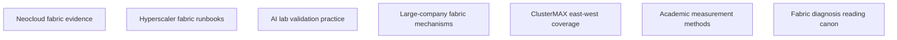

# Network research orchestrator report

Research date: 2026-10-11.

## 1. Result

The evidence shows a layered, measured `bench network` design.
Start with topology and actual transport selection.
Then run checks on isolated rails, directions, concurrent rails, and representative endpoint pairs.
Run operation-specific NCCL sweeps and keep raw results.
Check counter changes, rank/host timing, cleanup, and a fresh post-test canary.

The research shows no Chennai rack certification.
No researcher runs live fabric tests.

Target: GB300 NVL72-class, 18 trays, Chennai, India.
Scope: east-west fabric only.
Excluded: north-south internet, storage, code changes, and live certification.

Exactly seven researchers use the original seven independent category nodes.
Eleven additional researchers make the O'Reilly source supplement.
All use `agent=researcher` and `model=openai-codex/gpt-6-luna`.
Each child puts only its assigned brief in the run directory.
The children start no agents.
The orchestrator makes changes only inside `.lavish/network-research/`.

## 2. Full node map

No node makes another node necessary before research starts.
The distilled report uses every node.
Each `done` state shows accepted research, not a fabric PASS.

## 3. Category verdicts

| Category | Verdict | Remaining evidence limit |
| --- | --- | --- |
| neoclouds | Accepted: the brief keeps capability claims, recipes, and measurements separate | No comparable public measured GB300 rail baseline or continuous flap-rate disclosure |
| hyperscalers | Accepted: the brief keeps EFA, Azure IB, Google TCPX/TCPXO, and RDMA/gIB distinct | No portable switch thresholds or complete authoritative HNDR diagnosis runbook |
| ai-labs | Accepted: topology, collective patterns, overlap, and rank delays make causal checks possible | No validated GB300 thresholds or tested two-hour schedule |
| large-companies | Accepted: the brief keeps production accounts separate from prototypes and announcements | The bounded search shows no “self-serving fabric” seed title |
| clustermax | Accepted: the brief keeps current methodology separate from public cmax audit | No checked source shows the private commands, thresholds, raw corpus, and overall maximum scale |
| academia | Accepted: formulas, controls, congestion mechanisms, and limits make the suite possible | No matched current GB300 RoCE-versus-InfiniBand comparison |
| books | Accepted: the report puts current manuals above books for commands and counter definitions | No checked source shows deployed firmware, counter exposure, privileges, and switch access |

Each full brief keeps a Gaps section at the end.
Each brief keeps source URLs and observation/calculation/inference labels.
The node records show links to the complete returned evidence.

## 4. Decisive evidence checks

The orchestrator checks the briefs and checks decisive primary-source passages.
The checks below make acceptance possible.
They do not run the reported experiments independently.

| Evidence | Checked passage or result | Accepted use |
| --- | --- | --- |
| [ClusterMAX 3.0](https://newsletter.semianalysis.com/p/clustermax-30-the-industry-standard) | Collective sizes, launchers, isolated rails, scaling examples, endurance, and Oracle teardown case | Suite comparison and post-test gates |
| [ClusterMAX release page](https://www.clustermax.ai) | Current release listing | Release attribution |
| [Public cmax](https://github.com/SemiAnalysisAI/clustermax) | Audit scope; performance/reliability exclusions | Public/private boundary |
| [Meta production RoCE](https://engineering.fb.com/2024/08/05/data-center-engineering/roce-network-distributed-ai-training-at-scale/) | ECMP collisions, placement, QP entropy, congestion-control experience, failures | Possible mechanisms, not universal configuration rules |
| [MetaRoCE](https://engineering.fb.com/2026/08/24/networking-traffic/metaroce-rdma-transport-ai-ethernet) | Design, testing, and planned release | Emerging evidence, not target-rack availability |
| [Google Swift](https://research.google/pubs/swift-delay-is-simple-and-effective-for-congestion-control-in-the-datacenter) | Google authorship and production description | Loaded-latency motivation |
| [Microsoft Sirius](https://www.microsoft.com/en-us/research/video/sirius-a-flat-datacenter-network-with-nanosecond-optical-switching-sigcomm-2020-short-talk) | Prototype and simulation description | Research boundary |
| [DeepSeek](https://arxiv.org/html/2505.09343v1) | V3/H800 MPFT, actual deployment scale, and overlap | Pattern/topology lessons, not GB300 claims |
| [PyTorch](https://pytorch.org/blog/straggler-mitigation) | Late rank versus long synchronization wait | Rank-delay attribution limits |
| [NCCL-tests](https://github.com/NVIDIA/nccl-tests/blob/master/doc/PERFORMANCE.md) | Collective-specific algbw/busbw formulas | Normalization and parser tests |
| [NCCL networking](https://docs.nvidia.com/deeplearning/nccl/user-guide/docs/troubleshooting/networking_troubleshooting.html) | NIC/RDMA/GPU-memory separation and dynamic GID guidance | Layered diagnosis and version controls |
| [AWS EFA](https://docs.aws.amazon.com/AWSEC2/latest/UserGuide/efa-start-nccl.html) | Libfabric EFA discovery and NET/OFI provider logs | Transport-specific adapter |
| [Azure ND H100](https://learn.microsoft.com/en-us/azure/virtual-machines/nd-h100-v5-series) | Eight GPUs, dedicated 400G IB per GPU, GDR, common scale-set setup | SKU-specific topology, not measured capacity |
| [Google GPU networking](https://docs.cloud.google.com/compute/docs/gpus/gpu-network-bandwidth) | A3 variants, MRDMA, A4X Max NVLink subblocks, rails, and VF/PF counters | Direct GB300 transport and counter cautions |
| [Google gIB tests](https://docs.cloud.google.com/ai-hypercomputer/docs/nccl/test-gke-custom) | NCCL_NET=gIB, environment script, and AllGather launch | Reproducible provider recipe |
| [DCQCN](https://conferences.sigcomm.org/sigcomm/2015/pdf/papers/p523.pdf) | RoCE congestion mechanism and testbed/operation limits | Controlled congestion checks |
| [perftest](https://github.com/linux-rdma/perftest) | Flags, peer compatibility, GPU-build limits, and half-RTT latency | Bounded rail probes |
| [ibdump](https://github.com/Mellanox/ibdump) | Capture limits and migration to mstflint | Optional capture, never lossless proof |
| [Linux sysfs ABI](https://www.kernel.org/doc/Documentation/ABI/stable/sysfs-class-infiniband) | Four-octet units and 64-bit sysfs data counters | Unit conversion and counter-layer records |
| [CoreWeave](https://docs.coreweave.com/support/sunk/articles/what-do-nccl-errors-mean) | Small known-good measured baseline and transport triage | Baseline-based diagnosis |
| [Nebius](https://docs.nebius.com/compute/clusters/gpu) | Advertised NIC capacity and tenant test links | Capability-versus-result separation |

The initial IBTA PDF fetch shows only its first 100 pages.
That extraction shows no counter definitions.
The books researcher sends full-PDF text and exact passage locations.
The orchestrator checks `/tmp/ibta-v1.txt`, lines 59179–59184, 59341–59347, and 60449–60457.
Those passages show base saturation, four-octet units, 32-bit base width, and 64-bit extended width.
The final brief uses citations for §16.1.3.5/Table 228 and §16.1.4.11/Table 241.

Keep the temporary extraction outside the required deliverable list.
The brief keeps the source URL, pages, and quoted evidence.

The Azure sizes/gpu-accelerated ND H100 URL initially shows 404.
The accepted evidence uses the working official `/virtual-machines/nd-h100-v5-series` URL.
The man7 perfquery URL initially shows a failure.
The accepted brief uses the Ubuntu manual and primary IBTA definitions instead.

## 5. Corrections and conflicts

### 5.1 Project README corrections

The orchestrator checks the README and makes no changes.

- Lines 327–337 show planned network checks, not measured implementation evidence.
- Lines 332–335 show no universal 60%/98% RoCE acceptance rule.
- Strict curve monotonicity can show false failures for valid algorithm/protocol transitions.
- Collective `busbw` does not make a direct NIC payload-goodput measurement.
- NVL72 multi-tray collectives can run on NVLink/MNNVL.
- Logical rails do not necessarily make independent physical planes.
- Lines 504–506 put too much weight on public ClusterMAX fabric-fault injection evidence.
- Lines 478–493 show the longer smoke boundary for sustained network/GPU stress.

Check [local README](../../../README.md#L327-L337) and [ClusterMAX coverage claim](../../../README.md#L504-L506).

### 5.2 Source conflicts that remain visible

NCCL 2.21+ normally uses dynamic GID selection.
ClusterMAX shows one Google GB300 forced-GID workaround.
The report keeps that provider/image-specific exception separate from the default guidance.

NCCL's live troubleshooting index and networking subpage show different document versions.
The brief keeps those page versions, not one universal current release.

Meta shows stable PFC-based operation without transport congestion control for its workload.
DCQCN shows another congestion-control design and testbed.
Neither source shows a universal policy for the Chennai rack.

Google A3 variants use different stacks.
A network-tier setting does not show RDMA.
MRDMA VF physical counters can show up without movement during traffic.
The suite must check the correct counter layer and actual movement.

The Swift source shows Google authorship. The Sirius source shows experimental evidence.
The DeepSeek paper shows MPFT attribution for the documented V3/H800 infrastructure.
Thirteen nodes make one ClusterMAX provider example, not its maximum scale.

## 6. Honest two-hour misses

- Eight-hour concurrent GPU/network endurance and the additional sustained ClusterMAX fabric loop.
- Long-term link-flap rates, rare congestion, intermittent faults, and thermal drift.
- Scale beyond the available allocation and cross-rack peers.
- Switch ECN/PFC thresholds, queue behavior, and route choices without management access.
- Approved link/switch failure injection, rerouting, job recovery, and checkpoint recovery.
- Every directed 18-tray pair, every QP setting, and every workload/transport combination.
- Two complete MPI/PyTorch sweeps unless a timed local trial shows that coverage.
- Defensible p99 claims without enough raw samples.
- Target-rack acceptance thresholds before a matched measured baseline.

The proposed budget shows a total of 120 minutes.
The budget keeps engineering-estimate status until the target rack runs a timed trial.
A missing check keeps SKIP or INCONCLUSIVE status, not PASS.
The certificate must show its endpoints, ranks, rails, sizes, samples, and transport boundary.

## 7. Deliverables

Run directory:
`/home/avirus/.herdr/worktrees/rack-bench/research-network/.lavish/network-research/`

Main artifacts:

- `/home/avirus/.herdr/worktrees/rack-bench/research-network/.lavish/network-research/research.md`
- `/home/avirus/.herdr/worktrees/rack-bench/research-network/.lavish/network-research/docs/network-bench-research.md`
- `/home/avirus/.herdr/worktrees/rack-bench/research-network/.lavish/network-research/ORCHESTRATOR-REPORT.md`
- `/home/avirus/.herdr/worktrees/rack-bench/research-network/.lavish/network-research/README.md`

Full briefs:

- `/home/avirus/.herdr/worktrees/rack-bench/research-network/.lavish/network-research/neoclouds.md`
- `/home/avirus/.herdr/worktrees/rack-bench/research-network/.lavish/network-research/hyperscalers.md`
- `/home/avirus/.herdr/worktrees/rack-bench/research-network/.lavish/network-research/ai-labs.md`
- `/home/avirus/.herdr/worktrees/rack-bench/research-network/.lavish/network-research/large-companies.md`
- `/home/avirus/.herdr/worktrees/rack-bench/research-network/.lavish/network-research/clustermax.md`
- `/home/avirus/.herdr/worktrees/rack-bench/research-network/.lavish/network-research/academia.md`
- `/home/avirus/.herdr/worktrees/rack-bench/research-network/.lavish/network-research/books.md`

Accepted node records: `nodes/N01.md` through `nodes/N07.md` under the run directory.
The category paths above keep the full returned briefs.

Requested project destination:
`/home/avirus/.herdr/worktrees/rack-bench/research-network/docs/network-bench-research.md`

The run-directory rule keeps the orchestrator from writing that project file.
The parent must put the distilled report there and make relative-link adjustments.
This research makes no project README or implementation file changes.

## 8. Validation

The research checker shows a pass: seven nodes, seven lessons, each below 50 physical Markdown lines.
The orchestrator checks primary evidence and sentence length separately.
The checker makes no proof of factual accuracy, source availability, or ASD-STE100 vocabulary compliance.
The original artifact check shows seven briefs, seven node records, final Gaps sections, and local link targets.

## 9. O'Reilly source supplement

The supplement checks eleven supplied sources without repeating category research.
The captain sends matches from eight deduplicated catalog searches.
Each additional researcher uses `agent=researcher` and `model=openai-codex/gpt-6-luna`.
Each researcher puts one source note inside `oreilly/` and starts no agents.
The orchestrator checks decisive passages and makes eleven short lessons.

```mermaid
flowchart TD
N01["Shanley InfiniBand architecture"]
N02["VandenBrink Linux networking 2e: gap"]
N03["VandenBrink Linux networking 1e"]
N04["Benvenuti Linux network internals"]
N05["Dutt cloud-native fabrics: gap"]
N06["Prowse Linux networking video: gap"]
N07["Schroder Linux networking cookbook"]
N08["Sloan troubleshooting tools"]
N09["Stevens and Wright TCP/IP volume"]
N10["LaCroix Linux administration"]
N11["White troubleshooting event: gap"]
```

The source nodes show no prerequisite edges.
Seven source reviews show `done` states. Four source reviews keep explicit `gap` states.
All eleven nodes show returned briefs.
The states show evidence acceptance, not rack PASS.

| Source | Verdict | Main evidence limit |
| --- | --- | --- |
| Shanley | KEEP targeted native-InfiniBand architecture | Indexed previews; link-counter chapter locations and bibliographic fields keep uncertain status |
| VandenBrink 2e | HOLD chapters; possible host SKIM | No verified 2e TOC; 2025/2026 and August/September date differences |
| VandenBrink 1e | SKIM indexed Chapter 3 | No verified comparison with 2e; complete chapter count unresolved |
| Benvenuti | Conditional host-path SKIM | Linux 2.6-era concepts; different fetches show different TOC access |
| Dutt | KEEP selective Ethernet architecture | Indexed Chapters 2, 11, 18; complete primary TOC and Chapter 5 keep gap status |
| Prowse | Host/bootstrap SKIM; SKIP required fabric reading | InformIT TOC verified for separate ISBN; exact O'Reilly release/runtime/TOC correspondence unverified |
| Schroder | Optional dated host SKIM | November 2007 edition, copyright 2008; current commands unverified |
| Sloan | SKIM sequence; SKIP core addition | Existing internet-canon overlap and dated Ethernet/TCP/IP tools |
| Wright/Stevens | Conditional host/bootstrap SKIM | ISBN shows Volume 2 and 4.4BSD-Lite, not Volume 1 or Linux |
| LaCroix | Optional host-administration SKIM | Indexed TOC; no inspected chapter text |
| White | SKIM methods, not fabric rules | Author announcement shows January 26, 2023 for this ID; supplied 2025 attribution keeps unverified status |

### 9.1 Decisive corrections

The indexed TOC shows Shanley Chapter 27 as “The SMI.”
Indexed navigation shows no evidence for its link-layer/error/counter coverage.
The accepted note removes that unsupported assignment.

Packt's public repository explicitly shows first-edition ISBN 9781800202399.
It shows no second-edition chapters for ISBN 9781835881101.
Its Chapters 1–14 code scope shows no resolution of the indexed navigation count.

InformIT shows a readable publisher TOC and preface for TCP/IP Illustrated Volume 2.
The preface shows 4.4BSD-Lite.
This shows the supplied ISBN's exact volume and implementation scope.

Dutt's public description and author interview show Clos architecture context.
They show no GPU rail, RoCE, ECN, or PFC coverage.

The Google Books record shows November 22, 2019. The interview shows May 16, 2020.
The retry keeps selected chapter titles, not complete primary TOC access.
The Google and supplied catalog page counts show a difference: 486 versus 483.
The note keeps those date, format, and pagination limits visible.

White's public agenda shows half-split diagnosis and a flapping-BGP data-center example.
The public listing shows no event year. It shows no delivered-session or recording access.
The author's explicit announcement shows this event ID and January 26, 2023.
A later announcement uses the same ID without a session year.
This shows no unique explanation for the supplied 2025 metadata.

The Schroder and Sloan scans show matching front matter and TOCs.
Third-party hosting shows no publisher authorization or subscriber access.
Do not use inferred rack techniques as attributed textbook prescriptions.

### 9.2 Canon and handoff

The operational reading spine keeps its current form.
Current NCCL, NCCL-tests, perftest, counter specifications, and deployed vendor manuals keep first place.
Gregg, Jain, and Kurose/Ross keep their existing roles.
Shanley and Dutt put optional architecture context into the canon.
Dated Linux/TCP/IP sources keep conditional status for host/bootstrap questions.
Books and provider claims never show measured target-rack PASS.

New artifacts:

- [Per-source supplement and verdicts](oreilly.md).
- [Full source map and eleven lessons](oreilly/research.md).
- [Decisive evidence checks](oreilly/EVIDENCE-CHECKS.md).
- Accepted source records: `oreilly/nodes/N01.md` through `oreilly/nodes/N11.md`.

The [books canon](books.md) and [distilled reading list](docs/network-bench-research.md#reading-list) keep the supplement.
The parent must put the distilled report into project `docs/` and make relative-link adjustments.
The orchestrator makes no project file changes.

The final shared-worktree status also shows an untracked project `docs/network-bench-research.md`.
The orchestrator does not make that project file, put changes in it, or remove it.
The research keeps the initial misplaced Sloan draft. The corrected note puts it out of use.
Use [the corrected Sloan note](oreilly/troubleshooting-tools.md).

### 9.3 Supplement validation

The supplement checker shows eleven nodes and eleven lessons below 50 physical Markdown lines.
The artifact check shows a pass for claim-label spelling, brief headings, Gaps sections, and local links.
The orchestrator checks sentence length and decisive evidence separately.
Structural checks make no proof of factual accuracy or full ASD-STE100 vocabulary compliance.

### 9.4 Final targeted retry

The final retry shows a complete result.
The orchestrator checks all four updated source notes from disk.

All four briefs show complete text. Each source still shows specific material gaps.
One recovery resume sends the video child's final source note.
The orchestrator independently checks Google Books, InformIT, and the dated author announcements.
The retry uses no third researcher.

| Source | New evidence | Final missing field |
| --- | --- | --- |
| VandenBrink 2e | Matching Google Books metadata shows 2025 | Second-edition TOC/sample and publication-date reconciliation |
| Dutt | Indexed Chapters 2, 11, 18; Google Books chapter-list excerpts | Complete primary TOC/Look Inside and Chapter 5 title/number |
| Prowse | Public InformIT four-module, seventeen-lesson TOC; first edition, copyright 2024 | Exact O'Reilly release, 623-minute runtime attribution, and TOC correspondence |
| White | Explicit author announcement for January 26, 2023 shows this event ID | Unique supplied 2025 session attribution and delivered-content evidence |

Each remaining retrieval field shows a final declaration with attempted source links.
The declaration shows “not publicly retrievable as of 2026-10-11”.
The declaration does not put a limit on material that public evidence shows.
The [final retry record](oreilly/RETRY.md) shows the complete result and field-specific declarations.

The [distilled reading list](docs/network-bench-research.md#reading-list) now keeps the retry summary.
The parent must make that changed document public and make relative-link adjustments.
The orchestrator makes no project file changes.
The existing operational canon and measured-PASS boundary keep their current form.
