# O'Reilly network source supplement

Question: Which catalog sources show useful evidence for the network diagnosis canon?

Research date: 2026-10-11.

Target: GB300 NVL72-class rack with 18 trays, Chennai, India.
Scope: east-west NCCL, RDMA rails, goodput, topology, ECN/PFC, link events, and scale-out diagnosis.
Window: two hours. Use target-rack measurements for PASS, not book or provider claims.
Exclusions: category re-research, north-south internet, storage, code changes, and live tests.

The captain sends catalog metadata from eight searches.
Eleven researchers check one source each.
A catalog match does not show full-text access.
The original [books canon](../books.md) shows comparison context.
The source nodes are independent.
A `done` state shows accepted research, not rack PASS.

A `gap` state shows an unresolved part of the requested source check.
All eleven nodes show returned briefs.
Four fresh researchers run one targeted public-retrieval retry.
The retry checks different publisher, preview, schedule, and author routes.
It does not put in new categories. It keeps the certification scope unchanged.

The [retry record](RETRY.md) shows final results and remaining gaps.

```mermaid
flowchart TD
N01["Shanley InfiniBand architecture"]
N02["VandenBrink Linux networking 2e: gap"]
N03["VandenBrink Linux networking 1e"]
N04["Benvenuti Linux network internals"]
N05["Dutt cloud-native fabrics: gap"]
N06["Prowse Linux networking video: gap"]
N07["Schroder Linux networking cookbook"]
N08["Sloan troubleshooting tools"]
N09["Stevens and Wright TCP/IP volume"]
N10["LaCroix Linux administration"]
N11["White troubleshooting event: gap"]
```

| Node | Question | Dependencies | Acceptance condition | Child | State |
| --- | --- | --- | --- | --- | --- |
| N01 | What does Shanley show for fabric diagnosis? | None | Check edition, chapters, techniques, and limits | oreilly-infiniband-architecture | done |
| N02 | What does VandenBrink 2e show? | None | Check edition, chapters, techniques, and limits | oreilly2-linux-networking-2e | gap |
| N03 | Does VandenBrink 1e show more than 2e? | None | Check edition, chapters, techniques, and limits | oreilly-linux-networking-1e | done |
| N04 | What does Benvenuti show for host diagnosis? | None | Check edition, chapters, techniques, and limits | oreilly-linux-network-internals | done |
| N05 | What does Dutt show for fabric diagnosis? | None | Check edition, chapters, techniques, and limits | oreilly2-cloud-native-fabrics | gap |
| N06 | What does Prowse's video show? | None | Check release, modules, techniques, and limits | oreilly2-linux-networking-video | gap |
| N07 | What does Schroder show for host checks? | None | Check edition, chapters, techniques, and limits | oreilly-linux-networking-cookbook | done |
| N08 | Does Sloan show more than the internet canon? | None | Check edition, chapters, techniques, and overlap | oreilly-troubleshooting-tools | done |
| N09 | Which TCP/IP Illustrated volume does the ISBN show? | None | Check volume, chapters, techniques, and limits | oreilly-tcpip-illustrated | done |
| N10 | What does LaCroix show for host checks? | None | Check edition, chapters, techniques, and limits | oreilly-linux-administration | done |
| N11 | What can the White event show? | None | Check event metadata, agenda, techniques, and limits | oreilly2-modern-troubleshooting | gap |

## N01: Shanley InfiniBand architecture

[observed] ISBN 0321117654 shows the 2002 InfiniBand architecture title.
Indexed previews show transport and subnet-management material.
Chapter 27 is “The SMI,” not a verified link-counter chapter.
Exact link-layer/error/counter chapter locations are unverified.
[Full brief](infiniband-architecture.md)
[Catalog](https://www.oreilly.com/library/view/infiniband-network-architecture/0321117654)

[inference] KEEP as a targeted native-InfiniBand architecture reference.
Physical links, endpoint transport, and subnet management are different fault domains.
Check each domain with current tools. Do not use link-up as complete-health evidence.
For example, an active port does not show successful work completions.

The book shows no GB300, RoCE, NCCL, or SHARP thresholds.
Catalog author credits and page counts are inconsistent.

[Full brief](infiniband-architecture.md) [Canon](../books.md)

## N02: VandenBrink Linux networking second edition

[observed] ISBN 9781835881101 shows the second-edition catalog record.
O'Reilly shows August 2026; Amazon shows September 9, 2026; Google Books shows 2025.
The retry shows matching Google Books metadata, but no preview or verified second-edition TOC.
Packt regional routes show security verification; Amazon shows no readable listing.
The public Packt repository shows first-edition ISBN 9781800202399.
[Full brief](linux-networking-2e.md)
[Catalog](https://www.oreilly.com/library/view/linux-for-networking/9781835881101)
[Repository](https://github.com/PacktPublishing/Linux-for-Networking-Professionals)
[Google Books](https://books.google.com/books?vid=ISBN9781835881101)

[observed] Second-edition TOC/sample: not publicly retrievable as of 2026-10-11.

[inference] Keep this node at `gap` for chapter and date verification.
Do not put first-edition chapters in this edition.
SKIM only as possible host background; SKIP as fabric authority.
Host interface checks do not show actual RDMA transport or rail performance.
For example, an UP interface does not remove failed RDMA work.
Use current NCCL and perftest documents for those checks.

[Full brief](linux-networking-2e.md) [Canon](../books.md)

## N03: VandenBrink Linux networking first edition

[observed] ISBN 9781800202399 shows the first edition.
Indexed Packt material shows Chapter 3, “Using Linux and Linux Tools for Network Diagnostics.”
The complete chapter count is unresolved.
A repository code scope does not show the complete book structure.
[Full brief](linux-networking-1e.md)
[Packt chapter](https://www.packtpub.com/en-us/product/linux-for-networking-professionals-9781800202399/chapter/chapter-3-using-linux-and-linux-tools-for-network-diagnostics-5/section/further-reading?chapterId=5)

[inference] SKIM Chapter 3 for host-diagnosis orientation.
The available evidence does not show an improvement over the unseen second-edition chapters.
Keep host configuration separate from measured fabric results.
For example, correct DNS can make bootstrap run again. It does not make a slow RDMA rail fast.

Keep service checks separate from per-rail and collective checks.
Do not put this chapter in the second edition.
[Full brief](linux-networking-1e.md) [Canon](../books.md)

## N04: Benvenuti Linux network internals

[observed] This first-edition book shows a 2005 date and Linux 2.6-era networking.
The child shows direct TOC access; later fetches show denied access.
The TOC shows device state, interrupts, frame reception, transmission, and host routing.
No inspected chapter prose shows evidence for this review.
[Full brief](linux-network-internals.md)
[Bibliography](https://kernelnewbies.org/KernelBooks/ULNI)

[inference] KEEP as conditional host-path context, not core fabric guidance.
Host CPU, softirq, queue, and routing problems can make bootstrap traffic slow.
Check those causes when host-path evidence shows them.
For example, check CPU pressure against bootstrap stalls and independent RDMA results.
Historical kernel code does not show current ABI or kernel-bypass transport behavior.
Current Linux and vendor documents show operational definitions.

[Full brief](linux-network-internals.md) [Canon](../books.md)

## N05: Dutt cloud-native fabrics

[observed] Public descriptions show Clos topology, routing choices, NOS choices, EVPN, and automation.
The 2019 title uses O'Reilly identifier 9781492045595.
The retry shows publisher-indexed Chapters 2, Clos; 11, observability; and 18, configuration validation.
Google Books shows matching chapter-list excerpts, not a complete TOC.
Its record shows November 22, 2019; the author interview shows May 16, 2020.
Keep the Google preview's ISBN 9781492045571 separate from the supplied identifiers.

Complete primary public TOC: not publicly retrievable as of 2026-10-11.
[Full brief](cloud-native-fabrics.md)
[Public description](https://www.overdrive.com/media/5147220/cloud-native-data-center-networking)
[Google Books](https://books.google.com/books/about/Cloud_Native_Data_Center_Networking.html?id=79i_DwAAQBAJ)

[inference] Keep this node at `gap` for exact chapter assignments.
KEEP selectively for Ethernet fabric architecture.
Operators use topology concepts to make an expected-path map before tests.
For example, check tray/NIC mapping against switch inventory when access exists.

A host result alone does not show switch routing or queue behavior.
Do not use the title as evidence for RoCE, ECN, PFC, or NCCL coverage.
Dutt makes no change to the operational reading spine.
[Full brief](cloud-native-fabrics.md) [Canon](../books.md)

## N06: Prowse Linux networking video

[observed] The retry shows InformIT's first-edition Online Video TOC, copyright 2024.
Its ISBN 9780138357979 is not the supplied O'Reilly identifier 9780138358051.
The publisher TOC shows four modules and seventeen lessons.
The modules show setup, networking services, commands/configuration, and command-line host connections.
The researchers show no video-viewing evidence.

Exact O'Reilly release/runtime/TOC match: not publicly retrievable as of 2026-10-11.
[Full brief](linux-networking-video.md)
[Instructor catalog](https://prowse.tech/recorded_training)
[Publisher TOC](https://www.informit.com/store/linux-networking-basics-and-beyond-video-course-9780138357979)

[inference] Keep this node at `gap` for release and complete module verification.
SKIM for operator host/bootstrap preparation; SKIP as required fabric reading.
Live address, route, and resolver checks can show host setup problems.
For example, a wrong source address can make a bootstrap peer connection fail.
This does not show collective goodput or rail health.
Related Coursera courses do not show an identical O'Reilly syllabus.

[Full brief](linux-networking-video.md) [Canon](../books.md)

## N07: Schroder Linux networking cookbook

[observed] The matching ISBN is 9780596102487.
The reproduced front matter shows first edition, November 2007, and copyright 2008.
The TOC shows Chapters 13–14 for monitoring and Chapter 19 for troubleshooting.
The mirror's PDF page count is not the supplied catalog extent.
No inspected chapter text shows evidence for current commands.
[Full brief](linux-networking-cookbook.md)
[Front matter and TOC](https://www.lions-wing.net/lessons/networking-1/schroder_-_linux_networking_cookbook_oreilly_2008.pdf)

[inference] KEEP as optional dated host context, not required fabric reading.
Address-conflict and short capture checks can show bootstrap faults.
For example, use approved ARP checks only where the deployed network uses ARP.
Keep reachability, throughput, and latency as different measurements.
Historical TCP/IP recipes show no RDMA, NCCL, or PFC certification.
[Full brief](linux-networking-cookbook.md) [Canon](../books.md)

## N08: Sloan troubleshooting tools

[observed] The reproduced front matter shows first edition, August 2001.
The TOC and preface show information collection and Ethernet/TCP/IP scope.
The sibling internet canon already shows SKIP at lines 510–517 and 593–594.
It sends readers to newer tool references.
[Full brief](troubleshooting-tools.md)
[Front matter and TOC](http://www.nylxs.com/docs/networktroubleshootingtools.pdf)
[Exact sibling evidence](../../internet-research/books.md#L510)

[inference] SKIM for diagnostic sequence; SKIP as a core-canon addition.
Operators use a measured baseline to check new failures against old counter totals.
For example, check before/after rail counters with the same workload interval.
Use several evidence layers before a cause attribution.
Sloan's method does not show modern RDMA commands or thresholds.
[Full brief](troubleshooting-tools.md) [Canon](../books.md)

## N09: Stevens and Wright TCP/IP volume

[observed] ISBN 020163354X shows Volume 2, “The Implementation,” not Volume 1.
The authors are Gary R. Wright and W. Richard Stevens.
The publisher TOC shows interfaces, routing, ARP, TCP timers, and BSD Packet Filter.
The preface shows Berkeley 4.4BSD-Lite implementation code.

[Full brief](tcpip-illustrated.md)
[Publisher TOC and preface](https://www.informit.com/store/tcp-ip-illustrated-volume-2-implementation-9780201633542)

[inference] SKIM only for conditional host/bootstrap context; SKIP as certification reading.
Host routing and neighbor mechanisms can show the reason for failed IP setup.
For example, an unresolved bootstrap neighbor does not show a failed native-InfiniBand path.
BSD code is not current Linux behavior.
TCP retransmission theory does not show NCCL's selected payload transport.
Keep the original canon's TCP-versus-RDMA distinction.

[Full brief](tcpip-illustrated.md) [Canon](../books.md)

## N10: LaCroix Linux administration

[observed] Indexed metadata shows November 2015, ISBN 9781784399597, and 260 pages.
Indexed contents show host setup, basics, SSH, resource monitoring, and advanced networking.
Direct publisher fetches show denied access or security verification.
The complete readable TOC and chapter text are not available.
[Full brief](linux-administration.md)
[Publisher contents](https://www.packtpub.com/en-TW/product/mastering-linux-network-administration-9781784399597/chapter/preface-pref/section/what-this-book-covers-preflvl1sec02)

[inference] SKIM for host administration; SKIP as core fabric reading.
Host resource pressure can make a collective slow without a fabric fault.
For example, check CPU pressure, rank timing, and independent per-rail tests.
SSH success shows node access, not RDMA health.
Generic QoS coverage does not show ECN/PFC procedures.
The deployed manuals are the operational authority.

[Full brief](linux-administration.md) [Canon](../books.md)

## N11: White troubleshooting event

[observed] The public agenda shows Russ White, Pearson, and event ID 0790145043580.
It shows resilience, half-split diagnosis, network models, and correlation versus causation.
Its data-center example uses flapping BGP.
The retry shows an explicit author announcement for January 26, 2023 linked to this event ID.
A later announcement uses the same ID without a session year.
The listing shows no year; the supplied 2025 session attribution is unverified.

2025 attribution and delivered-content evidence: not publicly retrievable as of 2026-10-11.
[Full brief](modern-troubleshooting.md)
[Public agenda](https://www.oreilly.com/live-events/modern-network-troubleshooting/0790145043580)
[Explicit author announcement](https://rule11.tech/modern-network-troubleshooting)

[inference] Keep this node at `gap` for the supplied 2025 session attribution.
SKIM for diagnosis methods, not GPU-fabric procedures.
A valid scope split can show an implicated host or rail.
For example, keep topology and workload conditions when checking two endpoint groups.
Use controlled evidence before naming a cause.
BGP flaps are not RDMA link-flap qualification.

[Full brief](modern-troubleshooting.md) [Canon](../books.md)

## Sources and gaps

The [supplement](../oreilly.md) shows per-source verdicts and reading-spine changes.
The [evidence checks](EVIDENCE-CHECKS.md) show decisive passages and denied fetches.
The full briefs keep source URLs, claim labels, conflicts, and final Gaps sections.
Most supplied O'Reilly book/video fetches show denied access.

No catalog result shows subscriber access or unseen coverage.
The final gaps are the second-edition TOC, complete Dutt TOC, exact O'Reilly video metadata, and White's 2025 attribution.
Use deployed-version review and target-rack measurements for all proposed checks.
No source shows a measured rack PASS.
