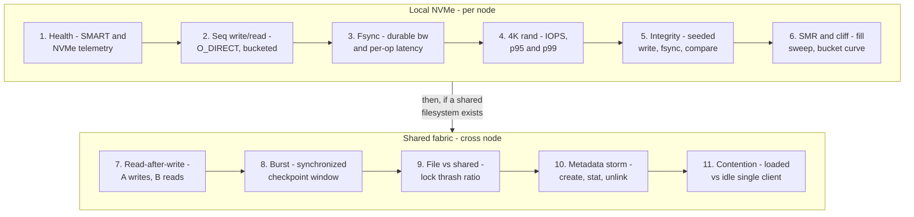

# Storage bench research: failure modes and suite design

Seven sourced research briefs back this document, one per category:
`docs/research/storage-research/{clustermax,hyperscalers,ai-labs,
neoclouds,parallel-fs,academia,books}.md`. Every claim below carries
its citation there. This file distills them into the rack-bench
storage bench: what breaks, who proved it, and which check catches it.

## Why storage is next

A GB300 rack's job is checkpoint bursts and dataset streaming. Meta's
Llama 3 405B fabric anchors the workload: 240 PB, 2 TB/s sustained,
7 TB/s peak, thousands of synchronized ranks (ai-labs §1). A stalled
checkpoint costs more than $200k/month in idle GPUs at 128 GPUs. The
tenant question is concrete: how fast can a node save a 2 TB
checkpoint, and can 8 nodes stream a dataset without stragglers?

The market cannot answer it. No neocloud anywhere publishes an
fsync'd write number (neoclouds §6). CoreWeave, the transparency
leader, benchmarks with `--direct=1` and no fsync — non-durable
sequential writes labeled "checkpoint operations." ClusterMAX 3.0 runs
a solid fio/IOR performance sweep but its 16 reliability criteria are
claim-checks, not tests; drive health, integrity, and failure
injection are absent (clustermax §2-3). The durability void is the
opening.

## Part 1 — Failure-mode catalog

Format: mode, evidence, and the rack-bench answer. "2h" = catchable
in a two-hour certification window.

### Silent data loss and corruption

- **Lost writes under power fail.** 13 of 15 SSDs, enterprise
   included, acknowledged writes they never persisted under hardware
   power-cut testing (FAST'13, hyperscalers §5). Detection at fleet:
   Meta's standing PowerLoss Storm drills. 2h: **no** — we cannot cut
   power. Our proxy: measure the fsync-rate cliff (4651/s with
   volatile cache vs 101/s honest, Percona). A device with
   capacitor-backed PLP shows no cliff. Declared miss: real
   power-loss injection.
- **Silent corruption, ~3e-7 per byte.** CERN probed 3000+ nodes
   with 2 GB write-read-compare every 2 h: ~500 errors in 5 weeks,
   80% clustered in 64 KB firmware-correlated regions (academia §4).
   Corruption is heavy-tailed: the worst 1% of NetApp's drives caused
   over half of >400k checksum mismatches (FAST'08). 2h: **yes at
   coarse rate** — seeded write, fsync, read-back, compare at GiB
   scale. We cannot bound a 1e-7 rate in 2 h; we can catch a bad
   drive that errors at 1e-5.
- **Latent sector errors.** 3.45% of 1.53M nearline drives over 32
   months; one LSE means 0.671 probability of more; 86.6% found by
   scrubbing, not by serving reads (SIGMETRICS'07). 2h: **partial** —
   a full-capacity verified read-back catches present LSEs; the
   low-rate tail needs months. Declared miss.
- **SMART-blind failures.** 56% of failed drives showed zero SMART
   signals (Google FAST'07). Telemetry is necessary, insufficient
   (SRE Book ch. 26). 2h: **yes** — the reason our integrity check
   exists at the data layer, not only SMART passthrough.

### Performance cliffs and masquerades

- **DM-SMR drives posing as CMR.** Drive-managed SMR reports
   `zoned=none`; its translation-layer GC collapses random writes
   past a utilization threshold (FAST'17 SMaRT). 2h: **yes** —
   behavioral detector: random-write rate at 25/50/70% fill against
   the empty-drive baseline. Collapse = SMR or cache exhaustion.
- **Write-cache cliff.** Consumer drives absorb writes into DRAM
   until the cache fills, then drop to media speed. 2h: **yes** —
   windowed writes with per-second buckets; the cliff is visible in
   the bucket curve, invisible to a 60-second dd (dd measures page
   cache anyway — Axboe, fio #1696).
- **Thermal throttling.** Sustained load exposes airflow faults a
   30-second test hides. 2h: **yes** — sample drive temps across the
   sustained window; report deltas, PASS means observed.

### Shared-fabric pathologies (invisible to single-node tests)

- **Metadata storms.** Thousands of files in one directory took
   filesystems offline (INCD); Ceph MDS cache pressure collapses stat
   throughput 36x (parallel-fs §1). 2h: **yes** — cross-node
   create/stat/unlink storm, capped, with collapse detection.
- **Lock thrash.** Lustre LDLM extent locks cap shared-file I/O at
   20-65% of file-per-process; GPFS token ping-pong hangs clusters
   (parallel-fs §1). 2h: **yes** — ior-hard shared-file pattern; the
   ratio to file-per-process is the finding.
- **Cross-node coherence.** Write on host A, read on host B must
    see the data; eager-coherence overhead also caps throughput
    (parallel-fs §3). 2h: **yes** — IO500's read-after-write gate,
    run cross-node.
- **Noisy neighbor on shared storage.** Nebius quantifies
    shared-FS contention up to 32x slower (neoclouds §7). 2h:
    **yes, self-loaded** — single-client throughput while N writers
    run, the storage twin of our loaded-latency design. Declared
    miss: true strangers (we only load ourselves).
- **Single-connection ceiling.** One TCP socket caps NFS near
    2 GB/s while nconnect/RDMA reaches 162 GB/s (VAST KB,
    parallel-fs §1). 2h: **yes** — scaling sweep at 1/4/16 streams;
    the knee is the finding.

### Benchmark fakes (methodology rails)

- **Buffered IO and page cache.** fio without `direct=1` loses
    iodepth to the page cache; CoreWeave's own docs warn `/tmp` is
    tmpfs that "inflates results." 2h: **yes** — O_DIRECT discipline
    plus drop-caches hygiene between phases (IO500 rules).
- **Compressible or dedupable payloads.** Vendors' dedup and
    zero-elimination fake bandwidth on compressible data (IO500
    anti-cheat, parallel-fs §4). 2h: **yes** — seeded deterministic
    incompressible payloads (the SeededPayload discipline from the
    internet bench), CRC32 verified on read-back.
- **Short warm runs.** 58% of 415 surveyed benchmarks ran under
    5 minutes and missed a 32x read slowdown (Traeger TOS'08).
    2h: **yes** — fixed-duration windows (stonewall semantics),
    per-second buckets, p95/p50 ratio reported, never the mean
    alone.

### What a 2-hour box honestly cannot certify

Wear-out (needs months), power-cut truth (needs hardware), the LSE
low-rate tail, TLER/error-path behavior (no safe injection), backup/
DR/snapshot round-trips (product features, not media), fairness/QoS
(no standardized benchmark exists — IO500 lists it as their top
requested addition), and availability accounting (the smoke stage).
These are declared misses, printed in every report.

## Part 2 — The suite: `rack-bench bench storage`

Inherits the internet bench contract: PASS means measured, never
threshold-met; failures are data; every skip carries a reason; owned
artifacts are cleaned up; checksummed payloads; no hidden retries.

### Local NVMe checks (per node, no shared FS required)

| Check | Measures | Catches |
| --- | --- | --- |
| `storage.local.health` | SMART/NVMe telemetry snapshot | DOA units, realloc counts |
| `storage.local.seq.write` | O_DIRECT sustained write, per-second buckets | write-cache cliff |
| `storage.local.seq.read` | verified read-back of written objects | present latent sector errors |
| `storage.local.fsync.bw` | durable write bandwidth | the fsync void itself |
| `storage.local.fsync.latency` | per-op latency distribution | power-fail cache lie (proxy) |
| `storage.local.rand.4k` | randread IOPS, p95/p99 | small-IO starvation |
| `storage.local.integrity` | seeded write, fsync, read, compare | silent corruption, SMART-blind failure |
| `storage.local.smr` | random-write rate at 25/50/70% fill | SMR masquerade |
| `storage.local.thermal` | temp deltas under sustained load | thermal/airflow faults |

`storage.local.fsync.*` are the differentiators: the two numbers no
neocloud and no competitor publishes. MLPerf Storage v3.0 is the only
public methodology that enforces them; we adopt the rule (fsync
before an object counts as written) and publish both numbers.

### Shared-fabric checks (cross-node, uses the --hosts manifest)

| Check | Measures | Catches |
| --- | --- | --- |
| `storage.shared.readafterwrite` | host A writes, host B reads, verifies | cross-node coherence bugs |
| `storage.shared.burst` | N synchronized writers, bounded pause, all nodes | checkpoint-burst stalls |
| `storage.shared.fileperproc` | aggregate at two node counts | per-client ceilings, scaling knees |
| `storage.shared.sharedfile` | one file, N writers; ratio to file-per-process | lock thrash |
| `storage.shared.metadata` | create/stat/unlink storm, capped, cross-node | metadata-server collapse |
| `storage.shared.smallio` | 4K randread, single client and rack-wide | small-IO starvation |
| `storage.shared.contention` | single-client rate while N writers load the fabric | noisy neighbor (self-loaded) |

`burst` mirrors the checkpoint contract from ai-labs §5: all ranks
write simultaneously, we measure the pause until the last fsync
completes, and per-second buckets expose the stall shape.

### CLI shape

`rack-bench bench storage [--profile quick|certify] [--target PATH]`
plus `--hosts`, `--duration`, `--keep-data`, `--yes` (certify cost
gate), and `--object-size`-style MiB knobs. Quick runs local checks
in ~15 minutes per node plus one shared pass; certify extends windows
and repeats runs, dropping best/worst as the internet bench does.

## Part 3 — Implementation tickets

1. `storage.local.health` — SMART/NVMe telemetry via existing audit
   probes, promoted to bench with PASS-observed grading.
2. Seeded block payload — port SeededPayload to fixed-size block
   IO with CRC32, incompressible SHAKE256-derived data.
3. Windowed O_DIRECT engine — fio-free stdlib implementation with
   per-second buckets (reuse the internet transfer-window shape) or
   a wrapped fio with published job files (ClusterMAX precedent).
   Decision ticket: stdlib-first for audit parity.
4. fsync instruments — durable-bandwidth window and per-op latency
   distribution.
5. SMR/cliff sweep — fill-threshold random-write probe.
6. Shared-fabric driver — host orchestration over the --hosts
   manifest, cross-node read-after-write gate, synchronized burst.
7. Honest-misses block — the Part 1 tail, printed in every report.
8. Cost estimate and `--yes` gate for certify volumes.

## Reading list

`docs/research/storage-research/books.md` ranks eight books for the
certification track. The storage-bench spine: Gregg, Systems
Performance 2e (methodology); Jain, Art of Computer Systems
Performance Analysis (runs, variance, confidence); OSTEP ch. 42
(crash consistency); Traeger TOS'08 and the IO500 rules (paper +
community canon).
